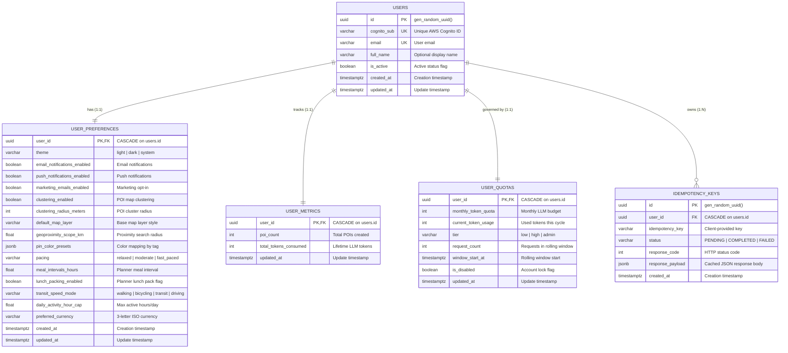

# Data Model & Schema Specification: 001-foundation-auth-quota

**Feature**: Foundation, Authentication, Quotas & Administration  
**Date**: 2026-10-18  
**Status**: APPROVED  

---

## 1. Domain Entities & Value Objects

### 1.1 Enumerations (Python `StrEnum`)
All state and category fields are modeled as Python `StrEnum` backed by PostgreSQL `VARCHAR(n)` columns with check constraints (strictly prohibiting native PostgreSQL `ENUM` types per Constitution Principle 4):

```python
from enum import StrEnum

class UserTier(StrEnum):
    LOW = "low"
    HIGH = "high"
    ADMIN = "admin"

class ThemeMode(StrEnum):
    LIGHT = "light"
    DARK = "dark"
    SYSTEM = "system"

class PacingMode(StrEnum):
    RELAXED = "relaxed"
    MODERATE = "moderate"
    FAST_PACED = "fast_paced"

class TransitSpeedMode(StrEnum):
    WALKING = "walking"
    BICYCLING = "bicycling"
    TRANSIT = "transit"
    DRIVING = "driving"

class IdempotencyStatus(StrEnum):
    PENDING = "PENDING"
    COMPLETED = "COMPLETED"
    FAILED = "FAILED"
```

---

## 2. Relational Schema & ORM Mapping

### 2.1 Entity Relationship Diagram



---

## 3. Database Invariants & DDL Definition

### 3.1 Extensions Required
```sql
CREATE EXTENSION IF NOT EXISTS "uuid-ossp";
CREATE EXTENSION IF NOT EXISTS "postgis";
CREATE EXTENSION IF NOT EXISTS "btree_gist";
CREATE EXTENSION IF NOT EXISTS "vector";
```

### 3.2 Constraints & Foreign Key Policies
1. **Mandatory Foreign Key Cascade**: Every child table references `users(id) ON DELETE CASCADE`.
2. **Idempotency Uniqueness**: `UNIQUE (user_id, idempotency_key)` guarantees duplicate prevention per tenant.
3. **No Row-Level Security (RLS)**: Enforced via explicit repository query predicates (`WHERE user_id = :current_user_id`) to avoid PgBouncer session variable leakage across shared connection pools.

---

## 4. Pydantic v2 Boundary Schemas (`packages/core/schemas`)

All schemas inherit from `StrictBaseModel` with `extra="forbid"`, `validate_assignment=True`, and `str_strip_whitespace=True` (Constitution Principle 5).

### 4.1 Base Schema
```python
from pydantic import BaseModel, ConfigDict

class StrictBaseModel(BaseModel):
    model_config = ConfigDict(
        extra="forbid",
        validate_assignment=True,
        str_strip_whitespace=True,
        populate_by_name=True,
    )
```

### 4.2 User & Profile Schemas
```python
from uuid import UUID
from datetime import datetime
from pydantic import EmailStr, Field

class UserResponse(StrictBaseModel):
    id: UUID
    email: EmailStr
    full_name: str | None
    is_active: bool
    created_at: datetime
    updated_at: datetime

class UpdateUserRequest(StrictBaseModel):
    full_name: str = Field(..., min_length=1, max_length=100)

class UserProfileResponse(StrictBaseModel):
    user: UserResponse
    preferences: "UserPreferencesResponse"
    metrics: "UserMetricsResponse"
    quotas: "UserQuotaResponse"
```

### 4.3 Sub-Domain Preference Schemas
```python
class UIPreferencesResponse(StrictBaseModel):
    theme: ThemeMode
    email_notifications_enabled: bool
    push_notifications_enabled: bool
    marketing_emails_enabled: bool

class UpdateUIPreferencesRequest(StrictBaseModel):
    theme: ThemeMode | None = None
    email_notifications_enabled: bool | None = None
    push_notifications_enabled: bool | None = None
    marketing_emails_enabled: bool | None = None

class POIPreferencesResponse(StrictBaseModel):
    clustering_enabled: bool
    clustering_radius_meters: int = Field(..., ge=10, le=500)
    default_map_layer: str = Field(..., max_length=32)
    geoproximity_scope_km: float = Field(..., ge=1.0, le=500.0)
    pin_color_presets: dict[str, str]

class UpdatePOIPreferencesRequest(StrictBaseModel):
    clustering_enabled: bool | None = None
    clustering_radius_meters: int | None = Field(None, ge=10, le=500)
    default_map_layer: str | None = Field(None, max_length=32)
    geoproximity_scope_km: float | None = Field(None, ge=1.0, le=500.0)
    pin_color_presets: dict[str, str] | None = None

class PlannerPreferencesResponse(StrictBaseModel):
    pacing: PacingMode
    meal_intervals_hours: float = Field(..., ge=1.0, le=8.0)
    lunch_packing_enabled: bool
    transit_speed_mode: TransitSpeedMode
    daily_activity_hour_cap: float = Field(..., ge=1.0, le=18.0)
    preferred_currency: str = Field(..., min_length=3, max_length=3)

class UpdatePlannerPreferencesRequest(StrictBaseModel):
    pacing: PacingMode | None = None
    meal_intervals_hours: float | None = Field(None, ge=1.0, le=8.0)
    lunch_packing_enabled: bool | None = None
    transit_speed_mode: TransitSpeedMode | None = None
    daily_activity_hour_cap: float | None = Field(None, ge=1.0, le=18.0)
    preferred_currency: str | None = Field(None, min_length=3, max_length=3)

class UserPreferencesResponse(StrictBaseModel):
    ui: UIPreferencesResponse
    poi: POIPreferencesResponse
    planner: PlannerPreferencesResponse
```

### 4.4 Metrics & Quota Schemas
```python
class UserMetricsResponse(StrictBaseModel):
    poi_count: int
    total_tokens_consumed: int
    updated_at: datetime

class UserQuotaResponse(StrictBaseModel):
    monthly_token_quota: int
    current_token_usage: int
    tier: UserTier
    is_disabled: bool
    updated_at: datetime

class UpdateUserQuotaRequest(StrictBaseModel):
    monthly_token_quota: int | None = Field(None, ge=0)
    tier: UserTier | None = None
```

### 4.5 Standard Error Envelope (RFC 7807)
```python
from pydantic import AnyHttpUrl

class InvalidParam(StrictBaseModel):
    name: str
    reason: str

class ProblemDetails(StrictBaseModel):
    type: str = Field(default="about:blank")
    title: str
    status: int
    detail: str
    instance: str | None = None
    invalid_params: list[InvalidParam] | None = None
```

---

## 5. State Transitions

### 5.1 Idempotency Key Lifecycle
```text
[Incoming Mutating Request]
         │
         ▼
  Does (user_id, key) exist?
         ├─ YES, status == 'PENDING'   ──► Return HTTP 409 Conflict (Concurrent mutation)
         ├─ YES, status == 'COMPLETED' ──► Replay cached payload & code (Header: X-Cache-Lookup: HIT)
         ├─ YES, status == 'FAILED'    ──► Allow retry, transition to 'PENDING'
         └─ NO                         ──► Insert row status='PENDING'
                                                 │
                                                 ▼
                                        Execute Downstream
                                                 │
                             ┌───────────────────┴───────────────────┐
                             ▼                                       ▼
                       Success (2XX/3XX)                     Unhandled Failure
                             │                                       │
                             ▼                                       ▼
                  Update status='COMPLETED'               Update status='FAILED'
                  Store response_code & payload
```

### 5.2 Rolling Window Rate Limit Lifecycle
```text
[Incoming Request]
         │
         ▼
  In-Memory Tier Cache Lookup
  (Key: user_id, TTL: 60s)
         │
         ▼
  Current Time > window_start_at + 60s?
         ├─ YES ──► Reset request_count = 1, window_start_at = NOW()
         └─ NO  ──► request_count += 1
                         │
                         ▼
             request_count > limit for tier?
             (Low: 60, High/Admin: 300)
                         ├─ YES ──► Return HTTP 429 Too Many Requests (Retry-After header)
                         └─ NO  ──► Pass to next handler
```
