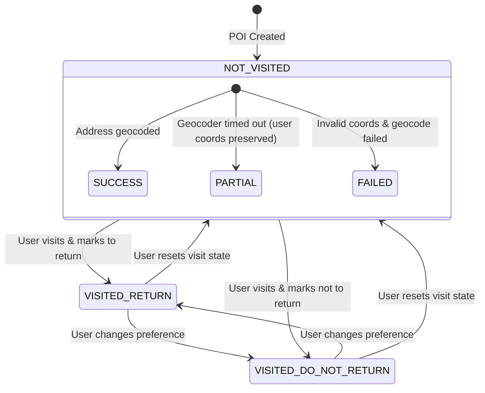

# Phase 1: Data Model & Persistence Architecture

**Feature Identifier**: `002-poi-domain-spatial`  
**Date**: 2026-10-19  
**Status**: Completed  
**Author**: Antigravity

---

## 1. Domain Entities & Value Objects (`packages/core/vistarae_core/domain/`)

### 1.1 Value Objects & Enumerations (`value_objects.py`)

```python
from enum import StrEnum
from dataclasses import dataclass

class VisitState(StrEnum):
    NOT_VISITED = "not_visited"
    VISITED_DO_NOT_RETURN = "visited_do_not_return"
    VISITED_RETURN = "visited_return"

class EnrichmentStatus(StrEnum):
    SUCCESS = "SUCCESS"
    PARTIAL = "PARTIAL"
    FAILED = "FAILED"

class DeduplicationPreset(int, StrEnum):
    URBAN = 805       # 0.5 miles in meters
    MACRO = 80467     # 50.0 miles in meters

@dataclass(frozen=True)
class WGS84Point:
    """Canonical geographic coordinate in EPSG:4326."""
    lon: float
    lat: float

    def __post_init__(self) -> None:
        if not (-180.0 <= self.lon <= 180.0):
            raise ValueError(f"Longitude {self.lon} out of range [-180, 180]")
        if not (-90.0 <= self.lat <= 90.0):
            raise ValueError(f"Latitude {self.lat} out of range [-90, 90]")

    @property
    def is_in_china_bbox(self) -> bool:
        """Determines if coordinate requires client-side GCJ-02 offset for Chinese tile providers."""
        return 73.66 <= self.lon <= 135.05 and 18.16 <= self.lat <= 53.55

@dataclass(frozen=True)
class BoundingBox:
    """2D planar geographic envelope for map viewports."""
    min_lon: float
    min_lat: float
    max_lon: float
    max_lat: float

    @property
    def crosses_antimeridian(self) -> bool:
        """True when viewport spans across the 180th meridian (min_lon > max_lon)."""
        return self.min_lon > self.max_lon

@dataclass(frozen=True)
class MergeResolutionRule:
    """Rules specifying attribute migration during an interactive POI merge."""
    target_poi_id: UUID
    source_poi_id: UUID
    use_source_for: list[str]  # e.g., ["description", "official_url", "image_urls"]
    merge_tags: bool = True
```

---

### 1.2 Domain Entities (`entities.py`)

```python
@dataclass
class POI:
    """Point of Interest root aggregate."""
    id: UUID
    user_id: UUID
    name: str
    geom: WGS84Point
    parent_poi_id: UUID | None = None
    description: str | None = None
    address: str | None = None
    city: str | None = None
    states: list[str] = field(default_factory=list)
    countries: list[str] = field(default_factory=list)
    official_url: str | None = None
    wiki_url: str | None = None
    image_urls: list[str] = field(default_factory=list)
    directory_paths: list[str] = field(default_factory=list)
    creation_metadata: dict[str, Any] = field(default_factory=dict)
    visit_state: VisitState = VisitState.NOT_VISITED
    visited_dates: list[str] = field(default_factory=list)
    rating: int | None = None
    estimated_cost: Decimal | None = None
    pricing_unit: str | None = None
    recommended_duration_hours: Decimal | None = None
    recommended_visit_days: int = 1
    enrichment_status: EnrichmentStatus = EnrichmentStatus.SUCCESS
    region_geom: str | None = None  # WKT MultiPolygon string if defined
    embedding: list[float] | None = None
    embedding_md5: str | None = None
    created_at: datetime = field(default_factory=lambda: datetime.now(UTC))
    updated_at: datetime = field(default_factory=lambda: datetime.now(UTC))

@dataclass
class ListEntity:
    """Curated collection of POIs."""
    id: UUID
    user_id: UUID
    title: str
    description: str | None = None
    is_public: bool = False
    created_at: datetime = field(default_factory=lambda: datetime.now(UTC))
    updated_at: datetime = field(default_factory=lambda: datetime.now(UTC))

@dataclass
class TagEntity:
    """User-scoped taxonomy marker."""
    id: UUID
    user_id: UUID
    name: str
    created_at: datetime = field(default_factory=lambda: datetime.now(UTC))

@dataclass
class GeocodingCacheEntry:
    """Cached geocoding result keyed by SHA-256 query hash."""
    query_hash: str
    lat: float
    lon: float
    formatted_address: str
    status: str
    created_at: datetime = field(default_factory=lambda: datetime.now(UTC))
    expires_at: datetime = field(default_factory=lambda: datetime.now(UTC) + timedelta(days=90))

@dataclass
class PotentialDuplicateMatch:
    """Represents a flagged collision during deduplication checks."""
    existing_poi: POI
    distance_meters: float
    name_similarity: float
    match_confidence: float
```

---

## 2. Relational Database Schema (`packages/core/vistarae_core/adapters/db/tables.py`)

### 2.1 Table: `pois`

- `id`: `UUID(as_uuid=True)`, PK, default `uuid.uuid4`.
- `user_id`: `UUID(as_uuid=True)`, FK `users(id) ON DELETE CASCADE`, indexed, NOT NULL.
- `parent_poi_id`: `UUID(as_uuid=True)`, FK `pois(id) ON DELETE SET NULL`, indexed, NULL.
- `name`: `VARCHAR(255)`, NOT NULL.
- `description`: `TEXT`, NULL.
- `address`: `VARCHAR(500)`, NULL.
- `city`: `VARCHAR(100)`, NULL.
- `states`: `JSONB`, NOT NULL, default `'[]'::jsonb`.
- `countries`: `JSONB`, NOT NULL, default `'[]'::jsonb`.
- `official_url`: `TEXT`, NULL.
- `wiki_url`: `TEXT`, NULL.
- `image_urls`: `JSONB`, NOT NULL, default `'[]'::jsonb`.
- `directory_paths`: `JSONB`, NOT NULL, default `'[]'::jsonb`.
- `creation_metadata`: `JSONB`, NOT NULL, default `'{}'::jsonb`.
- `visit_state`: `VARCHAR(32)`, NOT NULL, default `'not_visited'`.
- `visited_dates`: `JSONB`, NOT NULL, default `'[]'::jsonb`.
- `rating`: `INTEGER`, NULL.
- `estimated_cost`: `NUMERIC(10, 2)`, NULL.
- `pricing_unit`: `VARCHAR(16)`, NULL.
- `recommended_duration_hours`: `NUMERIC(4, 2)`, NULL.
- `recommended_visit_days`: `INTEGER`, NOT NULL, default `1`.
- `enrichment_status`: `VARCHAR(16)`, NOT NULL, default `'SUCCESS'`.
- `geom`: `geography(Point, 4326)`, NOT NULL.
- `region_geom`: `geometry(MultiPolygon, 4326)`, NULL.
- `embedding`: `vector(768)`, NULL.
- `embedding_md5`: `VARCHAR(32)`, NULL.
- `created_at`: `TIMESTAMPTZ`, NOT NULL, default `NOW()`.
- `updated_at`: `TIMESTAMPTZ`, NOT NULL, default `NOW()`.

#### Check Constraints

- `ck_pois_visit_state`: `visit_state IN ('not_visited', 'visited_do_not_return', 'visited_return')`
- `ck_pois_rating`: `rating IS NULL OR (rating >= 0 AND rating <= 5)`
- `ck_pois_duration`: `recommended_duration_hours IS NULL OR (recommended_duration_hours >= 0.25 AND recommended_duration_hours <= 12.00)`
- `ck_pois_enrichment`: `enrichment_status IN ('SUCCESS', 'PARTIAL', 'FAILED')`

#### Indexes

- `idx_pois_user_geom`: `USING gist (user_id, geom)` (Geodesic proximity, `ST_DWithin`, `ST_Distance`).
- `idx_pois_user_geom_geometry`: `USING gist (user_id, (geom::geometry))` (Planar viewport bounding boxes, `ST_MakeEnvelope`).
- `idx_pois_states_gin`: `USING gin (states)` (JSONB containment `@>` for state searches).
- `idx_pois_countries_gin`: `USING gin (countries)` (JSONB containment `@>` for country searches).
- `idx_pois_embedding`: `USING hnsw (embedding vector_cosine_ops)` (Approximate nearest-neighbor vector similarity).
- `idx_pois_name_trgm`: `USING gin (name gin_trgm_ops)` (Trigram fuzzy name matching).
- `idx_pois_parent_poi_id`: `(parent_poi_id)` (Hierarchical child traversal).

---

### 2.2 Table: `lists`

- `id`: `UUID`, PK.
- `user_id`: `UUID`, FK `users(id) ON DELETE CASCADE`, NOT NULL.
- `title`: `VARCHAR(200)`, NOT NULL.
- `description`: `TEXT`, NULL.
- `is_public`: `BOOLEAN`, NOT NULL, default `FALSE`.
- `created_at`: `TIMESTAMPTZ`, NOT NULL, default `NOW()`.
- `updated_at`: `TIMESTAMPTZ`, NOT NULL, default `NOW()`.
- Index: `idx_lists_user_id` on `(user_id)`.

### 2.3 Table: `poi_lists` (Association)

- `poi_id`: `UUID`, FK `pois(id) ON DELETE CASCADE`.
- `list_id`: `UUID`, FK `lists(id) ON DELETE CASCADE`.
- `added_at`: `TIMESTAMPTZ`, NOT NULL, default `NOW()`.
- Primary Key: `(poi_id, list_id)`.

### 2.4 Table: `tags`

- `id`: `UUID`, PK.
- `user_id`: `UUID`, FK `users(id) ON DELETE CASCADE`, NOT NULL.
- `name`: `VARCHAR(64)`, NOT NULL.
- `created_at`: `TIMESTAMPTZ`, NOT NULL, default `NOW()`.
- Unique Constraint: `uq_tags_user_name` on `(user_id, name)`.

### 2.5 Table: `poi_tags` (Association)

- `poi_id`: `UUID`, FK `pois(id) ON DELETE CASCADE`.
- `tag_id`: `UUID`, FK `tags(id) ON DELETE CASCADE`.
- Primary Key: `(poi_id, tag_id)`.

### 2.6 Table: `geocoding_cache`

- `query_hash`: `VARCHAR(64)`, PK (SHA-256 hex digest).
- `lat`: `DOUBLE PRECISION`, NOT NULL.
- `lon`: `DOUBLE PRECISION`, NOT NULL.
- `formatted_address`: `TEXT`, NOT NULL.
- `status`: `VARCHAR(16)`, NOT NULL.
- `created_at`: `TIMESTAMPTZ`, NOT NULL, default `NOW()`.
- `expires_at`: `TIMESTAMPTZ`, NOT NULL.
- Index: `idx_geocoding_cache_expires_at` on `(expires_at)`.

---

## 3. Port Protocols (`packages/core/vistarae_core/ports/`)

### 3.1 `IPOIRepository` (`repositories.py`)

```python
class IPOIRepository(Protocol):
    async def create(self, poi: POI) -> POI: ...
    async def get_by_id(self, poi_id: UUID, user_id: UUID) -> POI | None: ...
    async def update(self, poi: POI) -> POI: ...
    async def delete(self, poi_id: UUID, user_id: UUID) -> bool: ...
    async def bulk_delete(self, poi_ids: list[UUID], user_id: UUID) -> int: ...

    async def list_pois(
        self,
        user_id: UUID,
        bbox: BoundingBox | None = None,
        list_id: UUID | None = None,
        tag_ids: list[UUID] | None = None,
        state: str | None = None,
        country: str | None = None,
        visit_state: VisitState | None = None,
        visited_from: date | None = None,
        visited_to: date | None = None,
        hierarchy: str = "all",  # "all", "root_only", "children_only"
        parent_id: UUID | None = None,
        text_query: str | None = None,
        semantic_vector: list[float] | None = None,
        limit: int = 50,
        offset: int = 0,
    ) -> tuple[list[POI], int]: ...

    async def find_potential_duplicates(
        self,
        user_id: UUID,
        name: str,
        point: WGS84Point,
        radius_meters: float,
        similarity_threshold: float = 0.60,
    ) -> list[PotentialDuplicateMatch]: ...

    async def merge_pois(
        self,
        user_id: UUID,
        rule: MergeResolutionRule,
    ) -> POI: ...

    async def bulk_attach_tags(self, user_id: UUID, poi_ids: list[UUID], tag_ids: list[UUID]) -> int: ...
    async def bulk_detach_tags(self, user_id: UUID, poi_ids: list[UUID], tag_ids: list[UUID]) -> int: ...
    async def bulk_attach_lists(self, user_id: UUID, poi_ids: list[UUID], list_ids: list[UUID]) -> int: ...
    async def bulk_detach_lists(self, user_id: UUID, poi_ids: list[UUID], list_ids: list[UUID]) -> int: ...
```

### 3.2 `IGeocodingPort` (`geocoding.py`)

```python
@dataclass(frozen=True)
class GeocodingResult:
    lat: float
    lon: float
    formatted_address: str
    city: str | None = None
    states: list[str] = field(default_factory=list)
    countries: list[str] = field(default_factory=list)
    status: EnrichmentStatus = EnrichmentStatus.SUCCESS

class IGeocodingPort(Protocol):
    async def forward_geocode(self, query: str) -> GeocodingResult: ...
    async def reverse_geocode(self, lat: float, lon: float) -> GeocodingResult: ...
```

### 3.3 `IEmbeddingPort` (`embedding.py`)

```python
class IEmbeddingPort(Protocol):
    async def generate_embedding(self, text: str) -> list[float]: ...
```

---

## 4. Entity Lifecycle & State Machine


