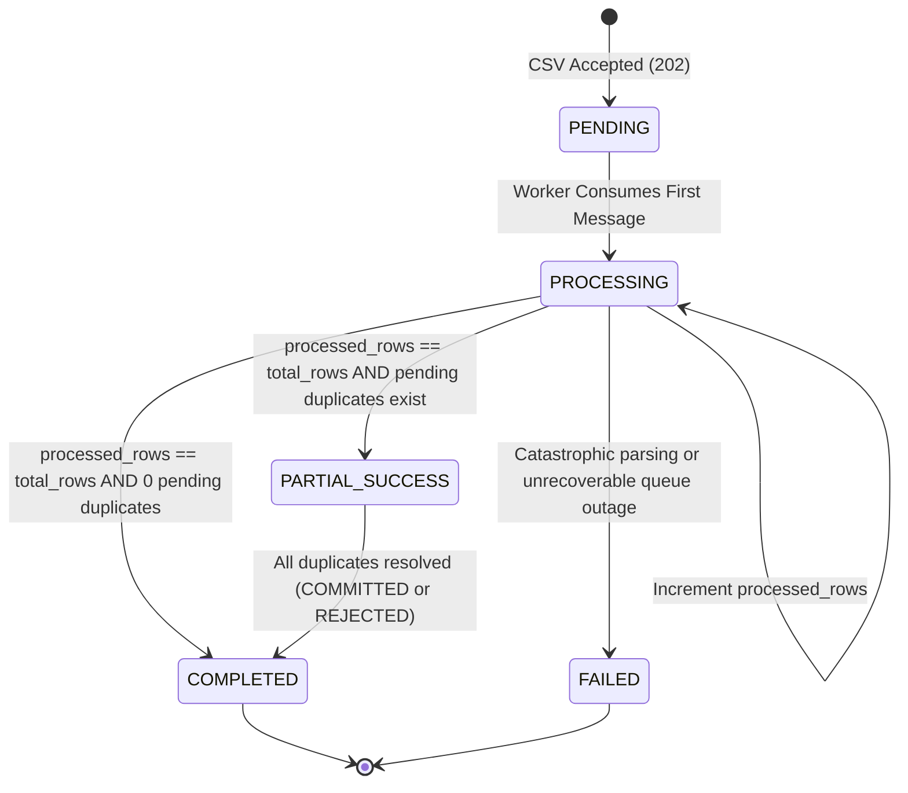
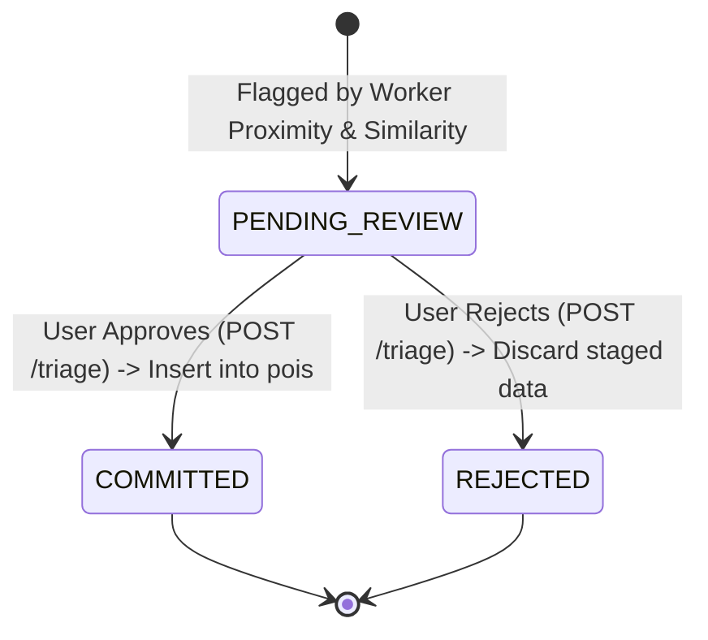

# Data Model & Schema Specification: Asynchronous Ingestion & Batch Processing

**Feature Identifier**: `003-async-ingestion-cli`  
**Date**: 2026-10-19  
**Status**: Completed  
**Spec**: [spec.md](file:///d:/Coding/Vistarae/specs/003-async-ingestion-cli/spec.md) | **Research**: [research.md](file:///d:/Coding/Vistarae/specs/003-async-ingestion-cli/research.md)  

---

## 1. Relational Database Schema (`ingest_jobs`)

### 1.1 DDL Specification

```sql
-- Table: ingest_jobs (Tracks asynchronous CSV batch uploads)
CREATE TABLE IF NOT EXISTS ingest_jobs (
    id UUID PRIMARY KEY DEFAULT gen_random_uuid(),
    user_id UUID NOT NULL REFERENCES users(id) ON DELETE CASCADE,
    job_status VARCHAR(16) NOT NULL,
    total_rows INT NOT NULL DEFAULT 0,
    processed_rows INT NOT NULL DEFAULT 0,
    duplicate_payloads JSONB NOT NULL DEFAULT '[]'::jsonb,
    target_list_id UUID NULL REFERENCES lists(id) ON DELETE SET NULL,
    error_summary JSONB NOT NULL DEFAULT '[]'::jsonb,
    created_at TIMESTAMPTZ NOT NULL DEFAULT NOW(),
    updated_at TIMESTAMPTZ NOT NULL DEFAULT NOW(),
    
    CONSTRAINT ck_ingest_jobs_status CHECK (
        job_status IN ('PENDING', 'PROCESSING', 'COMPLETED', 'PARTIAL_SUCCESS', 'FAILED')
    )
);

-- Index for tenant-scoped job history and sorting
CREATE INDEX IF NOT EXISTS idx_ingest_jobs_user_created 
    ON ingest_jobs (user_id, created_at DESC);

-- Index for fast user-scoped job lookup by primary key
CREATE INDEX IF NOT EXISTS idx_ingest_jobs_id_user 
    ON ingest_jobs (id, user_id);
```

### 1.2 Column Dictionary

| Column | Type | Constraints | Description |
| :--- | :--- | :--- | :--- |
| `id` | `UUID` | Primary Key, `gen_random_uuid()` | Unique job identifier returned to the client upon upload. |
| `user_id` | `UUID` | Foreign Key `users(id)` ON DELETE CASCADE | Tenant identifier for data isolation (Constitution Principle 3). |
| `job_status` | `VARCHAR(16)` | NOT NULL, Check Constraint | Job lifecycle state: `PENDING`, `PROCESSING`, `COMPLETED`, `PARTIAL_SUCCESS`, `FAILED`. |
| `total_rows` | `INT` | NOT NULL, DEFAULT 0 | Count of valid data rows parsed from the uploaded CSV. |
| `processed_rows` | `INT` | NOT NULL, DEFAULT 0 | Count of rows successfully processed or triaged so far. |
| `duplicate_payloads` | `JSONB` | NOT NULL, DEFAULT `'[]'::jsonb` | JSON array of suspected duplicate items flagged for user triage. |
| `target_list_id` | `UUID` | NULL, FK `lists(id)` ON DELETE SET NULL | Optional list to which imported POIs are automatically attached. |
| `error_summary` | `JSONB` | NOT NULL, DEFAULT `'[]'::jsonb` | Array of row-level error objects recording validation/unresolvable failures. |
| `created_at` | `TIMESTAMPTZ`| NOT NULL, DEFAULT NOW() | Timestamp when the upload was accepted. |
| `updated_at` | `TIMESTAMPTZ`| NOT NULL, DEFAULT NOW() | Timestamp of last progress or status mutation. |

---

## 2. JSON Structures & Value Objects

### 2.1 `duplicate_payloads` Schema

Each element in the `duplicate_payloads` JSONB array adheres to the schema:

```json
{
  "row_number": 42,
  "raw_name": "Yosemite Valley Overlook",
  "candidate_poi_id": "3fa85f64-5717-4562-b3fc-2c963f66afa6",
  "match_type": "POTENTIAL_DUPLICATE",
  "similarity_score": 0.88,
  "distance_meters": 120.5,
  "triage_status": "PENDING_REVIEW",
  "staged_poi_data": {
    "name": "Yosemite Valley Overlook",
    "description": "Stunning viewpoint of El Capitan and Half Dome.",
    "address": "Wawona Rd, Yosemite National Park, CA",
    "city": "Yosemite Village",
    "states": ["California"],
    "countries": ["United States"],
    "latitude": 37.715,
    "longitude": -119.677,
    "visited_date": "2024-05-15",
    "tags": ["scenic", "national-park"]
  }
}
```

### 2.2 `error_summary` Schema

```json
{
  "row_number": 105,
  "raw_name": "Corrupted Row",
  "error_type": "GEOCODING_NOT_FOUND",
  "detail": "OpenStreetMap Nominatim could not resolve address 'Nowhere Island 99999'",
  "timestamp": "2026-10-19T18:30:00Z"
}
```

---

## 3. Queue Payload Specification (`IngestRowMessage`)

Each message enqueued to `vistarae-ingest-{STAGE}` represents a single CSV row:

```json
{
  "job_id": "b3e0984a-9cb2-4a0b-b18c-8438fbe84e62",
  "user_id": "9d71c4c1-2cb2-49da-91db-c875d71cbfd2",
  "target_list_id": "a1f81012-7013-43c2-841b-4171ea72db55",
  "absolute_row_number": 42,
  "row_data": {
    "name": "Yosemite Valley Overlook",
    "description": "Stunning viewpoint of El Capitan and Half Dome.",
    "address": "Wawona Rd, Yosemite National Park, CA",
    "city": "Yosemite Village",
    "state": "California",
    "country": "United States",
    "latitude": "37.715",
    "longitude": "-119.677",
    "visited_date": "2024-05-15",
    "tags": "scenic,national-park"
  }
}
```

**SQS Message Attributes**:
- `traceparent`: `00-4bf92f3577b34da6a3ce929d0e0e4736-00f067aa0ba902b7-01` (`String`)
- `X-Amzn-Trace-Id`: `Root=1-5759e988-bd862e3fe1be46a994272793` (`String`)
- `user_id`: `9d71c4c1-2cb2-49da-91db-c875d71cbfd2` (`String`)
- `job_id`: `b3e0984a-9cb2-4a0b-b18c-8438fbe84e62` (`String`)

---

## 4. State Machines & Lifecycle Transitions

### 4.1 Ingestion Job Status Machine



### 4.2 Duplicate Triage Status Machine



---

## 5. Pydantic v2 Application Models

```python
# packages/core/vistarae_core/schemas/ingest.py
from datetime import datetime
from enum import StrEnum
from uuid import UUID
from pydantic import Field
from vistarae_core.schemas.base import StrictBaseModel

class IngestJobStatus(StrEnum):
    PENDING = "PENDING"
    PROCESSING = "PROCESSING"
    COMPLETED = "COMPLETED"
    PARTIAL_SUCCESS = "PARTIAL_SUCCESS"
    FAILED = "FAILED"

class DuplicateTriageStatus(StrEnum):
    PENDING_REVIEW = "PENDING_REVIEW"
    COMMITTED = "COMMITTED"
    REJECTED = "REJECTED"

class IngestUploadResponse(StrictBaseModel):
    job_id: UUID
    job_status: IngestJobStatus
    total_rows: int
    message: str

class DuplicateItemResponse(StrictBaseModel):
    row_number: int
    raw_name: str
    candidate_poi_id: UUID
    match_type: str
    similarity_score: float
    distance_meters: float
    triage_status: DuplicateTriageStatus
    staged_poi_data: dict

class IngestJobProgressResponse(StrictBaseModel):
    id: UUID
    job_status: IngestJobStatus
    total_rows: int
    processed_rows: int
    percent_complete: float
    duplicates_pending_count: int
    duplicate_items: list[DuplicateItemResponse]
    error_summary: list[dict]
    created_at: datetime
    updated_at: datetime

class TriageDecisionItem(StrictBaseModel):
    row_number: int
    decision: DuplicateTriageStatus

class TriageRequest(StrictBaseModel):
    decisions: list[TriageDecisionItem]

class PhotoPOIInference(StrictBaseModel):
    name: str = Field(description="Specific name of the point of interest or scenic viewpoint")
    description: str = Field(description="Concise description of the location and photo context")
    address: str | None = Field(default=None, description="Street address if identifiable")
    city: str | None = Field(default=None)
    state: str | None = Field(default=None)
    country: str | None = Field(default=None)
    latitude: float | None = Field(default=None)
    longitude: float | None = Field(default=None)
    confidence_score: float = Field(ge=0.0, le=1.0)
    is_uncertain: bool = Field(description="True if location is ambiguous, generic, or uncertain")
    reasoning: str = Field(description="Brief explanation of inference signals")
```

---

## 6. Alembic Migration Specification (`0003_async_ingestion_cli.py`)

- **Revision Identifier**: `0003_async_ingestion_cli`
- **Down Revision**: `0002_poi_domain_spatial`
- **Reversibility (`downgrade()`)**: Must cleanly drop `idx_ingest_jobs_id_user`, `idx_ingest_jobs_user_created`, and table `ingest_jobs`. Zero orphaned tables or dangling check constraints.
- **Enums**: Backed strictly by PostgreSQL `VARCHAR(16)` with check constraints; no PostgreSQL native `ENUM` created.
