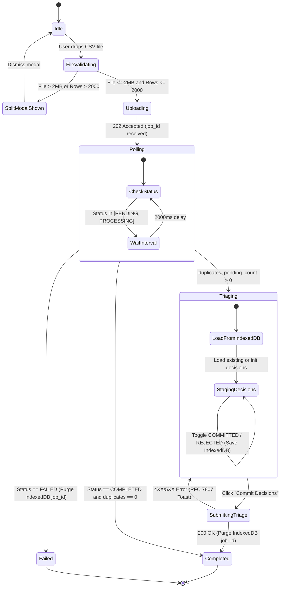
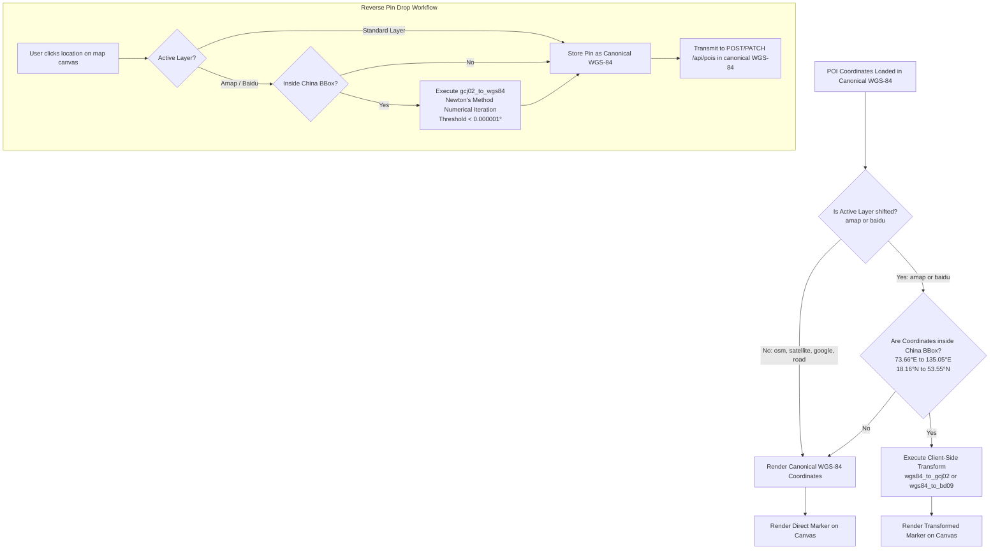

# Frontend Data Model & State Specifications: Phase 4 — Single-Page Application (SPA) & Interactive POI Frontend

**Feature Identifier**: `004-spa-poi-frontend`  
**Date**: 2026-10-20  
**Status**: Completed  
**Spec Reference**: [specs/004-spa-poi-frontend/spec.md](file:///d:/Coding/Vistarae/specs/004-spa-poi-frontend/spec.md)  
**Research Reference**: [specs/004-spa-poi-frontend/research.md](file:///d:/Coding/Vistarae/specs/004-spa-poi-frontend/research.md)

---

## 1. Domain Entities & State Models

```
+---------------------------------------------------------------------------------------------------+
|                                          UserSession                                              |
+---------------------------------------------------------------------------------------------------+
| id: string (UUID)                                                                                 |
| email: string (RFC 5322 compliant)                                                                |
| full_name: string | null                                                                          |
| cognito_sub: string                                                                               |
| is_admin: boolean                                                                                 |
| tier: 'LOW' | 'HIGH' | 'ADMIN'                                                                    |
| token: string (JWT Bearer Token)                                                                  |
| token_expires_at: number (epoch ms)                                                               |
+---------------------------------------------------------------------------------------------------+

+---------------------------------------------------------------------------------------------------+
|                                     UserPreferencesState                                          |
+---------------------------------------------------------------------------------------------------+
| ui: UIPreferencesResponse                                                                         |
|   theme: 'light' | 'dark' | 'system'                                                              |
|   email_notifications_enabled: boolean                                                            |
|   push_notifications_enabled: boolean                                                             |
|   marketing_emails_enabled: boolean                                                               |
| poi: POIPreferencesResponse                                                                       |
|   clustering_enabled: boolean                                                                     |
|   clustering_radius_meters: number (10 to 500)                                                    |
|   default_map_layer: string (e.g. 'osm', 'amap', 'satellite')                                     |
|   geoproximity_scope_km: number (1.0 to 500.0)                                                    |
|   pin_color_presets: Record<string, string>                                                       |
| planner: PlannerPreferencesResponse                                                               |
|   pacing: 'RELAXED' | 'BALANCED' | 'PACKED'                                                       |
|   meal_intervals_hours: number (1.0 to 8.0)                                                       |
|   lunch_packing_enabled: boolean                                                                  |
|   transit_speed_mode: 'WALKING' | 'CYCLING' | 'TRANSIT' | 'DRIVING'                               |
|   daily_activity_hour_cap: number (1.0 to 18.0)                                                   |
|   preferred_currency: string (ISO 4217, 3 uppercase chars)                                        |
+---------------------------------------------------------------------------------------------------+

+---------------------------------------------------------------------------------------------------+
|                                        POIMapFeature                                              |
+---------------------------------------------------------------------------------------------------+
| id: string (UUID)                                                                                 |
| name: string                                                                                      |
| canonical_lat: number (WGS-84, -90.0 to 90.0)                                                     |
| canonical_lng: number (WGS-84, -180.0 to 180.0)                                                   |
| render_lat: number (GCJ-02/BD-09 if China layer active and in China bbox, else canonical_lat)    |
| render_lng: number (GCJ-02/BD-09 if China layer active and in China bbox, else canonical_lng)    |
| visit_state: 'not_visited' | 'visited_do_not_return' | 'visited_return'                           |
| visited_dates: string[] (ISO 8601 strings)                                                        |
| rating: number | null (0 to 5)                                                                    |
| estimated_cost: number | null                                                                     |
| pricing_unit: string | null                                                                       |
| recommended_duration_hours: number | null (0.25 to 12.0)                                          |
| tags: string[]                                                                                    |
| lists: string[] (UUIDs)                                                                           |
| address: string | null                                                                            |
| city: string | null                                                                               |
| states: string[]                                                                                  |
| countries: string[]                                                                               |
| image_urls: string[]                                                                              |
| official_url: string | null                                                                       |
| wiki_url: string | null                                                                           |
+---------------------------------------------------------------------------------------------------+

+---------------------------------------------------------------------------------------------------+
|                                         MapViewState                                              |
+---------------------------------------------------------------------------------------------------+
| center: [number, number] (lng, lat)                                                               |
| zoom: number (0.0 to 22.0)                                                                        |
| pitch: number (0.0 to 60.0)                                                                       |
| bearing: number (-180.0 to 180.0)                                                                 |
| activeLayerId: 'osm' | 'satellite' | 'google-roadmap' | 'google-hybrid' | 'road' | 'amap' | 'baidu'  |
| isShiftedLayerActive: boolean                                                                     |
| isChinaBBoxActive: boolean                                                                        |
| isFilterToViewportActive: boolean                                                                 |
| clusteringEngine: 'client' | 'server'                                                             |
| visibleBounds: [number, number, number, number] | null ([minLng, minLat, maxLng, maxLat])         |
+---------------------------------------------------------------------------------------------------+

+---------------------------------------------------------------------------------------------------+
|                   StagedTriageRecord (IndexedDB: vistarae_ingest_db.triage_jobs)                   |
+---------------------------------------------------------------------------------------------------+
| job_id: string (UUID, KeyPath)                                                                    |
| total_rows: number                                                                                |
| processed_rows: number                                                                            |
| status: 'PENDING' | 'PROCESSING' | 'COMPLETED' | 'PARTIAL_SUCCESS' | 'FAILED'                     |
| decisions: Record<number, 'COMMITTED' | 'REJECTED'> (indexed by row_number)                       |
| duplicate_candidates: DuplicateItemResponse[]                                                     |
| last_updated: number (epoch ms)                                                                   |
| expires_at: number (epoch ms = last_updated + 604800000 ms [7 days])                              |
+---------------------------------------------------------------------------------------------------+

+---------------------------------------------------------------------------------------------------+
|                                       PhotoEXIFMetadata                                           |
+---------------------------------------------------------------------------------------------------+
| file_name: string                                                                                 |
| file_size: number (bytes)                                                                         |
| mime_type: 'image/jpeg' | 'image/webp' | 'image/png' | 'image/heic' | 'image/heif'                  |
| preview_url: string | null (ephemeral Blob URL generated via URL.createObjectURL)                  |
| has_gps: boolean                                                                                  |
| latitude: number | null (Canonical WGS-84)                                                        |
| longitude: number | null (Canonical WGS-84)                                                       |
| captured_at: string | null (ISO 8601 string)                                                      |
| orientation: number | null (EXIF orientation tag 1..8)                                            |
+---------------------------------------------------------------------------------------------------+
```

---

## 2. State Transition Diagrams

### 2.1 Ingestion Job & Client Duplicate Triage Lifecycle



### 2.2 Map Coordinate Projection Lifecycle



---

## 3. Storage Schemas & Client Caching

### 3.1 IndexedDB Store: `vistarae_ingest_db`

- **Database Name**: `vistarae_ingest_db`
- **Database Version**: `1`
- **Object Store**: `triage_jobs`
- **Key Path**: `job_id` (string, UUID)
- **Indexes**:
  - `idx_expires_at`: `expires_at` (numeric timestamp ms)
  - `idx_last_updated`: `last_updated` (numeric timestamp ms)
- **Eviction Routine**:
  ```typescript
  export async function evictExpiredTriageJobs(
    db: IDBPDatabase,
  ): Promise<void> {
    const tx = db.transaction("triage_jobs", "readwrite");
    const index = tx.store.index("idx_expires_at");
    const now = Date.now();
    let cursor = await index.openCursor(IDBKeyRange.upperBound(now));
    while (cursor) {
      await cursor.delete();
      cursor = await cursor.continue();
    }
    await tx.done;
  }
  ```

### 3.2 Browser `localStorage` Fallback & Preference Cache

- `vistarae_theme_mode`: `'light' | 'dark' | 'system'` (persisted for unauthenticated visitors).
- `vistarae_auth_token`: Cognito JWT ID/Access token.
- `vistarae_viewport_filter`: `'true' | 'false'` (table filter toggle state).
- `vistarae_active_map_layer`: Session override for map tile layer.

---

## 4. RFC 7807 / RFC 9457 Problem Details Client Model

```typescript
export interface ProblemDetails {
  type: string;
  title: string;
  status: number;
  detail: string;
  instance?: string;
  invalid_params?: Array<{
    name: string;
    reason: string;
  }>;
}

export class ApiError extends Error {
  public readonly problem: ProblemDetails;

  constructor(problem: ProblemDetails) {
    super(problem.detail || problem.title);
    this.name = "ApiError";
    this.problem = problem;
  }
}
```
