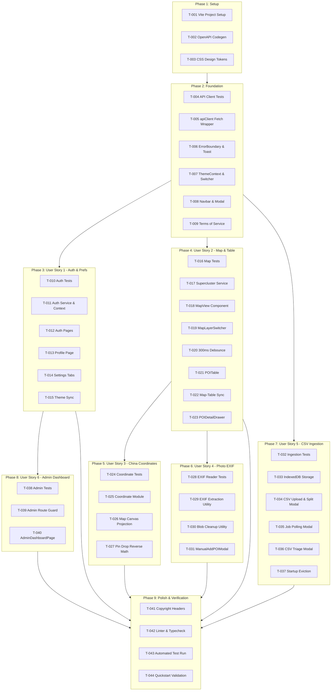

# Tasks: Phase 4 — Single-Page Application (SPA) & Interactive POI Frontend

**Feature Identifier**: `004-spa-poi-frontend`  
**Branch**: `004-spa-poi-frontend`  
**Date**: 2026-10-20  
**Status**: DRAFT  
**Spec Reference**: [specs/004-spa-poi-frontend/spec.md](file:///d:/Coding/Vistarae/specs/004-spa-poi-frontend/spec.md)  
**Plan Reference**: [specs/004-spa-poi-frontend/plan.md](file:///d:/Coding/Vistarae/specs/004-spa-poi-frontend/plan.md)  
**Constitution**: [.specify/memory/constitution.md](file:///d:/Coding/Vistarae/.specify/memory/constitution.md)

---

## Phase 1: Setup & Toolchain (Shared Infrastructure)

**Purpose**: Project initialization, build configuration, OpenAPI contract synchronization, and design system tokens.

- [X] T-001 Initialize the Vite 5 + React 18 + strict TypeScript 5.5 project structure under `frontend/` (`package.json`, `tsconfig.json`, `index.html`) configuring Vite dev proxy (`/api` -> `http://localhost:8000`, `changeOrigin: true`) in `frontend/vite.config.ts` [REQ-UI-001, Constitution Principle 6]
- [X] T-002 [P] Configure the OpenAPI TypeScript type generator script (`npm run codegen`) executing `npx openapi-typescript ./openapi.json -o ./frontend/src/types/api.ts` and verify synchronization with backend models in `frontend/src/types/api.ts` [REQ-UI-002, Constitution Principle 5]
- [X] T-003 [P] Implement the core Vanilla CSS design system tokens, CSS custom properties (`--bg-primary`, `--bg-surface`, `--text-primary`, `--accent`, `--border-color`), fluid typography (Inter, Outfit), dark-mode overrides, and micro-animation keyframes in `frontend/src/index.css` [REQ-UI-007, REQ-UI-008]

---

## Phase 2: Foundational Infrastructure (Blocking Prerequisites)

**Purpose**: Core HTTP transport, W3C distributed tracing, RFC 7807 problem details mapper, global theme engine, and base UI primitives that MUST be complete before any user story can be implemented.

- [X] T-004 [P] Unit tests for HTTP client, W3C `traceparent` telemetry injection, and RFC 7807/9457 ProblemDetails error parsing in `frontend/tests/unit/api.test.ts` [REQ-UI-003, REQ-UI-004, REQ-UI-005, Constitution Principle 5, Constitution Principle 7]
- [X] T-005 Implement the typed `apiClient` fetch wrapper in `frontend/src/services/api.ts` injecting W3C `traceparent` headers (`00-{trace_id}-{span_id}-01`), `Idempotency-Key` UUIDs on mutating requests, Bearer tokens, local mock headers (`X-Mock-User-Id`), and translating non-2XX responses into strongly typed `ProblemDetails` [REQ-UI-001, REQ-UI-003, REQ-UI-004, REQ-UI-005, Constitution Principle 5, Constitution Principle 7]
- [X] T-006 [P] Implement the global React Error Boundary and Toast Notification banner system (`ToastContext.tsx`, `ToastBanner.tsx`, `ErrorBoundary.tsx`) in `frontend/src/components/common/` rendering RFC 7807 `title`, `detail`, `invalid_params` hints, and a real-time countdown timer for HTTP 429 `Retry-After` headers [REQ-UI-003, REQ-UI-004, REQ-UI-005]
- [X] T-007 [P] Implement the global Theme Engine (`ThemeContext.tsx`, `ThemeSwitcher.tsx`) in `frontend/src/context/ThemeContext.tsx` supporting `light`, `dark`, and `system` modes with instantaneous (< 50ms) CSS attribute application on `document.documentElement` and unauthenticated `localStorage` fallback [REQ-UI-007, REQ-UI-008, REQ-UI-010]
- [X] T-008 [P] Implement the core application navigation header (`Navbar.tsx`) and accessible modal container primitive (`Modal.tsx`) with backdrop click and escape-key dismissal in `frontend/src/components/common/` [REQ-UI-006, REQ-UI-011]
- [X] T-009 [P] Implement the public Terms of Service page detailing platform data usage, privacy rules, and zero-cost cloud architecture in `frontend/src/pages/TermsPage.tsx` [REQ-UI-006]

**Checkpoint**: Core foundational pipeline ready — user story implementation can now begin.

---

## Phase 3: User Story 1 - Authentication, Profile, Preferences & Theming (Priority: P1) 🎯 MVP

**Goal**: Complete traveler authentication lifecycle, tenant profile management, and sub-domain preferences persistence.  
**Independent Test**: Register a new user, verify email confirmation code, authenticate, modify settings across Account/UI, POI, and Planner tabs, toggle themes with cloud persistence, and log out cleanly.

### Tests for User Story 1
- [X] T-010 [P] [US1] Unit and component tests for Cognito authentication lifecycle, preferences validation bounds, and theme persistence in `frontend/tests/components/AuthAndPreferences.test.tsx` [REQ-UI-008, REQ-UI-009, REQ-UI-011, REQ-UI-016, REQ-UI-017]

### Implementation for User Story 1
- [X] T-011 [P] [US1] Implement Cognito authentication service and context (`auth.ts`, `AuthContext.tsx`) in `frontend/src/services/auth.ts` and `frontend/src/context/AuthContext.tsx` managing JWT tokens, session refresh, local mock bypass, and login/logout state [REQ-UI-011, REQ-UI-012, REQ-UI-014]
- [X] T-012 [P] [US1] Implement authentication pages: Sign Up (`SignUpPage.tsx` with email code confirmation), Sign In (`LoginPage.tsx`), and Password Recovery (`ForgotPasswordPage.tsx`, `ResetPasswordPage.tsx`) in `frontend/src/pages/` [REQ-UI-011, REQ-UI-012, REQ-UI-013, REQ-UI-014]
- [X] T-013 [P] [US1] Implement User Profile page displaying identity details, quota usage cards, tier badge, and GDPR cascade account deletion modal in `frontend/src/pages/ProfilePage.tsx` [REQ-UI-015]
- [X] T-014 [US1] Implement Preferences context and tabbed settings pages (`PreferencesContext.tsx`, `SettingsPage.tsx`) in `frontend/src/context/PreferencesContext.tsx` and `frontend/src/pages/SettingsPage.tsx` partitioning controls into:
  - Account/UI: Theme mode, email/push/marketing notification toggles (`/settings/account`) [REQ-UI-009, REQ-UI-016]
  - POI Mode: Clustering toggle, radius slider (10m–500m), default map layer, geoproximity scope (1.0km–500.0km), pin colors (`/settings/poi`) [REQ-UI-016, REQ-UI-017]
  - Planner Mode: Pacing mode, meal intervals (1.0h–8.0h), lunch packing, transit speed, activity cap (1.0h–18.0h), currency (`/settings/planner`) [REQ-UI-016, REQ-UI-017]
- [X] T-015 [US1] Connect Theme Engine to `PreferencesContext` to synchronize the selected theme with `PATCH /api/users/me/preferences/ui` on login and selection change in `frontend/src/context/ThemeContext.tsx` [REQ-UI-009]

**Checkpoint**: User Story 1 complete — full authentication, theming, and preferences workflows testable independently.

---

## Phase 4: User Story 2 - Interactive Map Exploration, Layer Switching & Viewport Synchronization (Priority: P1)

**Goal**: Full-screen interactive MapLibre map with 7 tile layers, client-side Supercluster (< 1,000 POIs), 300ms debounced server queries (>= 1,000 POIs), and bidirectional table synchronization.  
**Independent Test**: Pan and zoom map across destinations, toggle tile layers without page reload, assert client-side clustering for collections < 1,000 points, toggle viewport filter to assert table updates, and verify bidirectional pin-table highlighting.

### Tests for User Story 2
- [X] T-016 [P] [US2] Unit and component tests for MapLibre layer swapping, 300ms viewport debounce, and bidirectional map-table synchronization in `frontend/tests/components/MapView.test.tsx` [REQ-MAP-001, REQ-MAP-002, REQ-MAP-010, REQ-MAP-014, REQ-MAP-015, REQ-MAP-016]

### Implementation for User Story 2
- [X] T-017 [P] [US2] Implement client-side Supercluster geospatial indexing and viewport filtering service in `frontend/src/services/clustering.ts` supporting in-memory cluster generation for collections < 1,000 POIs at 60 FPS [REQ-MAP-008, REQ-MAP-009, Spec §SC-004]
- [X] T-018 [US2] Implement the core `MapView.tsx` component in `frontend/src/components/map/MapView.tsx` embedding MapLibre GL JS, handling pitch/bearing/zoom, rendering GeoJSON marker layers with visit state glyphs, and updating geometries in-place via `map.getSource('pois').setData(...)` [REQ-MAP-001, REQ-MAP-009, REQ-MAP-019, REQ-MAP-020]
- [X] T-019 [P] [US2] Implement the `MapLayerSwitcher.tsx` control widget in `frontend/src/components/map/MapLayerSwitcher.tsx` supporting 7 tile sources (`osm`, `satellite`, `google-roadmap`, `google-hybrid`, `road`, `amap`, `baidu`) with session-first layer toggling, in-memory marker re-projection, and an explicit "Save as Default" button updating `user_preferences.poi.default_map_layer` [REQ-MAP-002, REQ-MAP-002a]
- [X] T-020 [US2] Implement 300ms map `moveend` debouncing in `MapView.tsx` for collections $\ge 1,000$ POIs calling `GET /api/pois?bbox={minLng,minLat,maxLng,maxLat}` with timer cancellation on active motion and in-flight request discarding via `AbortController` [REQ-MAP-010, REQ-MAP-011, Checklist CHK011, CHK012, CHK015]
- [X] T-021 [P] [US2] Implement the Synchronized `POITable.tsx` component in `frontend/src/components/poi/POITable.tsx` featuring columns for name, address/city, visit state badge, rating stars, tags, actions, empty-state messaging, and a prominent "Filter table to current map viewport" toggle switch [REQ-MAP-012, REQ-MAP-013, REQ-MAP-014, Checklist CHK018]
- [X] T-022 [US2] Implement bidirectional map-table synchronization: table row click executes `map.flyTo(...)` with popup inspection card; map pin click highlights and scrolls table row into view in `frontend/src/components/map/POIPopupCard.tsx` and `frontend/src/pages/HomePage.tsx` [REQ-MAP-015, REQ-MAP-016, REQ-MAP-017]
- [X] T-023 [P] [US2] Implement `POIDetailDrawer.tsx` in `frontend/src/components/poi/POIDetailDrawer.tsx` providing in-place editing for POI attributes, rating stars, visit state toggles (`not_visited`, `visited_return`, `visited_do_not_return`), and optimistic UI updates [REQ-MAP-018]

**Checkpoint**: User Stories 1 and 2 functional — full map exploration and tabular navigation ready.

---

## Phase 5: User Story 3 - Precision Coordinate Transformation for China Tiles (Priority: P2)

**Goal**: Pure client-side mathematical coordinate transformation (WGS-84 $\leftrightarrow$ GCJ-02/BD-09) active strictly inside China bounding box with sub-meter Newton's method reverse iteration on pin drops.  
**Independent Test**: Load points in Beijing and Shanghai on OpenStreetMap (canonical WGS-84) vs. AutoNavi (GCJ-02), drop a pin on AutoNavi, and assert that Newton iteration yields canonical WGS-84 within $0.000001^\circ$ tolerance before API transmission.

### Tests for User Story 3
- [X] T-024 [P] [US3] Unit tests for China bounding box validation, forward `wgs84_to_gcj02` / `wgs84_to_bd09`, and Newton's numerical iteration `gcj02_to_wgs84` (< 0.000001° convergence, max 30 iterations) in `frontend/tests/unit/coordinates.test.ts` [REQ-MAP-003, REQ-MAP-004, REQ-MAP-005, REQ-MAP-006, Contracts §3.2, Checklist CHK001–CHK010]

### Implementation for User Story 3
- [X] T-025 [P] [US3] Implement the pure mathematical coordinate transformation module in `frontend/src/utils/coordinates.ts` defining:
  - `isInChinaBBox(lng, lat)`: strict inclusion check ($73.66^\circ\text{E} \le \text{lng} \le 135.05^\circ\text{E}$ and $18.16^\circ\text{N} \le \text{lat} \le 53.55^\circ\text{N}$) [REQ-MAP-003, REQ-MAP-004]
  - `wgs84_to_gcj02(lng, lat)`: Krasovsky ellipsoid polynomial shift [REQ-MAP-003]
  - `gcj02_to_wgs84(lng, lat)`: Newton's numerical iteration converging to $< 1 \times 10^{-6}$ degrees ($< 0.1$m resolution) with 30-iteration ceiling and fallback [REQ-MAP-005, Plan §2, Checklist CHK004, CHK005]
  - `wgs84_to_bd09` and `bd09_to_wgs84`: Baidu polar coordinate transformation [REQ-MAP-006]
- [X] T-026 [US3] Integrate coordinate transformation into `MapView.tsx` GeoJSON rendering pipeline: transform coordinates purely on the client when a shifted Chinese layer (`amap` or `baidu`) is active and coordinates fall inside China bbox; pass coordinates unaltered outside China or on standard layers [REQ-MAP-003, REQ-MAP-004, REQ-MAP-007, Constitution Invariant 2]
- [X] T-027 [US3] Integrate reverse pin-drop transformation in `MapView.tsx` and `ManualAddPOIModal.tsx`: when dropping or picking a location pin on an active Chinese layer, execute `gcj02_to_wgs84` to derive canonical WGS-84 coordinates prior to setting form state or dispatching API requests [REQ-MAP-005, REQ-MAP-007, REQ-UI-023]

**Checkpoint**: User Story 3 complete — sub-meter China coordinate shifting active and validated.

---

## Phase 6: User Story 4 - Client-Only Photo EXIF Extraction & Manual POI Creation (Priority: P2)

**Goal**: In-browser Photo EXIF reader extracting GPS coordinates and timestamps with zero cloud transmission to AWS, supported by geolocation and map pin-drop fallbacks.  
**Independent Test**: Drag photo with EXIF metadata (JPEG or iPhone `.heic`) to pre-fill coordinates with zero outbound image network bytes; drag photo without EXIF to assert geolocation prompt and manual map pin picker.

### Tests for User Story 4
- [X] T-028 [P] [US4] Unit tests for client-only photo EXIF parsing across JPEG, WebP, PNG, and HEIC/HEIF files, and Blob URL revocation lifecycle in `frontend/tests/unit/exifReader.test.ts` [REQ-UI-020, REQ-UI-021, REQ-UI-021a, Checklist CHK030]

### Implementation for User Story 4
- [X] T-029 [P] [US4] Implement `extractPhotoEXIF(file)` in `frontend/src/utils/exifReader.ts` using `exifreader` to parse GPSLatitude, GPSLongitude, DateTimeOriginal, and Orientation directly from client memory buffers, returning canonical WGS-84 coordinates and creating an ephemeral `URL.createObjectURL(file)` preview [REQ-UI-021, REQ-UI-021a, Constitution Invariant 3]
- [X] T-030 [P] [US4] Implement ephemeral Blob memory cleanup utility `cleanupPhotoPreview(previewUrl)` in `frontend/src/utils/exifReader.ts` invoking `URL.revokeObjectURL(url)` to prevent memory leaks [REQ-UI-021a, Checklist CHK030]
- [X] T-031 [US4] Implement the `ManualAddPOIModal.tsx` dialog in `frontend/src/components/poi/ManualAddPOIModal.tsx` featuring:
  - Drag-and-drop photo dropzone with instant EXIF extraction pre-filling latitude, longitude, and visited date [REQ-UI-020, REQ-UI-021]
  - Advisory notice when EXIF GPS is absent [REQ-UI-022]
  - 1-click "Use Current Location" button invoking `navigator.geolocation.getCurrentPosition` with permission denial handling [REQ-UI-022, Checklist CHK036]
  - 1-click "Pick on Map" button engaging interactive crosshair pin placement on `MapView` [REQ-UI-022, REQ-UI-023]
  - Form validation, tag inputs (max 30 tags), duration and cost fields, and submission to `POST /api/pois` [REQ-UI-020, REQ-MAP-007]
  - Modal unmount hook ensuring `cleanupPhotoPreview` is called [REQ-UI-021a]

**Checkpoint**: User Story 4 complete — client-only photo POI creation operational with zero cloud costs.

---

## Phase 7: User Story 5 - Ingestion CSV Triage, Job Polling & Client Persistence (Priority: P3)

**Goal**: Client-side CSV guardrails (>2MB / >2,000 rows), 2-second job progress polling, and interactive duplicate triage modal with IndexedDB persistence (7-day TTL).  
**Independent Test**: Upload valid CSV file, observe real-time progress polling, toggle duplicate review decisions in triage modal, refresh browser to assert IndexedDB persistence, and submit batch decisions to backend.

### Tests for User Story 5
- [X] T-032 [P] [US5] Unit and integration tests for CSV file limit validation, IndexedDB triage job storage, and 7-day TTL eviction in `frontend/tests/unit/triageStorage.test.ts` [REQ-UI-024, REQ-UI-026, REQ-UI-027, REQ-UI-027a, Checklist CHK031, CHK033, CHK037]

### Implementation for User Story 5
- [X] T-033 [P] [US5] Implement the IndexedDB storage service (`triageStorage.ts`) in `frontend/src/services/triageStorage.ts` targeting database `vistarae_ingest_db` (object store `triage_jobs` keyed by `job_id`), implementing `saveDecision`, `getJobDecisions`, `deleteJobRecord`, and `evictExpiredRecords` (purging records where `expires_at <= Date.now()`) [REQ-UI-027, REQ-UI-027a, Data-Model §3.1, Checklist CHK033]
- [X] T-034 [P] [US5] Implement `CSVUploadModal.tsx` and `SplitModal.tsx` in `frontend/src/components/ingest/` enforcing client-side guardrails on files $> 2$MB or $> 2,000$ rows, presenting actionable partition instructions prior to network dispatch [REQ-UI-024, Constitution Operational Invariant 1]
- [X] T-035 [US5] Implement `CSVProgressModal.tsx` in `frontend/src/components/ingest/CSVProgressModal.tsx` polling `GET /api/ingest/jobs/{job_id}` at 2-second intervals, displaying percent complete and row counters until reaching `COMPLETED`, `PARTIAL_SUCCESS`, or `FAILED` [REQ-UI-025]
- [X] T-036 [US5] Implement the interactive `CSVTriageModal.tsx` in `frontend/src/components/ingest/CSVTriageModal.tsx` presenting duplicate candidate pairs side-by-side with match type, similarity score, distance in meters, and staged POI data; persisting decisions in IndexedDB on change, and submitting decisions via `POST /api/ingest/jobs/{job_id}/triage` with automatic local store cleanup [REQ-UI-026, REQ-UI-027, REQ-UI-028]
- [X] T-037 [US5] Wire startup triage eviction in `App.tsx` scanning `vistarae_ingest_db` on application load to purge stale records older than 7 days [REQ-UI-027a]

**Checkpoint**: User Story 5 complete — resilient CSV ingestion and duplicate triage pipeline active.

---

## Phase 8: User Story 6 - Administrative Governance & System Controls (Priority: P3)

**Goal**: Secure admin dashboard displaying platform metrics, managing user tiers, and toggling account statuses.  
**Independent Test**: Authenticate as administrator, navigate to `/admin`, view user management table, update user tier to `HIGH`, verify metrics cards; attempt access as non-admin and verify 403 Forbidden redirection.

### Tests for User Story 6
- [X] T-038 [P] [US6] Unit and route guard tests for admin dashboard authorization, tier mutations, and metrics rendering in `frontend/tests/components/AdminDashboard.test.tsx` [REQ-UI-018, REQ-UI-019, Checklist CHK034]

### Implementation for User Story 6
- [X] T-039 [P] [US6] Implement client-side route guard (`AdminRoute.tsx`) in `frontend/src/components/common/AdminRoute.tsx` verifying `user.is_admin === true` and redirecting unauthorized users to `/` with an RFC 7807 403 Forbidden error toast [REQ-UI-019, Spec §SC-009]
- [X] T-040 [US6] Implement the `AdminDashboardPage.tsx` in `frontend/src/pages/AdminDashboardPage.tsx` consuming:
  - User governance table with search, tier badge (`LOW`, `HIGH`), active status toggle, and mutation actions calling `PATCH /api/admin/users/{id}/tier` and `PATCH /api/admin/users/{id}/status` [REQ-UI-018]
  - Platform metrics cards displaying total users, active sessions, monthly token budget utilization, and SQS queue health [REQ-UI-018]
  - System controls card for platform rate limits and administrative flags [REQ-UI-018]

**Checkpoint**: All 6 user stories fully implemented and independently verified.

---

## Phase 9: Polish & Cross-Cutting Verification

**Purpose**: Formatting, copyright headers, automated test execution, and end-to-end quickstart validation.

- [X] T-041 [P] Verify standardized copyright header banner (`// Copyright (c) 2026 Vistarae. All rights reserved.`, `SPDX-License-Identifier: Apache-2.0`) across all `.ts` and `.tsx` source and test files using pre-commit verification [Constitution Principle 1]
- [X] T-042 [P] Verify code quality, ESLint, TypeScript strict checking (`tsc --noEmit`), and Prettier formatting across the entire `frontend/` directory [Constitution Principle 1]
- [X] T-043 Execute the full Vitest automated test suite (`npm run test:unit`) ensuring 100% pass rate across coordinates, EXIF reader, triage storage, API client, and UI components [Plan §3, Quickstart §3]
- [ ] T-044 Execute end-to-end manual validation of all 6 scenarios in [quickstart.md](file:///d:/Coding/Vistarae/specs/004-spa-poi-frontend/quickstart.md) against the running local ASGI gateway and PostGIS infrastructure [Quickstart §2]

---

## Dependencies & Execution Order



---

## Parallel Execution Opportunities

```bash
# Parallel Execution Window 1 (Foundational Primitives):
Task: "T-004 Unit tests for HTTP client in frontend/tests/unit/api.test.ts"
Task: "T-006 Implement React Error Boundary in frontend/src/components/common/ErrorBoundary.tsx"
Task: "T-007 Implement Theme Engine in frontend/src/context/ThemeContext.tsx"
Task: "T-008 Implement Navbar in frontend/src/components/common/Navbar.tsx"
Task: "T-009 Implement TermsPage in frontend/src/pages/TermsPage.tsx"

# Parallel Execution Window 2 (User Story 1 Auth & Preferences):
Task: "T-010 Auth unit tests in frontend/tests/components/AuthAndPreferences.test.tsx"
Task: "T-012 Auth pages in frontend/src/pages/LoginPage.tsx and SignUpPage.tsx"
Task: "T-013 ProfilePage in frontend/src/pages/ProfilePage.tsx"
Task: "T-014 SettingsPage tabs in frontend/src/pages/SettingsPage.tsx"

# Parallel Execution Window 3 (User Story 2 & User Story 3 Map & Coordinate Modules):
Task: "T-017 Supercluster service in frontend/src/services/clustering.ts"
Task: "T-019 MapLayerSwitcher in frontend/src/components/map/MapLayerSwitcher.tsx"
Task: "T-021 POITable in frontend/src/components/poi/POITable.tsx"
Task: "T-024 Coordinate tests in frontend/tests/unit/coordinates.test.ts"
Task: "T-025 Coordinate transformation module in frontend/src/utils/coordinates.ts"

# Parallel Execution Window 4 (Photo EXIF & CSV Triage Storage):
Task: "T-028 EXIF tests in frontend/tests/unit/exifReader.test.ts"
Task: "T-029 EXIF extraction utility in frontend/src/utils/exifReader.ts"
Task: "T-032 Ingestion tests in frontend/tests/unit/triageStorage.test.ts"
Task: "T-033 IndexedDB storage service in frontend/src/services/triageStorage.ts"
Task: "T-034 CSV upload and split modal in frontend/src/components/ingest/CSVUploadModal.tsx"
```

---

## Implementation Strategy & MVP Scope

1. **MVP Scope (Phase 1 through Phase 4)**:
   - Setup + Foundational (`T-001` to `T-009`).
   - Authentication, Theming, and Preferences (`T-010` to `T-015`).
   - Interactive Map with OSM/Satellite, Superclustering, and Viewport-filtered Table (`T-016` to `T-023`).
   - **Deliverable**: A fully functional, stunning travel POI web application where users can log in, switch themes, navigate POIs on an interactive map, and filter tabular collections.
2. **Increment 2 (Phases 5 & 6)**:
   - Precision China coordinate transformations (GCJ-02/BD-09 Newton iteration).
   - Client-only Photo EXIF Reader with geolocation/map-pin fallback.
3. **Increment 3 (Phases 7 & 8)**:
   - Bulk CSV ingestion guardrails, progress polling, and IndexedDB duplicate triage.
   - Admin governance dashboard and user management controls.
4. **Final Gate (Phase 9)**:
   - Copyright header verification, test coverage pass, and full end-to-end quickstart validation.
