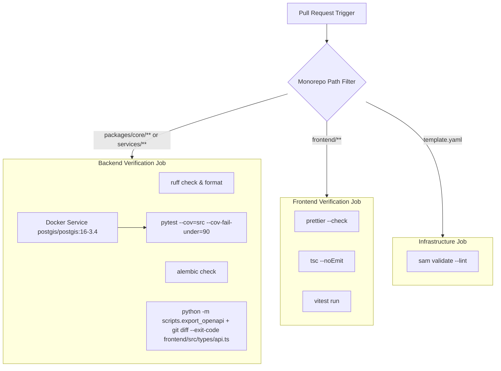

# GitHub Actions CI/CD Pipeline Contract: Phase 6

**Feature Identifier**: `006-trip-planner-aws-cicd`  
**Date**: 2026-10-20  
**CI/CD Engine**: GitHub Actions (`.github/workflows/ci.yml`, `.github/workflows/deploy.yml`)

---

## 1. Keyless AWS OIDC Trust Policy

```json
{
  "Version": "2012-10-17",
  "Statement": [
    {
      "Effect": "Allow",
      "Principal": {
        "Federated": "arn:aws:iam::123456789012:oidc-provider/token.actions.githubusercontent.com"
      },
      "Action": "sts:AssumeRoleWithWebIdentity",
      "Condition": {
        "StringLike": {
          "token.actions.githubusercontent.com:sub": "repo:timolker/vistarae:*"
        },
        "StringEquals": {
          "token.actions.githubusercontent.com:aud": "sts.amazonaws.com"
        }
      }
    }
  ]
}
```

---

## 2. CI Quality & Contract Enforcement Pipeline (`ci.yml`)



---

## 3. Production Deployment Pipeline (`deploy.yml`)

Triggered on: `push` to `main`

1. **OIDC Authentication**:
   - `aws-actions/configure-aws-credentials@v4` with `role-to-assume: arn:aws:iam::123456789012:role/GitHubActionsDeployerRole`, `aws-region: us-east-2`.
2. **Database Migration**:
   - Executes `alembic upgrade head` over direct Neon URL appending `?sslmode=require` (bypasses PgBouncer pooler).
3. **Serverless Infrastructure Build & Deploy**:
   - `sam build --use-container`
   - `sam deploy --no-confirm-changeset --no-fail-on-empty-changeset --stack-name vistarae-prod`
4. **Static Frontend S3 Sync & Caching Headers**:
   - `npm run build` in `frontend/`
   - Assets Sync (Fingerprinted):
     `aws s3 sync frontend/dist/assets/ s3://${SPA_BUCKET}/assets/ --cache-control "public, max-age=31536000, immutable"`
   - HTML Entrypoint Sync (No-Cache):
     `aws s3 cp frontend/dist/index.html s3://${SPA_BUCKET}/index.html --cache-control "public, max-age=0, must-revalidate"`
5. **Edge Cache Invalidation**:
   - `aws cloudfront create-invalidation --distribution-id ${DIST_ID} --paths "/index.html" "/"`
6. **Post-Deployment Health Probe**:
   - Single HTTP probe: `curl -f -s https://${DIST_DOMAIN}/api/health/ready`
   - Strictly single execution; zero continuous cron polling to permit Neon compute to scale to zero.
