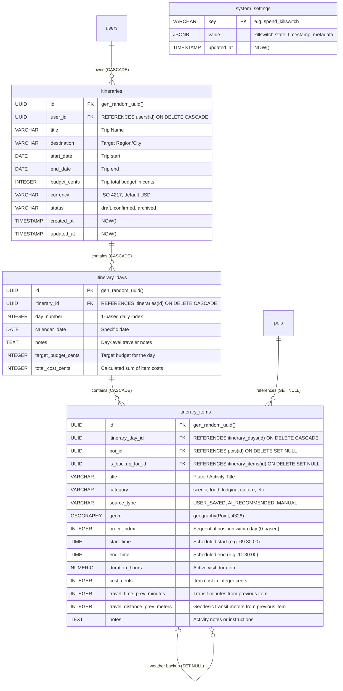
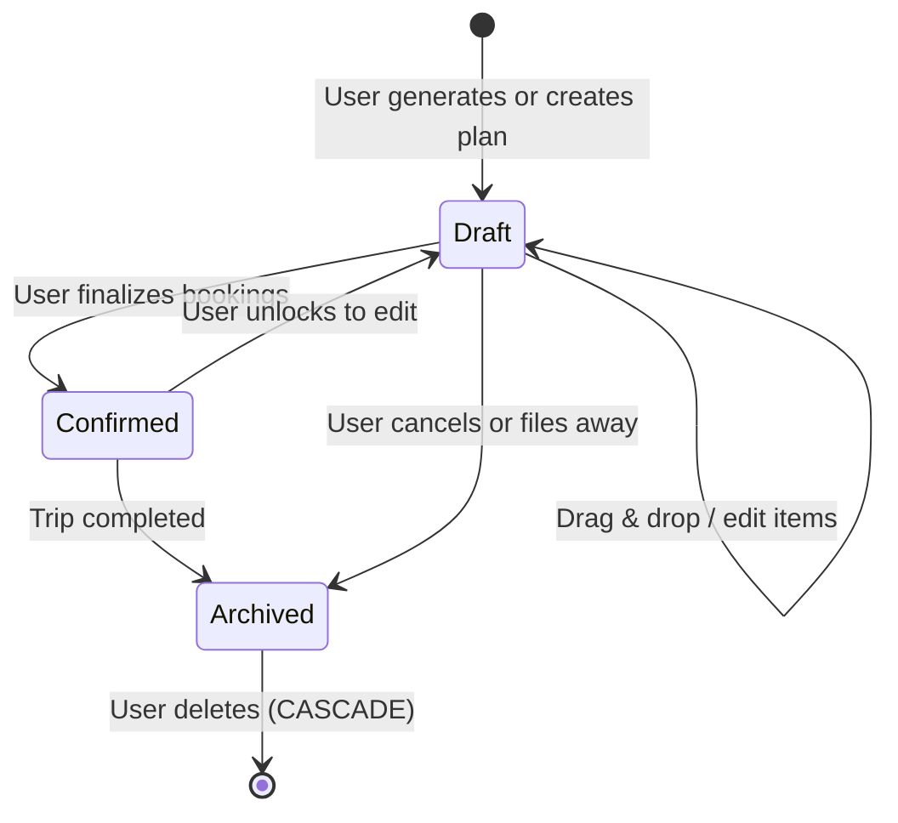
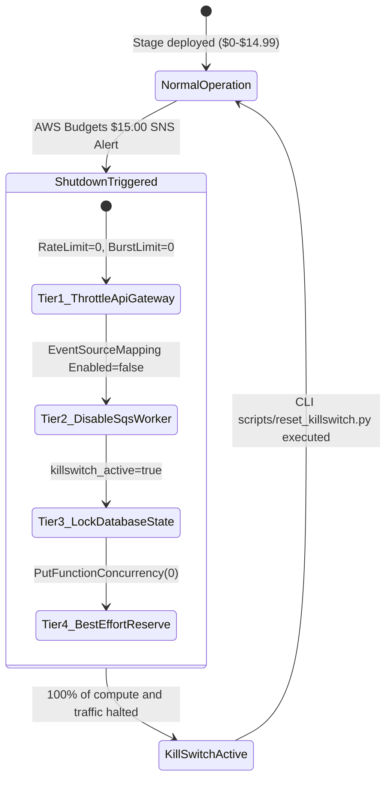

# Data Model & Storage Specifications: Phase 6 — AI Trip Planner, AWS SAM Serverless Infrastructure & GitHub Actions OIDC CI/CD

**Feature Identifier**: `006-trip-planner-aws-cicd`  
**Date**: 2026-10-20  
**Status**: Ratified  
**Database**: PostgreSQL 16+ with `postgis`, `pg_trgm`, `btree_gist`, and `vector` (Neon Serverless)

---

## 1. Database Relational Entities (Alembic Revision 0004)



---

## 2. Table Schemas & Constraints (SQL DDL)

```sql
-- Revision: 0004_trip_planner.py

-- 1. itineraries table
CREATE TABLE itineraries (
    id UUID PRIMARY KEY DEFAULT gen_random_uuid(),
    user_id UUID NOT NULL REFERENCES users(id) ON DELETE CASCADE,
    title VARCHAR(255) NOT NULL,
    destination VARCHAR(255) NOT NULL,
    start_date DATE NOT NULL,
    end_date DATE NOT NULL,
    budget_cents INTEGER NULL,
    currency VARCHAR(3) NOT NULL DEFAULT 'USD',
    status VARCHAR(32) NOT NULL DEFAULT 'draft',
    created_at TIMESTAMP WITH TIME ZONE NOT NULL DEFAULT NOW(),
    updated_at TIMESTAMP WITH TIME ZONE NOT NULL DEFAULT NOW(),
    CONSTRAINT ck_itineraries_dates CHECK (end_date >= start_date),
    CONSTRAINT ck_itineraries_budget CHECK (budget_cents IS NULL OR budget_cents >= 0),
    CONSTRAINT ck_itineraries_status CHECK (status IN ('draft', 'confirmed', 'archived'))
);

CREATE INDEX idx_itineraries_user_id ON itineraries (user_id);
CREATE INDEX idx_itineraries_user_status ON itineraries (user_id, status);

-- 2. itinerary_days table
CREATE TABLE itinerary_days (
    id UUID PRIMARY KEY DEFAULT gen_random_uuid(),
    itinerary_id UUID NOT NULL REFERENCES itineraries(id) ON DELETE CASCADE,
    day_number INTEGER NOT NULL,
    calendar_date DATE NOT NULL,
    notes TEXT NULL,
    target_budget_cents INTEGER NULL,
    total_cost_cents INTEGER NOT NULL DEFAULT 0,
    CONSTRAINT uq_itinerary_days_day_num UNIQUE (itinerary_id, day_number),
    CONSTRAINT ck_itinerary_days_positive CHECK (day_number > 0)
);

CREATE INDEX idx_itinerary_days_itinerary_id ON itinerary_days (itinerary_id);

-- 3. itinerary_items table
CREATE TABLE itinerary_items (
    id UUID PRIMARY KEY DEFAULT gen_random_uuid(),
    itinerary_day_id UUID NOT NULL REFERENCES itinerary_days(id) ON DELETE CASCADE,
    poi_id UUID NULL REFERENCES pois(id) ON DELETE SET NULL,
    is_backup_for_id UUID NULL REFERENCES itinerary_items(id) ON DELETE SET NULL,
    title VARCHAR(255) NOT NULL,
    category VARCHAR(64) NOT NULL DEFAULT 'attraction',
    source_type VARCHAR(32) NOT NULL DEFAULT 'USER_SAVED',
    geom geography(Point, 4326) NOT NULL,
    order_index INTEGER NOT NULL,
    start_time TIME WITHOUT TIME ZONE NULL,
    end_time TIME WITHOUT TIME ZONE NULL,
    duration_hours NUMERIC(4, 2) NOT NULL DEFAULT 1.00,
    cost_cents INTEGER NOT NULL DEFAULT 0,
    travel_time_prev_minutes INTEGER NULL,
    travel_distance_prev_meters INTEGER NULL,
    notes TEXT NULL,
    CONSTRAINT ck_itinerary_items_source CHECK (source_type IN ('USER_SAVED', 'AI_RECOMMENDED', 'MANUAL')),
    CONSTRAINT ck_itinerary_items_duration CHECK (duration_hours >= 0.25 AND duration_hours <= 12.00),
    CONSTRAINT ck_itinerary_items_cost CHECK (cost_cents >= 0)
);

CREATE INDEX idx_itinerary_items_day_order ON itinerary_items (itinerary_day_id, order_index);
CREATE INDEX idx_itinerary_items_poi_id ON itinerary_items (poi_id);
CREATE INDEX idx_itinerary_items_backup ON itinerary_items (is_backup_for_id);
CREATE INDEX idx_itinerary_items_geom ON itinerary_items USING gist (geom);

-- 4. system_settings table (for SpendKillSwitch & Platform Config)
CREATE TABLE system_settings (
    key VARCHAR(64) PRIMARY KEY,
    value JSONB NOT NULL DEFAULT '{}'::jsonb,
    updated_at TIMESTAMP WITH TIME ZONE NOT NULL DEFAULT NOW()
);

-- Seed spend_killswitch initial status
INSERT INTO system_settings (key, value)
VALUES ('spend_killswitch', '{"killswitch_active": false, "triggered_at": null, "reason": null}'::jsonb)
ON CONFLICT (key) DO NOTHING;
```

---

## 3. Pydantic Boundary Schemas (`vistarae_core.schemas.itinerary`)

```python
# Copyright (c) 2026 Tim Olker
# SPDX-License-Identifier: Apache-2.0

from __future__ import annotations

from datetime import date, time
from decimal import Decimal
from enum import StrEnum
from uuid import UUID

from pydantic import Field, field_validator
from vistarae_core.schemas.base import StrictBaseModel


class ItineraryStatus(StrEnum):
    DRAFT = "draft"
    CONFIRMED = "confirmed"
    ARCHIVED = "archived"


class ItineraryItemSource(StrEnum):
    USER_SAVED = "USER_SAVED"
    AI_RECOMMENDED = "AI_RECOMMENDED"
    MANUAL = "MANUAL"


class ItineraryItemBase(StrictBaseModel):
    title: str = Field(..., max_length=255)
    category: str = Field(default="attraction", max_length=64)
    source_type: ItineraryItemSource = Field(default=ItineraryItemSource.USER_SAVED)
    latitude: float = Field(..., ge=-90.0, le=90.0)
    longitude: float = Field(..., ge=-180.0, le=180.0)
    order_index: int = Field(..., ge=0)
    start_time: time | None = None
    end_time: time | None = None
    duration_hours: Decimal = Field(default=Decimal("1.00"), ge=Decimal("0.25"), le=Decimal("12.00"))
    cost_cents: int = Field(default=0, ge=0)
    travel_time_prev_minutes: int | None = Field(default=None, ge=0)
    travel_distance_prev_meters: int | None = Field(default=None, ge=0)
    notes: str | None = None
    poi_id: UUID | None = None
    is_backup_for_id: UUID | None = None


class ItineraryDayBase(StrictBaseModel):
    day_number: int = Field(..., ge=1)
    calendar_date: date
    notes: str | None = None
    target_budget_cents: int | None = Field(default=None, ge=0)
    items: list[ItineraryItemBase] = Field(default_factory=list)


class ItineraryGenerateRequest(StrictBaseModel):
    prompt: str = Field(..., min_length=3, max_length=1000)
    destination: str = Field(..., min_length=2, max_length=255)
    start_date: date
    end_date: date
    budget_cents: int | None = Field(default=None, ge=0)
    currency: str = Field(default="USD", min_length=3, max_length=3)

    @field_validator("end_date")
    @classmethod
    def validate_dates(cls, end_date: date, info) -> date:
        start_date = info.data.get("start_date")
        if start_date and end_date < start_date:
            raise ValueError("end_date must be on or after start_date")
        if start_date and (end_date - start_date).days > 30:
            raise ValueError("Trips cannot exceed 30 days in duration")
        return end_date


class ItineraryItemReorderItem(StrictBaseModel):
    item_id: UUID
    itinerary_day_id: UUID
    order_index: int = Field(..., ge=0)
    start_time: time | None = None
    end_time: time | None = None


class ItineraryItemReorderRequest(StrictBaseModel):
    items: list[ItineraryItemReorderItem]


class MissingMealAdvisory(StrictBaseModel):
    day_number: int
    meal_type: str  # "lunch" or "dinner"
    gap_start: time
    gap_end: time
    suggested_poi_id: UUID | None = None
    suggested_poi_title: str | None = None


class CircuitBreakerWarning(StrictBaseModel):
    day_number: int
    total_active_hours: Decimal
    threshold_hours: Decimal = Decimal("10.00")
    message: str


class ItineraryResponse(StrictBaseModel):
    id: UUID
    user_id: UUID
    title: str
    destination: str
    start_date: date
    end_date: date
    budget_cents: int | None
    currency: str
    status: ItineraryStatus
    total_estimated_cost_cents: int
    days: list[ItineraryDayResponse]
    advisories: list[MissingMealAdvisory] = Field(default_factory=list)
    circuit_breaker_warnings: list[CircuitBreakerWarning] = Field(default_factory=list)
```

---

## 4. State Transitions & Lifecycle

### 4.1 Itinerary Lifecycle State Machine



### 4.2 SpendKillSwitch Emergency State Machine


