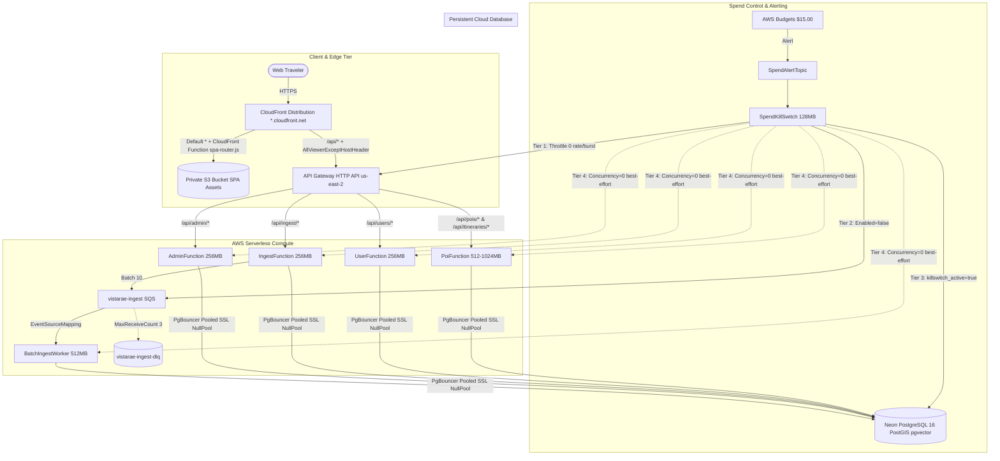

# Implementation Plan: Phase 6 — AI Trip Planner, AWS SAM Serverless Infrastructure & GitHub Actions OIDC CI/CD

**Branch**: `006-trip-planner-aws-cicd` | **Date**: 2026-10-20 | **Spec**: [specs/006-trip-planner-aws-cicd/spec.md](file:///d:/Coding/Vistarae/specs/006-trip-planner-aws-cicd/spec.md)  
**Input**: Feature specification from `specs/006-trip-planner-aws-cicd/spec.md`  
**Constitution**: [.specify/memory/constitution.md](file:///d:/Coding/Vistarae/.specify/memory/constitution.md)

---

## 1. Summary

Phase 6 (`006-trip-planner-aws-cicd`) transitions Vistarae into an intelligent travel planning platform backed by enterprise-grade serverless cloud infrastructure and automated keyless CI/CD:

1. **AI Trip Planner Mode & Itinerary Engine (`services/poi/` & `frontend/`)**:
   - **Hybrid PostGIS + pgvector RAG Querying**: Google Gemini `text-embedding-004` (768-dim embeddings) coupled with PostGIS spatial pre-filtering via `idx_pois_user_geom` (`WHERE user_id = :user_id AND ST_DWithin(geom, :corridor_geom, :radius_meters)`) and HNSW cosine ranking (`ORDER BY embedding <=> :query_vec LIMIT :k`).
   - **Interactive Itinerary Workbench**: Drag-and-drop schedule management (`@hello-pangea/dnd`) across daily hour-by-hour columns (08:00–22:00).
   - **Multi-Day POI Allocation & Circuit Breakers**: Distributes multi-day POIs (`recommended_visit_days > 1`) across sequential days while enforcing the 10.0-hour daily active exploration circuit breaker. Prompts traveler with actionable options if trip days are insufficient.
   - **Smart Calculations & Advisory Engine**: Transit duration/distance calculation, idle buffer tracking, line-item and daily integer-cent budgeting, missing meal detection (11:30–14:00 lunch, 17:30–20:30 dinner) with nearby restaurant suggestions, lodging anchors, and weather backup alternatives (`is_backup_for_id`).
   - **Map Synchronization & Offline Export**: Dual-mode macro trip and daily leg route maps, 1-click import of AI-suggested POIs into permanent POI storage with spatial deduplication, and vector `@media print` PDF export.

2. **AWS SAM Serverless Infrastructure in `us-east-2` (`template.yaml`)**:
   - **Private S3 & CloudFront OAC**: Private S3 bucket fronted by CloudFront Origin Access Control. Viewer Request CloudFront Function (`spa-router.js`) transparently rewrites extensionless SPA routes to `/index.html`.
   - **HTTP API Gateway (`/api/*`)**: Proxy cache behavior with `CachingDisabled` and `AllViewerExceptHostHeader`, delegating CORS to FastAPI.
   - **6 Domain Lambdas with Least-Privilege IAM & X-Ray**: `PoiFunction` (512–1024MB), `UserFunction` (256MB), `IngestFunction` (256MB), `AdminFunction` (256MB), `BatchIngestWorker` (512MB, 30s timeout, SQS `BatchSize: 10`, `MaximumConcurrency: 2`, `ReportBatchItemFailures: true`), and `SpendKillSwitch` (128MB). Custom `AWS::XRay::SamplingRule` (`ReservoirSize: 0`, `FixedRate: 0.01` / 1% sampling).
   - **SQS & CloudWatch Alarms (<10 Free Tier Limit)**: Ingest SQS (`VisibilityTimeout: 180s`, `ReceiveMessageWaitTimeSeconds: 20s`), DLQ (`maxReceiveCount: 3`, `MessageRetentionPeriod: 14 days`), 1 Error Metric Filter (`{ $.level = "ERROR" }`), and 1 DLQ visible message alarm publishing to SNS.
   - **Emergency Spend Kill Switch**: 4-tier cascading shutdown triggered at $15.00 AWS budget ceiling, handling account unreserved concurrency floor constraints without failure.

3. **GitHub Actions Keyless OIDC CI/CD Pipeline (`.github/workflows/`)**:
   - **Keyless AWS OIDC**: Assumes `GitHubActionsDeployerRole` (`repo:timolker/vistarae:*`) without hardcoded access keys.
   - **Monorepo Path Filtering**: Targeted execution for `packages/core/`, `services/`, `frontend/`, and `db/migrations/`.
   - **Quality & Contract Gates**: Docker PostGIS container (`postgis/postgis:16-3.4`), `pytest --cov=src --cov-fail-under=90`, `alembic check`, OpenAPI TypeScript drift check (`git diff --exit-code ./frontend/src/types/api.ts`), and `sam validate --lint`.
   - **Automated Deployment**: Direct Neon PostgreSQL SSL migration (`?sslmode=require`), S3 sync with `immutable` asset caching and `no-cache` for `index.html`, CloudFront invalidation (`/index.html`, `/`), and a single non-polling verification probe to `/health/ready` preserving Neon scale-to-zero.

---

## 2. Technical Context

- **Languages & Runtimes**: Python 3.12 (AWS Lambda `arm64`, FastAPI, SQLAlchemy 2.0 Pure Async), TypeScript 5.4+ / React 18+ (Vite SPA)
- **Primary Dependencies**:
  - Backend: `fastapi`, `uvicorn`, `mangum`, `sqlalchemy`, `asyncpg`, `geoalchemy2`, `google-genai` (Gemini SDK), `boto3`, `pydantic-v2`
  - Frontend: `react`, `react-router-dom`, `@hello-pangea/dnd`, `lucide-react`, `leaflet` / `react-leaflet` or Mapbox GL
  - Infrastructure: AWS SAM CLI, AWS CloudFormation, AWS CloudFront Functions, Amazon SQS, AWS X-Ray SDK
- **Storage & Geospatial**:
  - PostgreSQL 16+ on Neon Serverless with `postgis`, `pg_trgm`, `btree_gist`, and `vector` (pgvector 768-dim)
  - Connection mode: `NullPool` targeting Neon pooled endpoint (`-pooler`) with `statement_cache_size=0`
  - Migrations: Direct Neon connection with `?sslmode=require`
- **Testing**:
  - Unit/Integration: `pytest` with `pytest-asyncio`, `pytest-cov` enforcing minimum 90% branch and line coverage
  - Contract: `alembic check` and OpenAPI drift verification (`git diff --exit-code ./frontend/src/types/api.ts`)
  - Local Containers: `postgis/postgis:16-3.4` and `softwaremill/elasticmq-native:latest`
- **Performance Goals**:
  - Itinerary Generation Latency: $< 4.0$ seconds for 5-day itinerary
  - Drag-and-drop Reorder Latency: $< 150$ milliseconds (optimistic UI update)
  - CloudFront Function execution time: $< 1.0$ millisecond
  - Post-deploy health probe response: $< 500$ milliseconds
- **Constraints**:
  - Zero recurring AWS cost (strictly within AWS Free Tier limits, <10 CloudWatch alarms)
  - Zero continuous monitoring pings in production (allows Neon compute to scale to zero)
  - Infallible spend killswitch ($15.00 ceiling) with unreserved concurrency floor fallback
  - Strict EARS requirement traceability and Apache-2.0 copyright headers on all source files

---

## 3. Constitution Check

*GATE: Verified prior to research and re-evaluated post-design against `.specify/memory/constitution.md`.*

| Constitutional Invariant | Status | Compliance Detail |
| :--- | :---: | :--- |
| **1. File Header & Pre-Commit** | **PASS** | Every `.py` file starts with `# Copyright (c) 2026 Tim Olker...` and `.ts`/`.tsx` with `// Copyright (c) 2026 Tim Olker...`. Cognitive complexity $\le 15$, max nesting $\le 3$. |
| **2. Monorepo & Ports/Adapters** | **PASS** | Shared itinerary schemas, domain protocols, and exceptions reside in `packages/core/vistarae_core`. Domain services expose ASGI `app` and `Mangum(app, lifespan="off")` handlers. |
| **3. Database, PgBouncer & Tenancy** | **PASS** | SQLAlchemy 2.0 Pure Async. In cloud/Lambda, uses `NullPool` with `statement_cache_size: 0`. Every query enforces `WHERE user_id = :current_user_id`. No PostgreSQL RLS used over pooled connections. |
| **4. Alembic & Environment Isolation** | **PASS** | Revision `0004_trip_planner.py` placed in `db/migrations/versions/` with fully reversible `downgrade()`. Status fields use `StrEnum` backed by `VARCHAR(32)`. `alembic check` runs in CI. |
| **5. API Contract & Validation** | **PASS** | Generated OpenAPI 3.1 contract (`contracts/itinerary-api.yaml`). Boundary models use Pydantic `StrictBaseModel` with `extra="forbid"`. Non-2XX responses emit RFC 7807 `ProblemDetails`. Contract drift gate runs in CI. |
| **6. Middleware Order & Security** | **PASS** | Starlette LIFO middleware stack (RateLimitMiddleware outermost, IdempotencyMiddleware inner). CORS whitelisting on origin. CloudFront forwards `Origin` while rewriting `Host` for SNI. |
| **7. Observability, OpenTelemetry & X-Ray** | **PASS** | AWS X-Ray Active Tracing across all 6 Lambdas with custom `AWS::XRay::SamplingRule` (`ReservoirSize: 0, FixedRate: 0.01` / 1% sampling). Traceparent propagation in HTTP and SQS. |
| **8. PyTest & SDD Governance** | **PASS** | Automated test suite mirrors source tree 1:1, enforcing minimum 90% branch and line coverage (`--cov-fail-under=90`). Implementation derived strictly from ratified `spec.md`. |
| **Operational 1: SQS Queue Discipline** | **PASS** | Ingest SQS `VisibilityTimeout: 180s`, `ReceiveMessageWaitTimeSeconds: 20s`, DLQ `maxReceiveCount: 3`, `ReportBatchItemFailures: true`. |
| **Operational 2: Geospatial Storage** | **PASS** | Itinerary item coordinates stored canonically in `geography(Point, 4326)` for geodesic distances. Viewport queries use GiST bounding boxes. |
| **Operational 3: Zero-Cost & Free-Tier** | **PASS** | Static SPA in private S3 with CloudFront OAC. CloudWatch alarms strictly capped at 2 core alarms (<10 free tier limit). Zero continuous health pings. SpendKillSwitch at $15.00. |

---

## 4. Project Structure & Source Code Layout

### 4.1 Specification & Design Documentation
```text
specs/006-trip-planner-aws-cicd/
├── spec.md                     # Feature requirements & ratified EARS specifications
├── plan.md                     # This implementation plan
├── research.md                 # Phase 0 research findings & architectural decisions
├── data-model.md               # PostgreSQL schemas, Pydantic models & state machines
├── quickstart.md               # End-to-end verification & automated testing guide
├── checklists/
│   └── requirements.md         # Specification quality checklist
└── contracts/
    ├── itinerary-api.yaml      # OpenAPI 3.1 specification for Trip Planner endpoints
    ├── sam-contract.md         # SAM template, IAM policies & CloudFront routing contract
    └── cicd-contract.md        # GitHub Actions OIDC pipeline & deployment contract
```

### 4.2 Source Code Additions & Modifications
```text
# Monorepo Workspace
packages/core/vistarae_core/
├── domain/
│   └── itinerary.py            # Itinerary domain entities & value objects
├── ports/
│   └── itinerary_repo.py       # Itinerary repository interface (typing.Protocol)
├── schemas/
│   └── itinerary.py            # Pydantic v2 StrictBaseModel boundary schemas
└── adapters/
    └── repositories/
        └── itinerary_repo.py   # SQLAlchemy 2.0 Async PostgreSQL + PostGIS repository

services/poi/
├── routes/
│   └── itineraries.py          # /api/itineraries/* endpoints (CRUD, generate, reorder)
├── services/
│   └── planner.py              # Gemini RAG synthesis, circuit breakers, meal advisory
└── main.py                     # Mount itineraries router & export Mangum handler

services/admin/
└── handlers/
    └── killswitch.py           # SpendKillSwitch Lambda handler (4-tier fallback shutdown)

db/migrations/versions/
└── 0004_trip_planner.py        # Alembic migration for itineraries, days, items, system_settings

scripts/
└── reset_killswitch.py         # Administrative CLI tool to restore stage & reset killswitch

template.yaml                   # AWS SAM template in us-east-2 (S3 OAC, CloudFront, 6 Lambdas, SQS)
cloudfront/
└── spa-router.js               # Viewer Request CloudFront Function for extensionless routing

frontend/src/
├── components/planner/
│   ├── ItineraryBoard.tsx      # Multi-column drag-and-drop daily workbench (@hello-pangea/dnd)
│   ├── ItineraryDayColumn.tsx  # Daily hour-by-hour timeline (08:00–22:00)
│   ├── ItineraryItemCard.tsx   # Activity card with duration, cost, transit metrics
│   ├── MissingMealCard.tsx     # Meal advisory badge with nearby restaurant suggestions
│   ├── DayShortageModal.tsx    # Modal prompt when multi-day POI exceeds available days
│   ├── RouteMap.tsx            # Synchronized macro and daily leg map visualization
│   └── PrintExportView.tsx     # Print-optimized layout with @media print rules
├── pages/
│   ├── PlannerPage.tsx         # Main trip planning & itinerary workspace page
│   └── ItineraryDetailPage.tsx # Deep-linkable itinerary view & editor
└── services/
    └── itineraryService.ts     # Frontend API client for /api/itineraries/*

.github/workflows/
├── ci.yml                      # PR verification (PostGIS, pytest >=90%, alembic check, OpenAPI drift)
└── deploy.yml                  # Push to main (OIDC deploy, Neon migrate, S3 sync, CF invalidation)
```

---

## 5. Architectural Topology



---

## 6. Implementation Phases & Workstreams

### Phase 1: Database Schema & Core Domain (Days 1–2)
- [ ] Create Alembic migration `db/migrations/versions/0004_trip_planner.py` defining `itineraries`, `itinerary_days`, `itinerary_items`, and `system_settings`.
- [ ] Implement fully reversible `downgrade()` in `0004_trip_planner.py`.
- [ ] Implement domain models, StrEnums, and Pydantic v2 boundary schemas in `packages/core/vistarae_core/schemas/itinerary.py`.
- [ ] Implement async repository interface `ItineraryRepository` in `packages/core/vistarae_core/adapters/repositories/itinerary_repo.py`.
- [ ] Write unit tests for repository methods and migrations with Docker PostGIS in `tests/unit/db/test_0004_migration.py`.

### Phase 2: AI Itinerary Engine & Backend Services (Days 2–3)
- [ ] Implement hybrid PostGIS + pgvector query in `ItineraryRepository`: `ST_DWithin` spatial pre-filtering followed by cosine distance ranking `<=>`.
- [ ] Implement Gemini RAG synthesis service (`services/poi/services/planner.py`) with `thinking_budget: 0`.
- [ ] Implement circuit breaker calculation (max 10.0 active hours/day).
- [ ] Implement multi-day POI distribution logic and shortage detection.
- [ ] Implement missing meal detection (11:30–14:00 lunch, 17:30–20:30 dinner) and nearby restaurant lookup.
- [ ] Mount `/api/itineraries` routes in `services/poi/routes/itineraries.py`.
- [ ] Write unit & integration tests in `tests/unit/services/poi/test_itineraries.py` enforcing $\ge 90\%$ coverage.

### Phase 3: Interactive Itinerary Workbench Frontend (Days 3–4)
- [ ] Install and configure `@hello-pangea/dnd` in `frontend/`.
- [ ] Create `ItineraryBoard`, `ItineraryDayColumn`, and `ItineraryItemCard` components.
- [ ] Implement optimistic drag-and-drop item movement within and across days.
- [ ] Implement day shortage modal prompt (`DayShortageModal`) when multi-day attractions exceed available days.
- [ ] Implement transit duration and geodesic distance badges between consecutive waypoints.
- [ ] Implement dual-map route visualization (macro trip bounds and daily leg lines).
- [ ] Implement 1-click "Import to My POIs" for AI-recommended items.
- [ ] Implement print stylesheet (`@media print`) and PDF export preview (`PrintExportView`).
- [ ] Write frontend unit and component tests with Vitest in `frontend/tests/components/ItineraryPlanner.test.tsx`.

### Phase 4: AWS SAM Serverless Infrastructure & KillSwitch (Days 4–5)
- [ ] Write `template.yaml` in `us-east-2`:
  - Private S3 SPA bucket with CloudFront OAC.
  - Viewer Request CloudFront Function `spa-router.js`.
  - API Gateway HTTP API `$default` stage proxying `/api/*` with `CachingDisabled` and `AllViewerExceptHostHeader`.
  - 6 domain Lambdas (`PoiFunction`, `UserFunction`, `IngestFunction`, `AdminFunction`, `BatchIngestWorker`, `SpendKillSwitch`) with X-Ray active tracing (1% sampling rule).
  - SQS Ingest queue and DLQ with redrive policy.
  - CloudWatch Metric Filter (`{ $.level = "ERROR" }`) and DLQ visible messages alarm.
- [ ] Implement `SpendKillSwitch` Lambda handler (`services/admin/handlers/killswitch.py`) with 4-tier fallback.
- [ ] Implement administrative restoration CLI (`scripts/reset_killswitch.py`).
- [ ] Validate SAM template via `sam validate --lint`.

### Phase 5: GitHub Actions Keyless OIDC CI/CD (Day 5)
- [ ] Configure keyless AWS OIDC trust policy for `GitHubActionsDeployerRole`.
- [ ] Create `.github/workflows/ci.yml`:
  - Monorepo path filtering.
  - Docker PostGIS service container.
  - `ruff check`, `pytest --cov=src --cov-fail-under=90`.
  - `alembic check`.
  - OpenAPI TypeScript drift check (`git diff --exit-code ./frontend/src/types/api.ts`).
  - `sam validate --lint`.
- [ ] Create `.github/workflows/deploy.yml`:
  - Direct Neon SSL migration (`alembic upgrade head`).
  - Frontend build and S3 sync (`immutable` for assets, `no-cache` for `index.html`).
  - CloudFront cache invalidation (`/index.html`, `/`).
  - Single non-polling `/health/ready` check.
- [ ] Perform end-to-end dry run verification.
