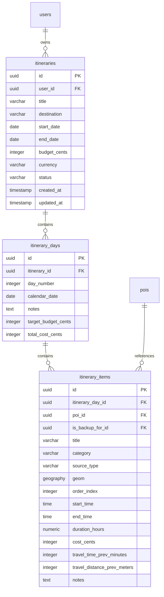
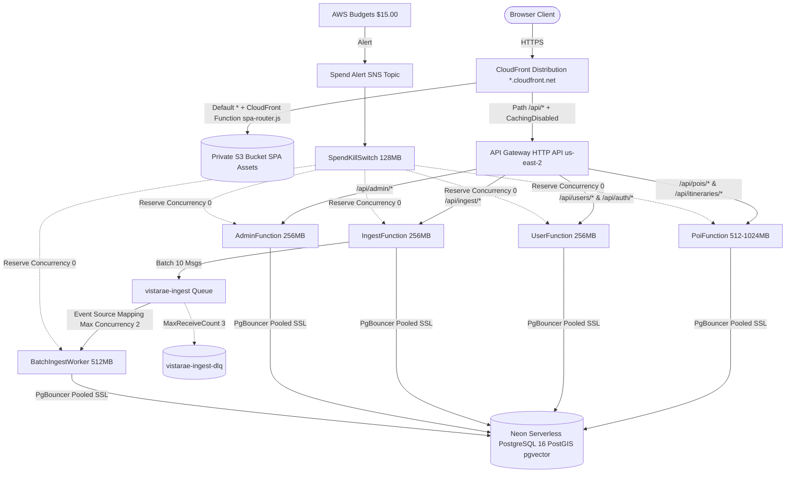

# Feature Specification: Phase 6 — AI Trip Planner, AWS SAM Serverless Infrastructure & GitHub Actions OIDC CI/CD

**Feature Identifier**: `006-trip-planner-aws-cicd`  
**Feature Branch**: `006-trip-planner-aws-cicd`  
**Created**: 2026-10-20  
**Status**: Draft  
**Target Systems**:
- AI Trip Planner & Itinerary Engine: `services/poi` (new routes `/api/itineraries/*`), Google Gemini (`text-embedding-004`, Flash-Lite / 1.5 Flash), PostGIS + pgvector RAG query engine, Day-by-Day/Hour-by-Hour drag-and-drop UI (`@hello-pangea/dnd`), Mapbox/Leaflet macro and daily route visualization, Client-side/CSS Print PDF generation engine
- AWS SAM Infrastructure: `template.yaml` in `us-east-2`, private S3 SPA bucket + CloudFront OAC + CloudFront Function SPA routing (`spa-router.js`), HTTP API Gateway (`{api-id}.execute-api.us-east-2.amazonaws.com`), 6 Lambdas (`PoiFunction`, `UserFunction`, `IngestFunction`, `AdminFunction`, `BatchIngestWorker`, `SpendKillSwitch`), X-Ray Active Tracing with 1% custom sampling rule, SQS + DLQ + CloudWatch alarms (<10 free tier limit)
- GitHub Actions CI/CD: `.github/workflows/ci.yml`, `.github/workflows/deploy.yml`, Keyless OIDC (`GitHubActionsDeployerRole`, `repo:timolker/vistarae:*`), path filtering, Docker PostGIS container (`postgis/postgis:16-3.4`), `pytest --cov=src --cov-fail-under=90`, `alembic check`, OpenAPI TypeScript drift gate (`git diff --exit-code ./frontend/src/types/api.ts`), `sam local start-api` / `sam validate`, direct Neon SSL migration (`?sslmode=require`), S3 sync with cache control, CloudFront invalidation, post-deploy single `/health/ready` check.

**Input**: User description: "/speckit.specify Create the specification for Phase 6 (006-trip-planner-aws-cicd) using strict EARS syntax (REQ-PLAN-xxx, REQ-SAM-xxx, REQ-CICD-xxx). Scope to cover: 1. AI Trip Planner Mode: Hybrid PostGIS + pgvector RAG Query (Pre-filter by tenant and spatial proximity using idx_pois_user_geom then order by cosine distance), Day-by-Day / Hour-by-Hour Itinerary UI & Engine (drag-and-drop, multi-day POI distribution across recommended_visit_days, over-planning circuit breakers, travel/activity/idle time and cost budgeting, missing meal alerts, hotel/weather backups, AI POI import into manager, macro/daily route maps, PDF export). 2. AWS SAM Infrastructure (template.yaml in us-east-2): Private S3 SPA bucket fronted by CloudFront OAC, extensionless SPA rewriting function, /api/* HTTP API behavior, 6 domain lambdas with least-privilege IAM and X-Ray 1% sampling, SQS & DLQ, CloudWatch error metric and DLQ alarms (<10 free tier limit), SpendKillSwitch at $15.00 budget. 3. GitHub Actions OIDC CI/CD (.github/workflows/): Keyless OIDC, path-filtered jobs, Docker PostGIS for pytest cov>=90%, alembic check, OpenAPI TS drift gate, sam validate/local start-api, direct Neon URL for alembic upgrade head, S3 sync with immutable/no-cache headers, CloudFront invalidation, single post-deploy health check."

---

## 1. Executive Summary & Architecture Context

Phase 6 (`006-trip-planner-aws-cicd`) transitions Vistarae from an exploratory point-of-interest capture tool into an end-to-end intelligent travel planning engine, backed by production-grade, zero-cost serverless AWS infrastructure and automated CI/CD:

1. **AI Trip Planner Mode & Itinerary Engine (`services/poi/` & `frontend/`)**:
   - **Hybrid PostGIS + pgvector RAG Query Pipeline**: Leverages Google Gemini `text-embedding-004` (768-dimensional embeddings) to power contextual semantic discovery. Queries apply strict tenant isolation and spatial bounding in PostgreSQL/PostGIS using the existing composite GiST index `idx_pois_user_geom` (`WHERE user_id = :user_id AND ST_DWithin(geom, :route_geom, :radius_meters)`), then rank candidates via HNSW cosine distance (`ORDER BY embedding <=> :query_vec LIMIT :k`).
   - **Day-by-Day / Hour-by-Hour Interactive Itinerary Planner**: An interactive drag-and-drop itinerary board where travelers organize activities across daily timelines. The planner intelligently distributes multi-day attractions (`recommended_visit_days > 1`) across sequential days without triggering daily over-planning circuit breakers (limiting active daily exploration to 8–10 hours).
   - **Smart Calculations & Advisory Engine**: Automatically computes transit times and distances between consecutive waypoints, tracks active exploration vs. idle buffers, aggregates line-item and daily expenses against user-defined trip budgets, detects meal intervals (11:30–14:00 lunch, 17:30–20:30 dinner) to flag missing meals with nearby restaurant recommendations or pack-lunch advisories, and suggests day-boundary lodging and indoor weather contingency backups.
   - **Cartographic Visualization, POI Import & PDF Export**: Provides synchronized dual-map visualization (a macro trip polyline overview and zoomed daily route legs), 1-click importing of AI-recommended POIs into the traveler's permanent POI collection (with spatial deduplication check), and clean vector-ready PDF export via print stylesheets.

2. **AWS SAM Serverless Infrastructure (`template.yaml` in `us-east-2`)**:
   - **Private Static S3 SPA Bucket & CloudFront OAC**: Private S3 hosting protected by Origin Access Control (OAC), restricting access exclusively to CloudFront. A lightweight Viewer Request CloudFront Function (`spa-router.js`) transparently rewrites extensionless single-page app routes (e.g. `/trips`, `/settings`) to `/index.html` while preserving direct S3 fetches for fingerprinted assets (`/assets/*`).
   - **API Gateway HTTP API (`/api/*`)**: High-throughput, low-cost HTTP API (`$default` stage) fronted by CloudFront's `/api/*` cache behavior with `CachingDisabled` and `AllViewerExceptHostHeader`, routing directly to domain Lambdas.
   - **6 Domain Lambdas with Least-Privilege IAM & Distributed Tracing**:
     - `PoiFunction` (512–1024MB): Manages POIs, spatial clustering, and the AI Trip Planner engine.
     - `UserFunction` (256MB): Handles authentication verification, user profiles, and preferences.
     - `IngestFunction` (256MB): Manages CSV upload validation, triage, and SQS chunk dispatch.
     - `AdminFunction` (256MB): Exposes admin metrics and tenant quota monitoring.
     - `BatchIngestWorker` (512MB, 30s timeout): Consumes SQS batches (`BatchSize: 10`, `MaximumConcurrency: 2`, `ReportBatchItemFailures: true`) for geocoding and deduplication.
     - `SpendKillSwitch` (128MB): Operational Lambda triggered by AWS Budgets SNS alert at the $15.00 ceiling, setting `ReservedConcurrentExecutions: 0` across domain Lambdas, throttling HTTP API stages, and setting an emergency flag in Neon DB.
     - AWS X-Ray Active Tracing across all Lambdas with a custom `AWS::XRay::SamplingRule` (`ReservoirSize: 0`, `FixedRate: 0.01` / 1% sampling) guaranteeing free-tier compliance.
   - **SQS & Resilient Dead-Letter Queue (DLQ)**: Primary queue `vistarae-ingest-*` (`VisibilityTimeout: 180s`, `ReceiveMessageWaitTimeSeconds: 20s`), paired with DLQ `vistarae-ingest-dlq-*` (`maxReceiveCount: 3`, `MessageRetentionPeriod: 14 days`).
   - **Zero-Cost CloudWatch Alerting (<10 Free-Tier Alarms)**: Exactly 2 core alarms: 1 Log Metric Filter capturing JSON log errors (`{ $.level = "ERROR" }`) triggering an error alarm, and 1 DLQ visible message alarm (`ApproximateNumberOfMessagesVisible >= 1`), notifying developers via SNS.

3. **GitHub Actions Keyless OIDC CI/CD Pipeline (`.github/workflows/`)**:
   - **Keyless AWS OIDC Authentication**: Eliminates static long-lived credentials by using GitHub OIDC to assume `GitHubActionsDeployerRole` scoped strictly to `repo:timolker/vistarae:*`.
   - **Monorepo Path Filtering**: Executes jobs selectively based on modified file paths across `frontend/`, `services/`, `packages/core/`, and `specs/`.
   - **Quality, Security & Contract Gates**: Runs `ruff` linting and formatting, `pytest` unit/integration tests with a Docker PostGIS container service (`postgis/postgis:16-3.4`) enforcing `--cov=src --cov-fail-under=90`, `alembic check` for ORM-migration parity, and the OpenAPI TypeScript contract drift gate (`git diff --exit-code ./frontend/src/types/api.ts`).
   - **Automated Cloud Deployment**: Validates SAM templates (`sam validate`), executes database migrations directly against the primary Neon SSL connection (`?sslmode=require`), synchronizes frontend static assets (`immutable` caching for assets, `max-age=0, must-revalidate` for `index.html`), triggers CloudFront cache invalidation (`/index.html`, `/`), and performs a single non-polling verification probe to `/health/ready`.

---

## 2. Clarifications & Key Design Decisions

### Session 2026-10-20
- **Q1: How should multi-day POIs (`recommended_visit_days > 1`) be handled when added to an itinerary?**
  - **A: Interactive User Prompt on Day Shortage (User Ratified)**: If an attraction specifies `recommended_visit_days = N` (e.g. 2 or 3 days) and the itinerary contains at least `N` available days, the engine divides the visit into `N` consecutive daily segments (e.g. "Day 1: Lower Loop", "Day 2: Upper Loop"), each allocating a balanced portion of recommended exploration hours without tripping the 8–10 hour daily over-planning circuit breaker. If the remaining available days in the itinerary are fewer than `recommended_visit_days`, the system rejects silent truncation and prompts the traveler with an actionable modal dialog: "Not enough days available for full visit (requires N days). Please extend the trip duration or remove scheduled events to make room."
- **Q2: How is the itinerary exported to PDF?**
  - **A: High-Fidelity Client-Side Print Engine (Option A)**: Uses a dedicated `@media print` stylesheet paired with browser print-to-PDF / `window.print()` and optional vector HTML canvas export, avoiding heavy server-side Chromium/Puppeteer Lambda dependencies that would exceed the AWS free tier and Lambda deployment limits.
- **Q3: How does CloudFront handle client-side Single-Page Application (SPA) routing without 404 errors?**
  - **A: Viewer Request CloudFront Function (`spa-router.js`) (Option A)**: A lightweight, sub-millisecond CloudFront Function inspects incoming URIs. If the request lacks a file extension and does not begin with `/api/`, it rewrites the request URI internally to `/index.html` before querying the private S3 OAC origin. Static assets (`/assets/*`, `.js`, `.css`, images) pass through unmodified.
- **Q4: How should SpendKillSwitch enforce spend cutoff if setting Lambda ReservedConcurrentExecutions: 0 fails due to account-level concurrency floor constraints?**
  - **A: Cascading Multi-Layer Shutdown (Option A - User Ratified)**: When AWS Budgets sends an alert at the $15.00 ceiling to the SNS topic, `SpendKillSwitch` executes a cascading multi-tier shutdown:
    1. **Primary Edge Cutoff**: Immediately update the API Gateway HTTP API `$default` stage throttle to `RateLimit: 0` and `BurstLimit: 0`, dropping 100% of incoming edge HTTP requests before they invoke any backend compute.
    2. **Secondary Database & Middleware State Lock**: Set `killswitch_active = true` and `killswitch_timestamp = NOW()` in the Neon database `system_settings` table. FastAPI `RateLimitMiddleware` / application middleware checks this flag (or cached state) and immediately returns RFC 7807 503 Service Unavailable, while SQS `BatchIngestWorker` aborts batch consumption loops.
    3. **Tertiary Best-Effort Concurrency Reserve**: Attempt to set `ReservedConcurrentExecutions: 0` across domain Lambdas (`PoiFunction`, `UserFunction`, `IngestFunction`, `AdminFunction`, `BatchIngestWorker`), safely catching and logging any AWS `ValidationException` (e.g. account unreserved concurrency floor of 100/10) without aborting the shutdown process. An administrative CLI tool (`scripts/reset_killswitch.py`) is provided to restore stage throttling and reset the database flag once billing review is complete.
- **Q5: How should CloudFront route requests to the API Gateway HTTP API origin without failing TLS SNI host validation or breaking CORS?**
  - **A: Managed Origin Request Policy `AllViewerExceptHostHeader` (Option A - User Ratified)**: API Gateway HTTP API default endpoints (`{api-id}.execute-api.us-east-2.amazonaws.com`) strictly require the HTTP `Host` header to match the execute-api domain name for TLS Server Name Indication (SNI) and internal routing. CloudFront's `/api/*` cache behavior attaches the AWS Managed Origin Request Policy `AllViewerExceptHostHeader` (`b689b0a8-53d0-40ab-baf2-68738e2966ac`). This automatically replaces the viewer `Host` header (`*.cloudfront.net`) with the API Gateway origin domain, preventing `403 Forbidden` errors while forwarding `Origin`, `Authorization`, `Idempotency-Key`, `traceparent`, and all `X-Forwarded-*` headers, allowing FastAPI `CORSMiddleware` and `TelemetryMiddleware` to validate allowed origins and trace context seamlessly.
- **Q6: How does the CI/CD pipeline ensure that Neon compute is allowed to scale to zero?**
  - **A: Single Post-Deploy Health Probe (Option A)**: CI/CD issues exactly one HTTP `GET /health/ready` check following CloudFront invalidation to verify deployment health. The pipeline strictly forbids synthetic uptime monitors, automated cron polling, or recurring curl checks against production endpoints.

---

## 3. User Scenarios & Testing *(mandatory)*

### User Story 1 - Natural Language Travel Prompt to Hybrid RAG Itinerary (Priority: P1)

A traveler plans a 4-day road trip to the Pacific Northwest. In the Vistarae Trip Planner UI, they enter their destination ("Olympic National Park & Seattle"), dates, trip budget ($1,200), and a prompt describing their travel style ("Scenic coastal hikes, local seafood, and relaxed afternoons"). The frontend dispatches `POST /api/itineraries/generate`. The backend uses Gemini `text-embedding-004` to generate a 768-dimensional embedding, pre-filters the user's saved POIs in PostGIS using `idx_pois_user_geom` within the trip's geographic corridor (`ST_DWithin`), and performs an HNSW cosine ranking (`ORDER BY embedding <=> :query_vec`). The LLM synthesizes these POIs into a cohesive day-by-day itinerary draft, populating activities, estimated transit times, and realistic time slots.

**Why this priority**: Core value proposition of Phase 6: connecting the user's previously captured POIs into a structured, executable travel itinerary via AI.

**Independent Test**: Can be tested by seeding a test user with 10 POIs in a specific region, submitting a travel prompt, and asserting that the endpoint returns an itinerary where the top ranked POIs are allocated across days with valid coordinates and time blocks.

**Acceptance Scenarios**:

1. **Given** an authenticated user with saved POIs in Washington State, **When** they submit a trip request with destination "Seattle & Olympic" and dates across 4 days, **Then** the backend executes hybrid spatial pre-filtering (`ST_DWithin`) followed by vector cosine ranking, returning an itinerary matching their preferences.
2. **Given** a travel prompt requesting specific activity types (e.g. "seafood and light walks"), **When** POIs are selected by the RAG engine, **Then** POIs with higher semantic cosine similarity to the prompt are prioritized in the schedule.
3. **Given** a user with no saved POIs in the target destination, **When** they generate an itinerary, **Then** the engine retrieves AI-recommended POIs marked with `source_type: "AI_RECOMMENDED"`, allowing the user to review them before saving.
4. **Given** an invalid date range (e.g. end date before start date or exceeding 30 days), **When** submitted, **Then** the API returns an RFC 7807 422 Unprocessable Entity error detailing the invalid parameters.

---

### User Story 2 - Day-by-Day & Hour-by-Hour Drag-and-Drop Itinerary Workbench (Priority: P1)

A traveler reviews their generated 4-day itinerary on a responsive drag-and-drop planning board. Each day is represented as a column with an hour-by-hour timeline (08:00 to 22:00). The traveler drags a museum POI from Day 1 afternoon to Day 2 morning. The workbench instantly recalculates the transit duration, walking/driving distance, and idle time between adjacent items. If the user schedules a multi-day attraction (e.g., a national park with `recommended_visit_days: 2`), the engine splits the visit across two consecutive days without tripping the 10-hour daily exploration limit. If total active hours exceed 10 hours on any day, an over-planning circuit breaker banner highlights the day with a warning. If available days are insufficient, the UI prompts the traveler to extend the trip or delete existing activities to free days.

**Why this priority**: Travelers need intuitive, flexible manual control to fine-tune AI-generated schedules to their personal pace.

**Independent Test**: Can be tested by mounting the Itinerary Workbench component, moving an itinerary item from Day 1 to Day 2 via drag-and-drop, and asserting that transit times, day durations, and order indices update immediately.

**Acceptance Scenarios**:

1. **Given** an itinerary with multiple days, **When** the traveler drags an item from Day 1 at 14:00 to Day 2 at 10:00, **Then** the UI updates item positions, persists changes to `PUT /api/itineraries/{id}/items/reorder`, and recalculates driving/walking transit times from the preceding POI.
2. **Given** an attraction with `recommended_visit_days = 2`, **When** added to an itinerary with 2 or more available days, **Then** the engine distributes the attraction across 2 days as linked activity blocks.
3. **Given** an attraction with `recommended_visit_days > remaining_available_days`, **When** added to the itinerary, **Then** the system prompts the traveler that insufficient days are available and prompts them to either extend the trip duration or remove existing activities to make room.
4. **Given** a daily schedule exceeding 10 hours of active exploration, **When** rendered on the board, **Then** the over-planning circuit breaker activates, displaying an amber warning banner advising the user to redistribute activities.
5. **Given** an empty schedule slot between 11:30 and 14:00 (lunch) or 17:30 and 20:30 (dinner), **When** evaluated by the meal advisory engine, **Then** the UI displays a "Missing Meal" badge with suggestions to add a nearby saved restaurant or pack a meal.

---

### User Story 3 - Synchronized Route Mapping, AI POI Import & PDF Export (Priority: P1)

The traveler views the completed itinerary on the Map tab. The macro map displays the entire trip's route with numbered day pins and connecting polylines. Clicking a "Day 2" tab filters the map to Day 2's specific route, showing step-by-step waypoint lines and travel times. On Day 3, the user notices an AI-recommended scenic overlook (`source_type: "AI_RECOMMENDED"`). They click "Import to Saved POIs", which triggers an inline deduplication check and saves it to their permanent collection. Finally, the traveler clicks "Export Itinerary", which opens a clean, print-optimized preview ready for saving as an offline PDF.

**Why this priority**: Visual spatial orientation, offline access (PDF), and building a persistent travel library are primary user needs during active travel.

**Independent Test**: Can be tested by loading an itinerary with 3 days, toggling between macro and daily map views, clicking "Import POI" on an AI-suggested waypoint, and invoking the print stylesheet to verify all days and transit details render cleanly.

**Acceptance Scenarios**:

1. **Given** an active itinerary, **When** viewing the map, **Then** the macro map renders a bounding box containing all trip waypoints with color-coded day markers.
2. **Given** a selected day filter (e.g. Day 2), **When** toggled, **Then** the map bounds zoom to Day 2's waypoints and draws directional lines between sequential activities.
3. **Given** an itinerary item with `source_type == "AI_RECOMMENDED"`, **When** the user clicks "Import to My POIs", **Then** the frontend dispatches `POST /api/pois` with the item attributes, verifies deduplication status, and updates the item to link to the new permanent POI ID.
4. **Given** an itinerary ready for offline use, **When** the user clicks "Export to PDF", **Then** the application applies `@media print` styling, hides non-printable navigation chrome, expands all day sections, and invokes the browser print dialog.

---

### User Story 4 - AWS SAM Infrastructure Deployment with OAC & Function Routing (Priority: P1)

An engineer deploys Vistarae to AWS region `us-east-2` using `sam build` and `sam deploy`. CloudFormation provisions a private S3 bucket containing the SPA frontend assets, an Origin Access Control (OAC) configuration, a CloudFront distribution, an HTTP API Gateway with `$default` stage, and 6 domain Lambdas. When a user navigates to `https://*.cloudfront.net/trips/123`, the Viewer Request CloudFront Function (`spa-router.js`) rewrites the path to `/index.html`, returning the SPA without 404 errors. When the SPA calls `/api/itineraries`, CloudFront forwards the request to the HTTP API Gateway using origin request policy `AllViewerExceptHostHeader`, routing to `PoiFunction` with X-Ray active tracing sampled at 1%.

**Why this priority**: Fully automated, reliable serverless cloud hosting adhering to AWS security best practices (OAC, least privilege) and staying strictly within the AWS Free Tier.

**Independent Test**: Can be tested by running `sam validate --lint`, launching `sam local start-api`, and sending HTTP requests to verify SPA routing and API proxy behavior.

**Acceptance Scenarios**:

1. **Given** `template.yaml` in `us-east-2`, **When** validated via `sam validate --lint`, **Then** the template passes without syntax errors, missing properties, or security warnings.
2. **Given** a request to `https://*.cloudfront.net/trips/abc` (an extensionless path), **When** intercepted by `spa-router.js`, **Then** the function rewrites the URI to `/index.html` and fetches the root document from private S3 via OAC.
3. **Given** a request to `https://*.cloudfront.net/api/pois`, **When** matched by the `/api/*` cache behavior, **Then** CloudFront forwards the request to API Gateway using origin request policy `AllViewerExceptHostHeader`, replacing `Host` with `{api-id}.execute-api.us-east-2.amazonaws.com` for TLS SNI routing while forwarding `Origin`, `Authorization`, and `traceparent` headers for backend CORS and telemetry validation.
4. **Given** all domain Lambdas (`PoiFunction`, `UserFunction`, `IngestFunction`, `AdminFunction`, `BatchIngestWorker`, `SpendKillSwitch`), **When** deployed, **Then** each Lambda configures `Tracing: Active` under a custom 1% X-Ray sampling rule.

---

### User Story 5 - Automated Spend Protection Kill Switch & CloudWatch Alarms (Priority: P2)

An unexpected external traffic spike or malicious script sends thousands of requests to the Vistarae API. As monthly projected costs cross $15.00, AWS Budgets dispatches an SNS notification to the `SpendKillSwitch` Lambda. The Lambda executes immediately in a cascading sequence: it throttles the API Gateway `$default` stage to 0 requests/sec, sets an emergency killswitch flag in Neon DB, and attempts setting `ReservedConcurrentExecutions: 0` on domain Lambdas (safely handling account concurrency floor limits). Meanwhile, CloudWatch alarms monitor Lambda errors via a single Metric Filter (`{ $.level = "ERROR" }`) and SQS DLQ messages (`ApproximateNumberOfMessagesVisible >= 1`), notifying the developer via SNS while keeping total active alarms under 10.

**Why this priority**: Guarantees zero unexpected cloud costs by shutting down compute before exceeding budget, protecting personal finances.

**Independent Test**: Can be tested by invoking `SpendKillSwitch` with a simulated AWS Budgets SNS payload, verifying that API Gateway stage throttle is set to 0, Neon DB flag is updated, and domain Lambda concurrency is set to 0.

**Acceptance Scenarios**:

1. **Given** an AWS Budgets threshold breach ($15.00), **When** SNS triggers `SpendKillSwitch`, **Then** the function immediately throttles the API Gateway `$default` stage to `RateLimit: 0` and `BurstLimit: 0`.
2. **Given** `SpendKillSwitch` execution, **When** updating database state, **Then** the function sets `killswitch_active = true` in Neon DB `system_settings` to immediately halt background workers and cause middleware to return 503 Service Unavailable.
3. **Given** `SpendKillSwitch` execution, **When** adjusting Lambda execution capacity, **Then** the function attempts setting `ReservedConcurrentExecutions: 0` across domain Lambdas as best-effort, catching any account-level concurrency floor exceptions without failing the shutdown.
4. **Given** application errors logged with level `"ERROR"`, **When** evaluated by the single Metric Filter `{ $.level = "ERROR" }`, **Then** CloudWatch increments `Vistarae/Errors/ApplicationErrorCount` and alarms if threshold is exceeded.
5. **Given** messages failing SQS processing 3 times, **When** moved to `vistarae-ingest-dlq`, **Then** the DLQ alarm triggers within 1 minute of visible messages >= 1.

---

### User Story 6 - Keyless GitHub Actions OIDC CI/CD Pipeline & Quality Gates (Priority: P1)

A developer opens a pull request on the `main` branch. GitHub Actions triggers the CI workflow. The workflow uses keyless OIDC to assume `GitHubActionsDeployerRole`, spins up a Docker PostGIS container, executes `ruff check`, runs `pytest --cov=src --cov-fail-under=90`, verifies `alembic check`, checks for OpenAPI TypeScript contract drift, and validates SAM templates. Upon merge to `main`, the deployment workflow executes `alembic upgrade head` directly against Neon (`?sslmode=require`), synchronizes frontend assets to S3 with cache headers, invalidates CloudFront edge caches, and runs a single `/health/ready` check.

**Why this priority**: Eliminates brittle secret management, enforces code quality, and automates zero-downtime serverless deployments.

**Independent Test**: Can be tested by executing the GitHub Actions workflow steps locally via Docker and validating that contract drift or test failures halt the pipeline.

**Acceptance Scenarios**:

1. **Given** a pull request with new code, **When** CI executes, **Then** `pytest` enforces >=90% test coverage and fails if coverage is below threshold.
2. **Given** a change to FastAPI schemas without updating `frontend/src/types/api.ts`, **When** CI runs `git diff --exit-code ./frontend/src/types/api.ts`, **Then** the workflow fails with an explicit drift error.
3. **Given** a merge to `main`, **When** deploy runs, **Then** GitHub Actions authenticates keylessly via OIDC without AWS access keys.
4. **Given** static assets in `dist/assets/*`, **When** uploaded to S3, **Then** they are assigned `Cache-Control: public, max-age=31536000, immutable`, while `index.html` is assigned `Cache-Control: public, max-age=0, must-revalidate`.
5. **Given** completion of deployment, **When** verifying system status, **Then** the pipeline issues a single probe to `/health/ready` and stops without recurring polling.

---

### Edge Cases

- **Multi-Day POI Allocation with Insufficient Days**: If a user attempts to schedule a POI with `recommended_visit_days > remaining_available_days`, the scheduler blocks placement and prompts the user to either extend the itinerary length or delete existing events to free required days.
- **AWS Account Concurrency Reserve Floor Contention**: If setting `ReservedConcurrentExecutions: 0` fails due to AWS Lambda's mandatory unreserved concurrency floor (or lack of concurrency quota), the kill switch safely catches the exception, relying on API Gateway stage throttling (0 burst, 0 rate) and Neon DB `killswitch_active` flag to drop 100% of traffic.
- **CloudFront SNI vs. CORS Origin Preservations**: While CloudFront substitutes the `Host` header with `{api-id}.execute-api.us-east-2.amazonaws.com` to prevent 403 Forbidden SNI errors, the forwarded `Origin` header preserves `https://*.cloudfront.net` (or `http://localhost:5173`), satisfying FastAPI `CORSMiddleware` origin whitelisting.
- **Hallucinated or Unroutable Coordinates**: If the AI planner proposes a POI with coordinates in an ocean or inaccessible terrain, the geocoding/routing validator rejects the candidate and prompts fallback to user-saved locations.
- **Extreme Transit Distances**: If two consecutive POIs are separated by >300 miles in a single day, the routing engine flags a travel warning ("Transit exceeds 5 hours") and suggests an intermediate stopover.
- **Over-Budget Itineraries**: If the cumulative estimated cost exceeds the user's budget, line items exceeding budget are marked with warning badges, and the UI recommends free/low-cost alternative POIs.
- **Zero-Budget Trips**: When trip budget is set to $0, the planner filters exclusively for free attractions (`estimated_cost == 0` or public parks/beaches) and flags picnic/pack-lunch recommendations.
- **Neon Cold Starts During Deploy**: Database migrations in CI retry connection up to 3 times with exponential backoff (500ms, 1500ms, 3000ms) to accommodate Neon compute wakeup.
- **CloudFront OAC Propagation Delay**: CloudFront distribution updates or invalidations are monitored with a timeout; non-blocking invalidations ensure deployment jobs finish within GitHub free tier limits.

---

## 4. Requirements *(mandatory)*

### 4.1 AI Trip Planner & Itinerary Engine (`REQ-PLAN-xxx`)

- **REQ-PLAN-001 (Ubiquitous):** The trip planner domain shall persist all itinerary data in PostgreSQL tables `itineraries`, `itinerary_days`, and `itinerary_items` linked to the authenticated user tenant anchor (`user_id`).
- **REQ-PLAN-002 (Event-Driven):** When a user submits a natural language trip prompt, destination, and dates to `POST /api/itineraries/generate`, the planner service shall generate a 768-dimensional text embedding using Google Gemini `text-embedding-004`.
- **REQ-PLAN-003 (Event-Driven):** When querying POIs for an itinerary corridor, the repository shall execute a hybrid spatial and vector query pre-filtering by tenant and spatial proximity using `idx_pois_user_geom` (`WHERE user_id = :user_id AND ST_DWithin(geom, :corridor_geom, :radius_meters)`) and ranking by cosine distance (`ORDER BY embedding <=> :query_vec LIMIT :k`).
- **REQ-PLAN-004 (Event-Driven):** When the target geographic area contains fewer than 3 user-saved POIs, the planner engine shall retrieve curated public POIs or generate AI suggestions tagged with `source_type = "AI_RECOMMENDED"`.
- **REQ-PLAN-005 (Event-Driven):** When the AI synthesizes an itinerary, it shall structure output strictly matching the Pydantic schema `ItineraryCreate` with non-overlapping daily time slots between 08:00 and 22:00.
- **REQ-PLAN-006 (Ubiquitous):** The planner engine shall enforce a daily exploration circuit breaker restricting scheduled active activity duration to a maximum of 10.0 hours per day.
- **REQ-PLAN-007 (Event-Driven):** When a POI specifies `recommended_visit_days > 1` and the itinerary contains at least that many available days, the itinerary generation engine shall partition the visit into sequential daily segments without exceeding the daily 10.0-hour exploration circuit breaker.
- **REQ-PLAN-007a (Unwanted Behaviour):** If an attraction specifies `recommended_visit_days > remaining_available_days`, then the itinerary engine and UI shall reject silent truncation and prompt the user that insufficient days remain, offering options to extend the trip duration or remove existing scheduled activities to make room.
- **REQ-PLAN-008 (Event-Driven):** When consecutive items are scheduled within a day, the engine shall compute estimated driving and walking transit time and geodesic distance between coordinates using `ST_Distance` on `geography(Point, 4326)`.
- **REQ-PLAN-009 (Event-Driven):** When the gap between consecutive activities includes the lunch window (11:30–14:00) or dinner window (17:30–20:30) without a scheduled meal, the engine shall flag a `MISSING_MEAL` advisory and recommend nearby restaurants within a 1,500-meter radius.
- **REQ-PLAN-010 (Event-Driven):** When outdoor activities are scheduled, the planner engine shall evaluate weather vulnerabilities and link indoor alternative POIs using `is_backup_for_id`.
- **REQ-PLAN-011 (Event-Driven):** When an itinerary is created with a user budget, the engine shall sum item costs, daily totals, and remaining budget, returning RFC 7807 422 errors if item currency types conflict.
- **REQ-PLAN-012 (Ubiquitous):** The frontend itinerary UI shall provide an interactive drag-and-drop board supporting reordering of items within a day and moving items between days.
- **REQ-PLAN-013 (Event-Driven):** When an item is dragged to a new position, the UI shall dispatch `PUT /api/itineraries/{id}/items/reorder` with updated order indices and recalculate transit buffers.
- **REQ-PLAN-014 (Event-Driven):** When a user clicks "Import to My POIs" on an `AI_RECOMMENDED` item, the frontend shall invoke `POST /api/pois` with the item attributes, perform deduplication, and link the new permanent POI ID.
- **REQ-PLAN-015 (Ubiquitous):** The trip planner UI shall provide a dual-mode map displaying a macro polyline route across all days and zoomed-in daily legs with numbered sequence pins.
- **REQ-PLAN-016 (Event-Driven):** When a user selects "Export Itinerary", the frontend shall apply `@media print` print styling, format all days and details into a multi-page document, and trigger the print/PDF dialog.
- **REQ-PLAN-017 (Unwanted Behaviour):** If a user attempts to retrieve, update, or delete an itinerary belonging to another user, then the service shall return an RFC 7807 404 Not Found response.
- **REQ-PLAN-018 (State-Driven):** While rendering in the browser, all monetary calculations shall maintain integer cents (`cost_cents`) to eliminate floating-point rounding errors.

---

### 4.2 AWS SAM Infrastructure & Monitoring (`REQ-SAM-xxx`)

- **REQ-SAM-001 (Ubiquitous):** The serverless infrastructure shall be declared in AWS SAM format in `template.yaml` targeting AWS region `us-east-2`.
- **REQ-SAM-002 (Ubiquitous):** Static frontend Single-Page Application assets shall be stored in a private Amazon S3 bucket (`AWS::S3::Bucket`) with public access blocked (`BlockPublicAcls: true`, `BlockPublicPolicy: true`, `IgnorePublicAcls: true`, `RestrictPublicBuckets: true`).
- **REQ-SAM-003 (Ubiquitous):** The Amazon CloudFront distribution (`AWS::CloudFront::Distribution`) shall access the private S3 bucket exclusively via Origin Access Control (`AWS::CloudFront::OriginAccessControl`).
- **REQ-SAM-004 (Ubiquitous):** The S3 bucket policy shall grant `s3:GetObject` permission strictly to the CloudFront service principal (`cloudfront.amazonaws.com`) conditioned on `AWS:SourceArn` matching the distribution ARN.
- **REQ-SAM-005 (Event-Driven):** When an extensionless SPA route is requested on CloudFront, the Viewer Request CloudFront Function (`spa-router.js`) shall rewrite the request URI to `/index.html` before querying S3.
- **REQ-SAM-006 (Event-Driven):** When a request URI begins with `/assets/` or contains a file extension, `spa-router.js` shall pass the URI unchanged to S3.
- **REQ-SAM-007 (Ubiquitous):** CloudFront shall configure an `/api/*` cache behavior forwarding requests to the API Gateway HTTP API origin with `CachingDisabled` cache policy and `AllViewerExceptHostHeader` origin request policy (`b689b0a8-53d0-40ab-baf2-68738e2966ac`), substituting the viewer `Host` header with `{api-id}.execute-api.us-east-2.amazonaws.com` for TLS SNI routing while forwarding `Origin`, `Authorization`, `Idempotency-Key`, `traceparent`, and all `X-Forwarded-*` headers.
- **REQ-SAM-008 (Ubiquitous):** The API Gateway HTTP API (`AWS::Serverless::HttpApi`) shall expose a `$default` stage routing `/api/*` paths to domain Lambdas.
- **REQ-SAM-008a (Unwanted Behaviour):** If API Gateway HTTP API declares CORS headers, it shall not duplicate CORS responses, delegating all `Access-Control-*` header emission exclusively to FastAPI's `CORSMiddleware` to prevent multiple conflicting header values at the CloudFront edge.
- **REQ-SAM-009 (Ubiquitous):** The application architecture shall deploy exactly 6 domain Lambda functions: `PoiFunction`, `UserFunction`, `IngestFunction`, `AdminFunction`, `BatchIngestWorker`, and `SpendKillSwitch`.
- **REQ-SAM-010 (Ubiquitous):** All Lambda functions shall execute on Python 3.12 with `arm64` architecture.
- **REQ-SAM-011 (Ubiquitous):** `PoiFunction` shall be allocated 512MB to 1024MB memory with a 15-second timeout, handling `/api/pois/*` and `/api/itineraries/*`.
- **REQ-SAM-012 (Ubiquitous):** `UserFunction` shall be allocated 256MB memory with a 10-second timeout, handling `/api/users/*` and `/api/auth/*`.
- **REQ-SAM-013 (Ubiquitous):** `IngestFunction` shall be allocated 256MB memory with a 15-second timeout, handling `/api/ingest/*` and sending message batches to SQS.
- **REQ-SAM-014 (Ubiquitous):** `AdminFunction` shall be allocated 256MB memory with a 10-second timeout, handling `/api/admin/*`.
- **REQ-SAM-015 (Ubiquitous):** `BatchIngestWorker` shall be allocated 512MB memory with a 30-second timeout, triggered by SQS with `BatchSize: 10`, `ScalingConfig: { MaximumConcurrency: 2 }`, and `ReportBatchItemFailures: true`.
- **REQ-SAM-016 (Ubiquitous):** `SpendKillSwitch` shall be allocated 128MB memory with a 10-second timeout, triggered by an SNS topic linked to AWS Budgets.
- **REQ-SAM-017 (Event-Driven):** When AWS Budgets sends an alert at the $15.00 threshold to SNS, `SpendKillSwitch` shall execute a multi-tier shutdown: first throttling the API Gateway `$default` stage to `RateLimit: 0` and `BurstLimit: 0`, second disabling the SQS EventSourceMapping for `BatchIngestWorker` (`Enabled: false`), third setting `killswitch_active = true` in Neon DB `system_settings` to halt background workers and middleware, and fourth attempting to set `ReservedConcurrentExecutions: 0` across domain Lambdas as best-effort if account-level unreserved concurrency floor constraints (e.g. 10 or 100 limit) permit.
- **REQ-SAM-018 (Ubiquitous):** Every Lambda function shall declare least-privilege IAM policies, restricting SQS access strictly to the ingest queue and secrets access to the application secret ARN.
- **REQ-SAM-019 (Ubiquitous):** All application Lambdas shall enable AWS X-Ray active tracing (`Tracing: Active`) under a custom `AWS::XRay::SamplingRule` configured with `ReservoirSize: 0` and `FixedRate: 0.01` (1% sampling).
- **REQ-SAM-020 (Ubiquitous):** The primary SQS queue (`AWS::SQS::Queue`) shall configure `VisibilityTimeout: 180` seconds and `ReceiveMessageWaitTimeSeconds: 20` seconds.
- **REQ-SAM-021 (Ubiquitous):** The dead-letter queue (DLQ) shall configure `maxReceiveCount: 3`, `MessageRetentionPeriod: 1209600` seconds (14 days), and `RedriveAllowPolicy: byQueue`.
- **REQ-SAM-022 (Ubiquitous):** The CloudWatch monitoring setup shall configure exactly 1 Log Metric Filter `{ $.level = "ERROR" }` sending to metric `Vistarae/Errors/ApplicationErrorCount`.
- **REQ-SAM-023 (Event-Driven):** When `ApplicationErrorCount >= 5` in 5 minutes, CloudWatch shall trigger an alarm publishing to the developer SNS topic.
- **REQ-SAM-024 (Event-Driven):** When DLQ visible messages (`ApproximateNumberOfMessagesVisible >= 1`), CloudWatch shall trigger an alarm publishing to the developer SNS topic.
- **REQ-SAM-025 (Ubiquitous):** The total number of active CloudWatch alarms in `template.yaml` shall not exceed the AWS free tier limit of 10 alarms.
- **REQ-SAM-026 (State-Driven):** While running in production, external monitoring services shall not issue recurring pings to `/health/ready` to permit Neon compute to scale to zero.

---

### 4.3 GitHub Actions Keyless OIDC CI/CD Pipeline (`REQ-CICD-xxx`)

- **REQ-CICD-001 (Ubiquitous):** The CI/CD system shall execute via GitHub Actions workflows in `.github/workflows/ci.yml` and `.github/workflows/deploy.yml`.
- **REQ-CICD-002 (Ubiquitous):** The delivery pipeline shall authenticate to AWS exclusively using keyless OpenID Connect (OIDC) assuming `GitHubActionsDeployerRole` scoped to `repo:timolker/vistarae:*`.
- **REQ-CICD-003 (Unwanted Behaviour):** If a workflow file or script defines hardcoded AWS access keys or secret keys, then the CI security linter shall fail the pipeline.
- **REQ-CICD-004 (Event-Driven):** When a pull request is submitted, the CI workflow shall execute monorepo path filtering to run only affected test and build suites.
- **REQ-CICD-005 (Event-Driven):** When running backend CI tests, the workflow shall initialize a Docker PostGIS service container (`postgis/postgis:16-3.4`).
- **REQ-CICD-006 (Event-Driven):** When executing `pytest`, the test runner shall enforce line and branch coverage threshold `--cov=src --cov-fail-under=90`.
- **REQ-CICD-007 (Unwanted Behaviour):** If pytest test coverage falls below 90%, then the workflow shall fail and block merging.
- **REQ-CICD-008 (Event-Driven):** When running CI checks, the runner shall execute `alembic check` to verify parity between SQLAlchemy ORM metadata and Alembic migrations.
- **REQ-CICD-009 (Event-Driven):** When running CI checks, the runner shall execute `python -m scripts.export_openapi` and assert contract parity via `git diff --exit-code ./frontend/src/types/api.ts`.
- **REQ-CICD-010 (Unwanted Behaviour):** If TypeScript types diverge from backend OpenAPI schemas, then CI shall reject the pull request.
- **REQ-CICD-011 (Event-Driven):** When validating AWS SAM infrastructure, the workflow shall execute `sam validate --lint`.
- **REQ-CICD-012 (Event-Driven):** When a commit merges into `main`, the deployment workflow shall execute database schema migrations using `alembic upgrade head` over the direct Neon PostgreSQL URL appending `?sslmode=require`.
- **REQ-CICD-013 (Event-Driven):** When deploying the frontend, the runner shall build production assets via `npm run build` in `frontend/`.
- **REQ-CICD-014 (Event-Driven):** When synchronizing static assets to S3, the workflow shall apply `Cache-Control: public, max-age=31536000, immutable` to all files in `dist/assets/*`.
- **REQ-CICD-015 (Event-Driven):** When uploading `dist/index.html` to S3, the workflow shall apply `Cache-Control: public, max-age=0, must-revalidate`.
- **REQ-CICD-016 (Event-Driven):** When S3 upload completes, the workflow shall trigger CloudFront edge cache invalidation for paths `"/index.html"` and `"/"`.
- **REQ-CICD-017 (Event-Driven):** When CloudFront invalidation completes, the workflow shall issue a single verification request to `GET /health/ready`.
- **REQ-CICD-018 (Unwanted Behaviour):** If the `/health/ready` probe returns any status code other than 200, then the deployment workflow shall fail and notify the repository owner.

---

## 5. Key Entities & Data Models

### 5.1 Database Entity Relationship (PostgreSQL/PostGIS)

### 5.2 Serverless Edge & Microservice Topology

---

## 6. Success Criteria *(mandatory)*

### Measurable Outcomes

- **SC-001**: AI itinerary generation endpoint completes initial day-by-day schedule generation in under 4.0 seconds for a 5-day trip.
- **SC-002**: Drag-and-drop item reordering and travel recalculation in the frontend updates the UI within 150 milliseconds.
- **SC-003**: 100% of generated itineraries satisfy daily exploration constraints without exceeding 10.0 active hours per day.
- **SC-004**: Single-page application routes load cleanly from any deep link (e.g. `/trips/123`) with zero HTTP 404 errors.
- **SC-005**: All cloud infrastructure deploys into `us-east-2` with zero recurring monthly AWS infrastructure cost under standard monthly usage (<100,000 requests, <10 CloudWatch alarms).
- **SC-006**: Total test coverage across all Python modules maintains $\ge 90\%$ branch and line coverage in GitHub Actions.
- **SC-007**: OpenAPI TypeScript contract drift check terminates CI within 60 seconds if frontend types fall out of sync with backend models.
- **SC-008**: Spend kill switch terminates all serverless execution concurrency within 30 seconds of an AWS Budgets notification.

---

## 7. Assumptions & Constraints

- **PostGIS & pgvector Extension Availability**: The database environment (Neon PostgreSQL 16) has `postgis`, `btree_gist`, `pg_trgm`, and `vector` extensions enabled.
- **Google Gemini API Quota**: AI prompt synthesis and text embeddings use Gemini API credentials stored in AWS Secrets Manager or environment variables.
- **AWS Free Tier Limitations**: CloudWatch metrics are limited to 1 Metric Filter and 2 core alarms (Error count and DLQ visible messages) to stay strictly below the 10 free alarm limit.
- **Neon Compute Suspension**: Neon serverless compute automatically scales to zero after 5 minutes of inactivity; recurring monitoring pings in production are strictly forbidden.
- **Client-Side PDF Generation**: Itinerary export relies on browser vector printing (`@media print`) and print-to-PDF to eliminate heavy serverless rendering dependencies.
