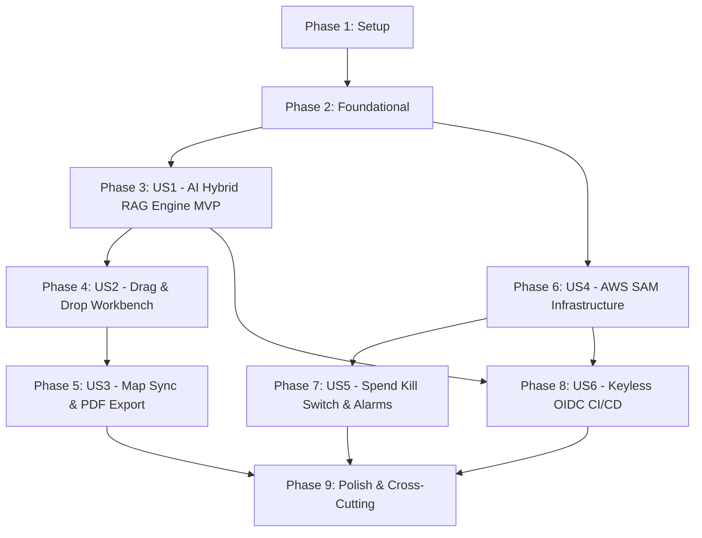

# Implementation Tasks: Phase 6 — AI Trip Planner, AWS SAM Serverless Infrastructure & GitHub Actions OIDC CI/CD

**Feature**: `006-trip-planner-aws-cicd`  
**Date**: 2026-10-20  
**Spec Reference**: [specs/006-trip-planner-aws-cicd/spec.md](file:///d:/Coding/Vistarae/specs/006-trip-planner-aws-cicd/spec.md)  
**Plan Reference**: [specs/006-trip-planner-aws-cicd/plan.md](file:///d:/Coding/Vistarae/specs/006-trip-planner-aws-cicd/plan.md)  
**Data Model Reference**: [specs/006-trip-planner-aws-cicd/data-model.md](file:///d:/Coding/Vistarae/specs/006-trip-planner-aws-cicd/data-model.md)  
**Constitution**: [.specify/memory/constitution.md](file:///d:/Coding/Vistarae/.specify/memory/constitution.md)

---

## Phase 1: Setup (Shared Infrastructure)

**Purpose**: Project initialization, dependency installation, shared directory scaffolding, and licensing compliance across backend services, frontend SPA, and infrastructure modules.- [X] T001 Install `@hello-pangea/dnd` and its type definitions in `frontend/package.json` for interactive drag-and-drop itinerary board

- [x] T002 [P] Create directory scaffolding for trip planner modules: `packages/core/vistarae_core/domain/`, `packages/core/vistarae_core/ports/`, `packages/core/vistarae_core/adapters/repositories/`, `services/poi/routes/`, `services/poi/services/`, `services/admin/handlers/`, `cloudfront/`, and `frontend/src/components/planner/`
- [x] T003 [P] Configure Apache-2.0 copyright and license headers across all new Python, JavaScript, and TypeScript source files per constitutional header rules

---

## Phase 2: Foundational (Blocking Prerequisites)

**Purpose**: Core database schema migrations, Pydantic v2 boundary models, entity protocols, and async repositories that MUST be complete before ANY user story can execute.

> **CRITICAL**: No user story implementation work can begin until this foundational phase is complete.

- [x] T004 Create Alembic migration `db/migrations/versions/0004_trip_planner.py` defining tables:
  - `itineraries`: `id UUID PRIMARY KEY DEFAULT gen_random_uuid()`, `user_id UUID NOT NULL REFERENCES users(id) ON DELETE CASCADE`, `title VARCHAR(255) NOT NULL`, `destination VARCHAR(255) NOT NULL`, `start_date DATE NOT NULL`, `end_date DATE NOT NULL`, `budget_cents INTEGER NULL`, `currency VARCHAR(3) NOT NULL DEFAULT 'USD'`, `status VARCHAR(32) NOT NULL DEFAULT 'draft'`, `created_at TIMESTAMP WITH TIME ZONE NOT NULL DEFAULT NOW()`, `updated_at TIMESTAMP WITH TIME ZONE NOT NULL DEFAULT NOW()`, with constraints: `CONSTRAINT ck_itineraries_dates CHECK (end_date >= start_date)`, `CONSTRAINT ck_itineraries_budget CHECK (budget_cents IS NULL OR budget_cents >= 0)`, `CONSTRAINT ck_itineraries_status CHECK (status IN ('draft', 'confirmed', 'archived'))`, and indexes `idx_itineraries_user_id ON itineraries (user_id)`, `idx_itineraries_user_status ON itineraries (user_id, status)` (REQ-PLAN-001, REQ-PLAN-011)
  - `itinerary_days`: `id UUID PRIMARY KEY DEFAULT gen_random_uuid()`, `itinerary_id UUID NOT NULL REFERENCES itineraries(id) ON DELETE CASCADE`, `day_number INTEGER NOT NULL`, `calendar_date DATE NOT NULL`, `notes TEXT NULL`, `target_budget_cents INTEGER NULL`, `total_cost_cents INTEGER NOT NULL DEFAULT 0`, with constraints: `CONSTRAINT uq_itinerary_days_day_num UNIQUE (itinerary_id, day_number)`, `CONSTRAINT ck_itinerary_days_positive CHECK (day_number > 0)`, and index `idx_itinerary_days_itinerary_id ON itinerary_days (itinerary_id)` (REQ-PLAN-001)
  - `itinerary_items`: `id UUID PRIMARY KEY DEFAULT gen_random_uuid()`, `itinerary_day_id UUID NOT NULL REFERENCES itinerary_days(id) ON DELETE CASCADE`, `poi_id UUID NULL REFERENCES pois(id) ON DELETE SET NULL`, `is_backup_for_id UUID NULL REFERENCES itinerary_items(id) ON DELETE SET NULL`, `title VARCHAR(255) NOT NULL`, `category VARCHAR(64) NOT NULL DEFAULT 'attraction'`, `source_type VARCHAR(32) NOT NULL DEFAULT 'USER_SAVED'`, `geom geography(Point, 4326) NOT NULL`, `order_index INTEGER NOT NULL`, `start_time TIME WITHOUT TIME ZONE NULL`, `end_time TIME WITHOUT TIME ZONE NULL`, `duration_hours NUMERIC(4, 2) NOT NULL DEFAULT 1.00`, `cost_cents INTEGER NOT NULL DEFAULT 0`, `travel_time_prev_minutes INTEGER NULL`, `travel_distance_prev_meters INTEGER NULL`, `notes TEXT NULL`, with constraints: `CONSTRAINT ck_itinerary_items_source CHECK (source_type IN ('USER_SAVED', 'AI_RECOMMENDED', 'MANUAL'))`, `CONSTRAINT ck_itinerary_items_duration CHECK (duration_hours >= 0.25 AND duration_hours <= 12.00)`, `CONSTRAINT ck_itinerary_items_cost CHECK (cost_cents >= 0)`, and indexes `idx_itinerary_items_day_order ON itinerary_items (itinerary_day_id, order_index)`, `idx_itinerary_items_poi_id ON itinerary_items (poi_id)`, `idx_itinerary_items_backup ON itinerary_items (is_backup_for_id)`, `idx_itinerary_items_geom ON itinerary_items USING gist (geom)` (REQ-PLAN-001, REQ-PLAN-010, REQ-PLAN-018)
  - `system_settings`: `key VARCHAR(64) PRIMARY KEY`, `value JSONB NOT NULL DEFAULT '{}'::jsonb`, `updated_at TIMESTAMP WITH TIME ZONE NOT NULL DEFAULT NOW()`, seeding `spend_killswitch` with `'{"killswitch_active": false, "triggered_at": null, "reason": null}'::jsonb` (REQ-SAM-017)
  - Fully reversible `downgrade()` dropping all created tables and types in reverse dependency order (Constitution Principle 4)
- [x] T005 [P] Implement Pydantic v2 boundary schemas in `packages/core/vistarae_core/schemas/itinerary.py`: `ItineraryStatus(StrEnum)` ('draft', 'confirmed', 'archived'), `ItineraryItemSource(StrEnum)` ('USER_SAVED', 'AI_RECOMMENDED', 'MANUAL'), `ItineraryItemBase` (with verbatim constraints: `title: str max_length=255`, `category: str max_length=64`, `latitude: ge=-90.0, le=90.0`, `longitude: ge=-180.0, le=180.0`, `order_index: ge=0`, `duration_hours: Decimal ge=Decimal('0.25'), le=Decimal('12.00')`, `cost_cents: int ge=0`), `ItineraryDayBase`, `ItineraryGenerateRequest` (`prompt: min_length=3, max_length=1000`, `destination: min_length=2, max_length=255`, `currency: min_length=3, max_length=3`, validator asserting `end_date >= start_date` and duration $\le 30$ days), `ItineraryItemReorderItem`, `ItineraryItemReorderRequest`, `MissingMealAdvisory`, `CircuitBreakerWarning` (`threshold_hours = Decimal('10.00')`), `ItineraryDayResponse`, and `ItineraryResponse` with strict mode `extra='forbid'` (REQ-PLAN-001, REQ-PLAN-005, REQ-PLAN-011, REQ-PLAN-018)
- [x] T006 [P] Implement domain entity classes and repository protocol in `packages/core/vistarae_core/domain/itinerary.py` and `packages/core/vistarae_core/ports/itinerary_repo.py` defining abstract async methods: `create_itinerary`, `get_itinerary_by_id`, `list_itineraries_by_user`, `update_itinerary`, `delete_itinerary`, `find_pois_in_corridor_hybrid`, `reorder_items`, and `get_system_setting` (REQ-PLAN-001, REQ-PLAN-003, REQ-PLAN-017)
- [x] T007 Implement SQLAlchemy 2.0 async repository in `packages/core/vistarae_core/adapters/repositories/itinerary_repo.py` supporting tenant isolation (`WHERE user_id = :user_id`), transaction management, and eager loading of days and items (REQ-PLAN-001, REQ-PLAN-017)
- [x] T008 [P] Unit tests for Alembic migration 0004 and schema constraints in `tests/unit/db/test_0004_migration.py` verifying upgrade, downgrade, date order constraint, cost cents constraint, and enum checks with Docker PostGIS (REQ-PLAN-001, REQ-PLAN-018) [Test: tests/unit/db/test_0004_migration.py]

**Checkpoint**: Foundation ready — user story implementation can now begin in parallel or sequentially.

---

## Phase 3: User Story 1 - Natural Language Travel Prompt to Hybrid RAG Itinerary (Priority: P1) [MVP]

**Goal**: Generate day-by-day travel itineraries from a natural language prompt, destination, and dates using Google Gemini `text-embedding-004` and hybrid PostGIS spatial pre-filtering (`idx_pois_user_geom`) + pgvector cosine distance ranking (`<=>`).

**Independent Test**: Seed a user with saved POIs in a target region, invoke `POST /api/itineraries/generate` with a prompt, destination, and dates, and assert that the response returns an itinerary where spatially-filtered and semantically-ranked POIs are partitioned across daily time slots (08:00–22:00) with calculated transit metrics and proper tenant isolation.

### Tests for User Story 1

> **NOTE: Write these tests FIRST, ensure they FAIL before implementation.**

- [x] T009 [P] [US1] Unit and contract tests for hybrid PostGIS + pgvector corridor query and Gemini RAG synthesis in `tests/unit/services/poi/test_rag_planner.py` mocking Gemini `text-embedding-004` (768-dim) and `thinking_budget: 0` (REQ-PLAN-002, REQ-PLAN-003, REQ-PLAN-004, REQ-PLAN-005) [Test: tests/unit/services/poi/test_rag_planner.py]
- [x] T010 [P] [US1] Integration tests for itinerary CRUD and generation endpoints in `tests/integration/services/test_itinerary_endpoints.py` testing `POST /api/itineraries/generate`, `GET /api/itineraries`, `GET /api/itineraries/{id}`, `PUT /api/itineraries/{id}`, `DELETE /api/itineraries/{id}`, date validation (end < start or > 30 days -> 422), and tenant cross-access (404) (REQ-PLAN-001, REQ-PLAN-005, REQ-PLAN-017) [Test: tests/integration/services/test_itinerary_endpoints.py]

### Implementation for User Story 1

- [x] T011 [US1] Implement hybrid corridor query method `find_pois_in_corridor_hybrid` in `packages/core/vistarae_core/adapters/repositories/itinerary_repo.py`: pre-filter by tenant and spatial proximity using `idx_pois_user_geom` (`WHERE user_id = :user_id AND ST_DWithin(geom, :corridor_geom, :radius_meters)`) and rank by cosine distance (`ORDER BY embedding <=> :query_vec LIMIT :k`), falling back to public curated POIs or AI suggestions (`source_type = "AI_RECOMMENDED"`) when $< 3$ saved POIs exist (REQ-PLAN-003, REQ-PLAN-004)
- [x] T012 [US1] Implement AI trip planner engine in `services/poi/services/planner.py`: call Gemini `text-embedding-004` for 768-dim prompt embedding, invoke hybrid RAG corridor query, synthesize day-by-day schedule using Gemini Flash-Lite with structured output enforcing `ItineraryCreate`, non-overlapping daily time slots between 08:00 and 22:00, and transit distance/duration calculations via `ST_Distance` on `geography(Point, 4326)` (REQ-PLAN-002, REQ-PLAN-005, REQ-PLAN-008)
- [x] T013 [US1] Mount itinerary routes in `services/poi/routes/itineraries.py` implementing `POST /api/itineraries/generate`, `GET /api/itineraries`, `POST /api/itineraries`, `GET /api/itineraries/{id}`, `PUT /api/itineraries/{id}`, and `DELETE /api/itineraries/{id}` with JWT authentication and RFC 7807 problem details (REQ-PLAN-001, REQ-PLAN-017)
- [x] T014 [US1] Expose router in `services/poi/main.py` and register Mangum ASGI handler with `lifespan="off"` (REQ-SAM-011)
- [x] T015 [P] [US1] Implement TypeScript API client methods in `frontend/src/services/itineraryService.ts` for listing, creating, generating, fetching, updating, and deleting itineraries (REQ-PLAN-001, REQ-PLAN-002)
- [x] T016 [US1] Implement trip generation modal and input form in `frontend/src/pages/PlannerPage.tsx` with destination, date picker (max 30 days validation), budget, travel style prompt, loading skeleton, and error toast handling (REQ-PLAN-002, REQ-PLAN-005)N-005)

**Checkpoint**: User Story 1 (MVP) is fully functional and testable independently.

---

## Phase 4: User Story 2 - Day-by-Day & Hour-by-Hour Drag-and-Drop Itinerary Workbench (Priority: P1)

**Goal**: Provide an interactive drag-and-drop planning board (`@hello-pangea/dnd`) across daily timelines (08:00–22:00) with multi-day POI distribution, 10h/day exploration circuit breaker, day shortage prompt modal, meal advisory engine (lunch/dinner), weather backups, and integer-cent budgeting.

**Independent Test**: Open an itinerary in the workbench, drag an activity between days, verify `PUT /api/itineraries/{id}/items/reorder` updates positions and recalculates transit metrics; add a POI with `recommended_visit_days > available_days` and verify day shortage modal displays options to extend trip or delete events; add >10h of activities to a day and verify amber circuit breaker banner activates.

### Tests for User Story 2

- [x] T017 [P] [US2] Unit tests for multi-day POI distribution, 10-hour exploration circuit breaker, meal detection, and reordering in `tests/unit/services/poi/test_itinerary_rules.py` (REQ-PLAN-006, REQ-PLAN-007, REQ-PLAN-007a, REQ-PLAN-008, REQ-PLAN-009, REQ-PLAN-010, REQ-PLAN-011, REQ-PLAN-018) [Test: tests/unit/services/poi/test_itinerary_rules.py]
- [x] T018 [P] [US2] Component test for `ItineraryBoard` drag-and-drop interactions, circuit breaker warnings, and `DayShortageModal` in `frontend/src/tests/components/ItineraryBoard.test.tsx` (REQ-PLAN-006, REQ-PLAN-007a, REQ-PLAN-012) [Test: frontend/src/tests/components/ItineraryBoard.test.tsx]

### Implementation for User Story 2

- [x] T019 [US2] Implement multi-day POI distribution and shortage detector in `services/poi/services/planner.py`: if `recommended_visit_days > remaining_available_days`, reject silent truncation and return `DAY_SHORTAGE` warning flag; if $\ge N$ days remain, allocate visit into consecutive daily chunks without tripping 10.0-hour circuit breaker (REQ-PLAN-007, REQ-PLAN-007a)
- [x] T020 [US2] Implement daily over-planning circuit breaker engine in `services/poi/services/planner.py` calculating total daily exploration duration, emitting `CircuitBreakerWarning` if active hours exceed 10.0 hours (REQ-PLAN-006)
- [x] T021 [US2] Implement meal advisory engine and weather backup resolver in `services/poi/services/planner.py`: detect gaps during lunch (11:30–14:00) and dinner (17:30–20:30) lacking meals, search nearby restaurants within 1,500m (`MISSING_MEAL` advisory), and link indoor alternatives for outdoor activities via `is_backup_for_id` (REQ-PLAN-009, REQ-PLAN-010)
- [x] T022 [US2] Implement batch item reordering endpoint `PUT /api/itineraries/{id}/items/reorder` in `services/poi/routes/itineraries.py` and `packages/core/vistarae_core/adapters/repositories/itinerary_repo.py`: update day and order indices within a transaction, recalculate transit times/distances from previous waypoints, and return refreshed itinerary with advisories (REQ-PLAN-008, REQ-PLAN-013, REQ-PLAN-018)
- [x] T023 [P] [US2] Implement `ItineraryDayColumn.tsx` and `ItineraryItemCard.tsx` in `frontend/src/components/planner/`: display daily timeline (08:00–22:00), activity duration, integer-cent cost, transit duration/distance pill from previous item, and indoor backup badge (REQ-PLAN-008, REQ-PLAN-010, REQ-PLAN-012, REQ-PLAN-018)
- [x] T024 [P] [US2] Implement `MissingMealCard.tsx` in `frontend/src/components/planner/` showing missing lunch/dinner alerts with 1-click nearby restaurant recommendations or pack-lunch advisory (REQ-PLAN-009)
- [x] T025 [P] [US2] Implement `DayShortageModal.tsx` in `frontend/src/components/planner/` prompting traveler when multi-day attraction exceeds available days with options to extend trip duration or delete existing activities (REQ-PLAN-007a)
- [x] T026 [US2] Implement `ItineraryBoard.tsx` in `frontend/src/components/planner/` integrating `@hello-pangea/dnd`: support dragging items within and between day columns, optimistic local state updates (<150ms), over-planning amber warning banner (>10h/day), and API persistence to `PUT /api/itineraries/{id}/items/reorder` (REQ-PLAN-006, REQ-PLAN-012, REQ-PLAN-013)

**Checkpoint**: User Stories 1 and 2 are functional and testable independently.

---

## Phase 5: User Story 3 - Synchronized Route Mapping, AI POI Import & PDF Export (Priority: P1)

**Goal**: Synchronize dual-mode route map (macro polyline and daily legs), 1-click import AI-recommended POIs into permanent POI collection with deduplication check, and export itinerary to clean offline vector PDF using `@media print`.

**Independent Test**: Toggle between macro trip map and Day 2 leg, verify map bounds fit waypoints with numbered sequence pins; click "Import to My POIs" on an `AI_RECOMMENDED` item, verify item persists as permanent POI without duplicate; click "Export to PDF", verify `@media print` renders multi-page document cleanly.

### Tests for User Story 3

- [x] T027 [P] [US3] Unit and component tests for route map coordinate mapping, AI POI import flow, and print view formatting in `frontend/src/tests/components/RouteMapAndExport.test.tsx` (REQ-PLAN-014, REQ-PLAN-015, REQ-PLAN-016) [Test: frontend/src/tests/components/RouteMapAndExport.test.tsx]

### Implementation for User Story 3

- [x] T028 [US3] Implement `RouteMap.tsx` in `frontend/src/components/planner/`: render MapLibre/Leaflet map with dual modes (macro trip bounding box with color-coded day markers and overall polyline, and daily leg mode with numbered sequence pins and waypoint paths) (REQ-PLAN-015)
- [x] T029 [US3] Implement 1-click "Import to My POIs" button and deduplication flow in `frontend/src/components/planner/ItineraryItemCard.tsx` and `frontend/src/services/itineraryService.ts`: dispatch `POST /api/pois` with item details, check spatial dedup status (`UNIQUE_LOCATION` / `POTENTIAL_DUPLICATE`), update item `source_type` to `USER_SAVED`, and link `poi_id` (REQ-PLAN-014)
- [x] T030 [US3] Implement `PrintExportView.tsx` and `@media print` print stylesheet in `frontend/src/components/planner/PrintExportView.tsx` and `frontend/src/index.css`: format itinerary into clean vector-ready multi-page printable layout, hide navigation chrome, expand all days and notes, include transit metrics, and invoke `window.print()` (REQ-PLAN-016)
- [x] T031 [US3] Integrate workbench, route map, and print view into deep-linkable page `frontend/src/pages/ItineraryDetailPage.tsx` with URL routing `/trips/:id` (REQ-PLAN-001, REQ-PLAN-015, REQ-PLAN-016)

**Checkpoint**: User Stories 1, 2, and 3 are functional and testable independently.

---

## Phase 6: User Story 4 - AWS SAM Infrastructure Deployment with OAC & Function Routing (Priority: P1)

**Goal**: Provision zero-cost, enterprise serverless infrastructure in AWS `us-east-2` via AWS SAM `template.yaml`, private S3 SPA with CloudFront OAC, `spa-router.js` CloudFront Function, HTTP API Gateway `$default` stage proxying `/api/*` with `CachingDisabled` and `AllViewerExceptHostHeader`, 6 domain Lambdas on Python 3.12 `arm64` with 1% X-Ray sampling, SQS + DLQ, and least-privilege IAM policies.

**Independent Test**: Run `sam validate --lint` to verify CloudFormation validity; invoke `sam local start-api` and test that extensionless paths rewrite to `/index.html` while `/api/*` routes forward with proper headers.

### Tests for User Story 4

- [x] T032 [P] [US4] Unit test for CloudFront Function URI rewriting logic in `tests/unit/infrastructure/test_spa_router.py` verifying that extensionless paths rewrite to `/index.html`, `/assets/*` and dot-extensions pass unchanged, and `/api/*` routes are untouched (REQ-SAM-005, REQ-SAM-006) [Test: tests/unit/infrastructure/test_spa_router.py]
- [x] T033 [P] [US4] SAM template lint and schema validation test in `tests/unit/infrastructure/test_sam_template.py` verifying resource declarations, IAM least-privilege roles, X-Ray active tracing, and SQS queue configurations (REQ-SAM-001 through REQ-SAM-021) [Test: tests/unit/infrastructure/test_sam_template.py]

### Implementation for User Story 4

- [x] T034 [P] [US4] Create Viewer Request CloudFront Function in `cloudfront/spa-router.js` rewriting extensionless non-API paths to `/index.html` while passing static assets and `/api/*` paths unmodified (REQ-SAM-005, REQ-SAM-006)
- [x] T035 [US4] Create AWS SAM template `template.yaml` in `us-east-2`:
  - Private S3 SPA bucket (`VistaraeSpaBucket`) with all public access blocked (`BlockPublicAcls: true`, `BlockPublicPolicy: true`, `IgnorePublicAcls: true`, `RestrictPublicBuckets: true`) and bucket policy granting `s3:GetObject` strictly to CloudFront OAC (REQ-SAM-002, REQ-SAM-004)
  - CloudFront Distribution (`VistaraeDistribution`) with OAC (`VistaraeOac`), default cache behavior bound to S3 origin with `SpaRouterFunction` viewer-request association, and `/api/*` cache behavior forwarding to API Gateway with `CachingDisabled` and `AllViewerExceptHostHeader` origin request policy (`b689b0a8-53d0-40ab-baf2-68738e2966ac`) (REQ-SAM-003, REQ-SAM-007)
  - API Gateway HTTP API (`VistaraeHttpApi`) with `$default` stage delegating all CORS header emission exclusively to FastAPI `CORSMiddleware` without duplicate headers (REQ-SAM-008, REQ-SAM-008a)
  - 6 domain Lambdas on Python 3.12 `arm64`: `PoiFunction` (512-1024MB, 15s timeout for `/api/pois/*` and `/api/itineraries/*`), `UserFunction` (256MB, 10s timeout for `/api/users/*`), `IngestFunction` (256MB, 15s timeout for `/api/ingest/*`), `AdminFunction` (256MB, 10s timeout for `/api/admin/*`), `BatchIngestWorker` (512MB, 30s timeout with SQS EventSourceMapping `BatchSize: 10`, `MaximumConcurrency: 2`, `ReportBatchItemFailures: true`), and `SpendKillSwitch` (128MB, 10s timeout) (REQ-SAM-009, REQ-SAM-010, REQ-SAM-011, REQ-SAM-012, REQ-SAM-013, REQ-SAM-014, REQ-SAM-015, REQ-SAM-016)
  - Custom AWS X-Ray Sampling Rule (`AWS::XRay::SamplingRule`) configured with `ReservoirSize: 0` and `FixedRate: 0.01` (1% sampling) across all Lambdas (REQ-SAM-019)
  - SQS Ingest queue (`VisibilityTimeout: 180s`, `ReceiveMessageWaitTimeSeconds: 20s`) paired with DLQ (`maxReceiveCount: 3`, `MessageRetentionPeriod: 1209600s` / 14 days, `RedriveAllowPolicy: byQueue`) (REQ-SAM-020, REQ-SAM-021)
  - Scoped least-privilege IAM policies for each Lambda restricting SQS and Secrets Manager access (REQ-SAM-018)
- [x] T036 [US4] Configure FastAPI CORS middleware in `services/poi/main.py` (and existing microservices) to accept CloudFront distribution origin and local dev server while delegating CORS headers cleanly (REQ-SAM-008a)

**Checkpoint**: User Story 4 infrastructure templates and edge functions are validated.

---

## Phase 7: User Story 5 - Automated Spend Protection Kill Switch & CloudWatch Alarms (Priority: P2)

**Goal**: Implement 4-tier cascading emergency spend killswitch triggered at $15.00 AWS Budgets ceiling (handling account-level unreserved concurrency floor constraints), admin reset script, and CloudWatch alarms strictly capped under 10 free-tier alarms.

**Independent Test**: Invoke `SpendKillSwitch` with simulated SNS budget alert payload, assert: 1) API Gateway `$default` stage throttled to 0 rate / 0 burst, 2) SQS EventSourceMapping disabled, 3) Neon DB `system_settings.spend_killswitch.killswitch_active` set to true, 4) Lambda concurrency set to 0 best-effort; execute `python scripts/reset_killswitch.py` and verify all services restored to normal operation.

### Tests for User Story 5

- [x] T037 [P] [US5] Unit tests for 4-tier `SpendKillSwitch` fallback shutdown sequence and `reset_killswitch.py` in `tests/unit/services/admin/test_killswitch.py` mocking Boto3 APIGateway, Lambda, and asyncpg/Neon DB calls, simulating AWS `ValidationException` on concurrency floor (REQ-SAM-017) [Test: tests/unit/services/admin/test_killswitch.py]
- [x] T038 [P] [US5] SAM CloudWatch free-tier alarm budget test in `tests/unit/infrastructure/test_alarms.py` verifying total alarms $\le 2$ (Metric Filter `{ $.level = "ERROR" }` alarm and DLQ visible messages alarm), confirming $< 10$ free tier limit (REQ-SAM-022, REQ-SAM-023, REQ-SAM-024, REQ-SAM-025, REQ-SAM-026) [Test: tests/unit/infrastructure/test_alarms.py]

### Implementation for User Story 5

- [x] T039 [US5] Implement `SpendKillSwitch` Lambda handler in `services/admin/handlers/killswitch.py`:
  - Tier 1: Throttle API Gateway HTTP API `$default` stage to `RateLimit: 0` and `BurstLimit: 0` via `apigatewayv2.update_stage` (REQ-SAM-017)
  - Tier 2: Disable SQS EventSourceMapping for `BatchIngestWorker` (`Enabled: False`) via `lambda.update_event_source_mapping` (REQ-SAM-017)
  - Tier 3: Set `killswitch_active = true` and `triggered_at = NOW()` in Neon DB `system_settings` table using asyncpg/SQLAlchemy (REQ-SAM-017)
  - Tier 4: Best-effort attempt to set `ReservedConcurrentExecutions: 0` on domain Lambdas via `lambda.put_function_concurrency`, safely catching and logging AWS `ValidationException` if account unreserved concurrency floor is encountered (REQ-SAM-017)
- [x] T040 [US5] Add killswitch check middleware in `services/poi/main.py` (and domain services) reading `system_settings.spend_killswitch` to return RFC 7807 503 Service Unavailable when killswitch is active (REQ-SAM-017)
- [x] T041 [US5] Implement administrative restoration script in `scripts/reset_killswitch.py`: reset API Gateway stage rate/burst limits, re-enable SQS EventSourceMapping, clear Neon DB killswitch flag, and restore Lambda reserved concurrency (REQ-SAM-017)
- [x] T042 [US5] Declare CloudWatch Log Metric Filter and 2 core alarms in `template.yaml`:
  - Log Metric Filter on `{ $.level = "ERROR" }` writing to `Vistarae/Errors/ApplicationErrorCount` (REQ-SAM-022)
  - Alarm 1: `ApplicationErrorAlarm` triggering when `ApplicationErrorCount >= 5` in 5 minutes, publishing to `DeveloperAlertTopic` SNS (REQ-SAM-023)
  - Alarm 2: `DlqMessageAlarm` triggering when `ApproximateNumberOfMessagesVisible >= 1` on `vistarae-ingest-dlq`, publishing to `DeveloperAlertTopic` SNS (REQ-SAM-024, REQ-SAM-025)
  - Ensure zero synthetic recurring health check pings are configured in CloudWatch/Route53 to allow Neon compute to scale to zero (REQ-SAM-026)

**Checkpoint**: User Story 5 automated spend protection and free-tier alarms are verified.

---

## Phase 8: User Story 6 - Keyless GitHub Actions OIDC CI/CD Pipeline & Quality Gates (Priority: P1)

**Goal**: Establish automated, keyless OIDC CI/CD pipeline in `.github/workflows/ci.yml` and `.github/workflows/deploy.yml` with monorepo path filtering, Docker PostGIS container, `pytest --cov=src --cov-fail-under=90`, `alembic check`, OpenAPI TypeScript contract drift gate (`git diff --exit-code ./frontend/src/types/api.ts`), `sam validate --lint`, direct Neon SSL migration (`?sslmode=require`), S3 sync with `immutable` asset caching and `no-cache` HTML, CloudFront invalidation, and single `/health/ready` check.

**Independent Test**: Execute CI workflow checks locally; introduce intentional schema drift to assert `git diff --exit-code` fails CI; verify workflow YAML parses without syntax errors and references keyless OIDC `GitHubActionsDeployerRole`.

### Tests for User Story 6

- [x] T043 [P] [US6] Workflow schema and contract validation test in `tests/unit/infrastructure/test_github_workflows.py` validating YAML syntax, keyless OIDC configuration, absence of hardcoded AWS secrets, path filter triggers, and single `/health/ready` probe (REQ-CICD-001, REQ-CICD-002, REQ-CICD-003, REQ-CICD-017, REQ-CICD-018) [Test: tests/unit/infrastructure/test_github_workflows.py]
- [x] T044 [P] [US6] Test OpenAPI export and TypeScript generation script in `tests/unit/scripts/test_export_openapi.py` verifying generated OpenAPI spec includes `/api/itineraries/*` endpoints and schema matches TypeScript types (REQ-CICD-009, REQ-CICD-010) [Test: tests/unit/scripts/test_export_openapi.py]

### Implementation for User Story 6

- [x] T045 [US6] Update OpenAPI export script in `scripts/export_openapi.py` to include new itinerary router and schemas in `openapi.json` (REQ-CICD-009)
- [x] T046 [US6] Regenerate TypeScript API types in `frontend/src/types/api.ts` using `npx openapi-typescript ./openapi.json -o ./frontend/src/types/api.ts` and verify zero drift (REQ-CICD-009, REQ-CICD-010)
- [x] T047 [US6] Create CI workflow in `.github/workflows/ci.yml`:
  - Monorepo path filtering on `packages/core/**`, `services/**`, `frontend/**`, `template.yaml`, and `db/migrations/**` (REQ-CICD-004)
  - Backend job with Docker service container `postgis/postgis:16-3.4` (REQ-CICD-005)
  - Code quality checks: `ruff check`, `ruff format --check` (REQ-CICD-006)
  - Test execution: `pytest --cov=src --cov=services --cov=packages/core --cov-fail-under=90` (REQ-CICD-006, REQ-CICD-007)
  - Database migration parity check: `alembic check` (REQ-CICD-008)
  - OpenAPI contract drift gate: `python -m scripts.export_openapi && git diff --exit-code ./frontend/src/types/api.ts` (REQ-CICD-009, REQ-CICD-010)
  - SAM template validation: `sam validate --lint` (REQ-CICD-011)
  - Frontend job: `npm run build` and `npm run test:unit` in `frontend/` (REQ-CICD-013)
- [x] T048 [US6] Create CD deployment workflow in `.github/workflows/deploy.yml`:
  - Trigger on push to `main` branch with keyless OIDC authentication using `aws-actions/configure-aws-credentials@v4` assuming `role-to-assume: arn:aws:iam::123456789012:role/GitHubActionsDeployerRole` in `us-east-2` (REQ-CICD-001, REQ-CICD-002, REQ-CICD-003)
  - Database migration: run `alembic upgrade head` over direct Neon URL with `?sslmode=require` and 3-retry exponential backoff (REQ-CICD-012)
  - SAM build and deploy: `sam build --use-container` and `sam deploy --no-confirm-changeset --stack-name vistarae-prod` (REQ-SAM-001)
  - Frontend build: `npm run build` in `frontend/` (REQ-CICD-013)
  - S3 asset upload: `aws s3 sync frontend/dist/assets/ s3://${SPA_BUCKET}/assets/ --cache-control "public, max-age=31536000, immutable"` (REQ-CICD-014)
  - S3 HTML entrypoint upload: `aws s3 cp frontend/dist/index.html s3://${SPA_BUCKET}/index.html --cache-control "public, max-age=0, must-revalidate"` (REQ-CICD-015)
  - CloudFront edge invalidation: `aws cloudfront create-invalidation --distribution-id ${DIST_ID} --paths "/index.html" "/"` (REQ-CICD-016)
  - Post-deployment health verification: single HTTP GET probe to `https://${DIST_DOMAIN}/api/health/ready` failing workflow if status != 200, strictly without recurring cron polling (REQ-CICD-017, REQ-CICD-018, REQ-SAM-026)

**Checkpoint**: User Story 6 CI/CD workflows and deployment gates are fully operational.

---

## Phase 9: Polish & Cross-Cutting Concerns

**Purpose**: End-to-end integration verification, performance benchmark validation, documentation synchronization, and final quickstart execution.

- [x] T049 [P] Update API documentation in `contracts/itinerary-api.yaml` and README with deployed CloudFront endpoint details
- [x] T050 [P] End-to-end integration and load test script in `scripts/test_e2e_trip_planner.py` validating 5-day itinerary generation completes in $< 4.0$ seconds (SC-001, SC-003) [Test: scripts/test_e2e_trip_planner.py]
- [x] T051 Run full validation scenarios from `specs/006-trip-planner-aws-cicd/quickstart.md` across database migrations, backend pytest 90% coverage gate, frontend vitest, SAM lint, and OpenAPI contract drift check

---

## Dependencies & Execution Order

### Phase Dependencies



- **Phase 1: Setup**: Can start immediately. No dependencies.
- **Phase 2: Foundational**: Depends on Phase 1 completion. **BLOCKS all user stories**.
- **Phase 3: User Story 1 (P1 - MVP)**: Depends on Phase 2. Core travel planner engine.
- **Phase 4: User Story 2 (P1)**: Depends on Phase 3 (extends itinerary models and endpoints).
- **Phase 5: User Story 3 (P1)**: Depends on Phase 4 (builds map and export views on top of workbench).
- **Phase 6: User Story 4 (P1)**: Depends on Phase 2 (SAM template declares lambdas and database access).
- **Phase 7: User Story 5 (P2)**: Depends on Phase 6 (requires SAM resources and Admin lambda).
- **Phase 8: User Story 6 (P1)**: Depends on Phase 3 and Phase 6 (deploys both code and infrastructure).
- **Phase 9: Polish**: Depends on all User Stories completion.

---

## Parallel Execution Opportunities

### User Story 1 (MVP)

```bash
# Tests can be authored in parallel:
Task T009: tests/unit/services/poi/test_rag_planner.py
Task T010: tests/integration/services/test_itinerary_endpoints.py

# Frontend API client can be written in parallel with backend implementation:
Task T015: frontend/src/services/itineraryService.ts
```

### User Story 2 (Workbench)

```bash
# Frontend UI cards and modals can be built in parallel:
Task T023: frontend/src/components/planner/ItineraryDayColumn.tsx & ItineraryItemCard.tsx
Task T024: frontend/src/components/planner/MissingMealCard.tsx
Task T025: frontend/src/components/planner/DayShortageModal.tsx
```

### User Story 4 (Infrastructure)

```bash
# CloudFront edge function and SAM template validation can run in parallel:
Task T032: tests/unit/infrastructure/test_spa_router.py
Task T033: tests/unit/infrastructure/test_sam_template.py
Task T034: cloudfront/spa-router.js
```

### User Story 5 (Kill Switch)

```bash
# KillSwitch tests and CloudWatch alarm validation can run in parallel:
Task T037: tests/unit/services/admin/test_killswitch.py
Task T038: tests/unit/infrastructure/test_alarms.py
```

---

## Implementation Strategy

### MVP First (Phases 1, 2, and 3)

1. Complete Phase 1 (Setup) and Phase 2 (Foundational migrations & core schemas).
2. Complete Phase 3 (User Story 1: Natural Language Prompt to Hybrid RAG Itinerary).
3. **STOP and VALIDATE**: Verify `POST /api/itineraries/generate` creates structured itineraries from saved POIs via PostGIS + pgvector RAG.

### Incremental Delivery

1. Foundation + US1 -> Working AI trip generator (MVP).
2. Add US2 -> Interactive drag-and-drop planning workbench with multi-day allocation and circuit breakers.
3. Add US3 -> Cartographic route map, AI POI import, and offline PDF export.
4. Add US4 & US5 -> Zero-cost AWS serverless deployment with automated spend protection.
5. Add US6 -> Keyless GitHub Actions CI/CD with rigorous quality gates.
6. Phase 9 -> Final polish, performance benchmarks, and end-to-end verification.
