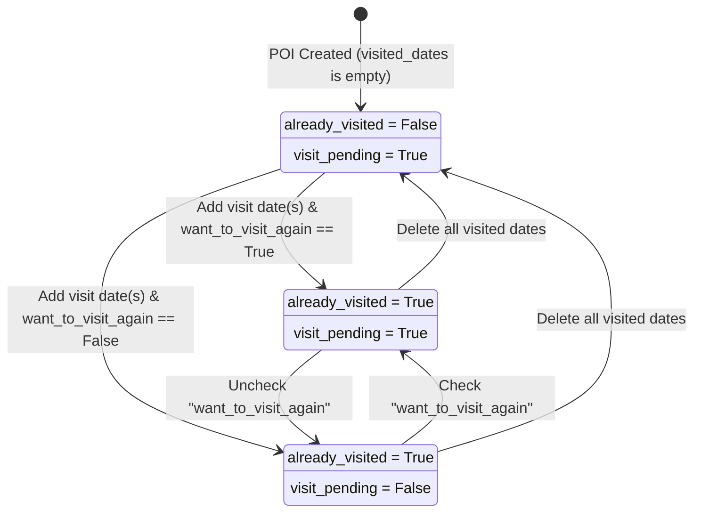

# Phase 1 Data Model: Phase 7 — UI POI Editor Enhancements, Location Finder & Merge Workflow

**Feature Identifier**: `007-ui-edit-poi-enhancements`  
**Date**: 2026-10-21  
**Status**: Ratified  
**Target Systems**: `packages/core/vistarae_core/`, `services/poi/`, `db/migrations/`

---

## 1. Relational Database Schema (`db/migrations/versions/0005_poi_edit_enhancements.py`)

### 1.1 Table Alterations: `pois`

```sql
-- Migration: 0005_poi_edit_enhancements.py
-- Upgrade: Add rich metadata, hierarchy, multi-address JSONB, and visit lifecycle tracking

ALTER TABLE pois
    ADD COLUMN IF NOT EXISTS description TEXT,
    ADD COLUMN IF NOT EXISTS parent_poi_id UUID REFERENCES pois(id) ON DELETE SET NULL,
    ADD COLUMN IF NOT EXISTS addresses JSONB NOT NULL DEFAULT '[]'::jsonb,
    ADD COLUMN IF NOT EXISTS recommended_duration_hours NUMERIC(4, 2),
    ADD COLUMN IF NOT EXISTS recommended_visit_days INTEGER NOT NULL DEFAULT 1,
    ADD COLUMN IF NOT EXISTS source_type VARCHAR(50) NOT NULL DEFAULT 'Manual',
    ADD COLUMN IF NOT EXISTS source_value VARCHAR(1000),
    ADD COLUMN IF NOT EXISTS official_url VARCHAR(2000),
    ADD COLUMN IF NOT EXISTS wiki_url VARCHAR(2000),
    ADD COLUMN IF NOT EXISTS directory_paths JSONB NOT NULL DEFAULT '[]'::jsonb,
    ADD COLUMN IF NOT EXISTS image_urls JSONB NOT NULL DEFAULT '[]'::jsonb,
    ADD COLUMN IF NOT EXISTS visited_dates JSONB NOT NULL DEFAULT '[]'::jsonb,
    ADD COLUMN IF NOT EXISTS want_to_visit_again BOOLEAN NOT NULL DEFAULT FALSE,
    ADD COLUMN IF NOT EXISTS already_visited BOOLEAN NOT NULL DEFAULT FALSE,
    ADD COLUMN IF NOT EXISTS visit_pending BOOLEAN NOT NULL DEFAULT TRUE;

-- GIN Index for rapid JSONB address path lookups
CREATE INDEX IF NOT EXISTS idx_pois_addresses_path 
    ON pois USING gin (addresses jsonb_path_ops);

-- B-Tree Index for hierarchical parent lookups under tenant isolation
CREATE INDEX IF NOT EXISTS idx_pois_user_parent 
    ON pois (user_id, parent_poi_id);

-- Check constraint preventing self-referencing parent
ALTER TABLE pois 
    ADD CONSTRAINT chk_pois_parent_not_self 
    CHECK (parent_poi_id IS NULL OR parent_poi_id != id);

-- Data Backfill: Migrate legacy states and countries arrays into addresses JSONB
UPDATE pois
SET addresses = (
    SELECT COALESCE(
        jsonb_agg(
            jsonb_build_object(
                'street', NULL,
                'city', NULL,
                'state_province', s.elem,
                'country', COALESCE(c.elem, 'Unknown'),
                'postal_code', NULL
            )
        ),
        '[]'::jsonb
    )
    FROM jsonb_array_elements_text(COALESCE(pois.states, '[]'::jsonb)) WITH ORDINALITY AS s(elem, ord)
    FULL OUTER JOIN jsonb_array_elements_text(COALESCE(pois.countries, '[]'::jsonb)) WITH ORDINALITY AS c(elem, ord)
        ON s.ord = c.ord
)
WHERE jsonb_array_length(addresses) = 0 
  AND (jsonb_array_length(COALESCE(states, '[]'::jsonb)) > 0 OR jsonb_array_length(COALESCE(countries, '[]'::jsonb)) > 0);
```

### 1.2 Reversible Downgrade (`downgrade()`)

```sql
-- Downgrade: Revert schema changes cleanly per Constitution Principle 4
DROP INDEX IF EXISTS idx_pois_user_parent;
DROP INDEX IF EXISTS idx_pois_addresses_path;

ALTER TABLE pois DROP CONSTRAINT IF EXISTS chk_pois_parent_not_self;

ALTER TABLE pois
    DROP COLUMN IF EXISTS visit_pending,
    DROP COLUMN IF EXISTS already_visited,
    DROP COLUMN IF EXISTS want_to_visit_again,
    DROP COLUMN IF EXISTS visited_dates,
    DROP COLUMN IF EXISTS image_urls,
    DROP COLUMN IF EXISTS directory_paths,
    DROP COLUMN IF EXISTS wiki_url,
    DROP COLUMN IF EXISTS official_url,
    DROP COLUMN IF EXISTS source_value,
    DROP COLUMN IF EXISTS source_type,
    DROP COLUMN IF EXISTS recommended_visit_days,
    DROP COLUMN IF EXISTS recommended_duration_hours,
    DROP COLUMN IF EXISTS addresses,
    DROP COLUMN IF EXISTS parent_poi_id,
    DROP COLUMN IF EXISTS description;
```

---

## 2. Core Domain Entities & Value Objects (`packages/core/vistarae_core/domain/`)

### 2.1 Value Object: `AddressRecord`

```python
# packages/core/vistarae_core/domain/value_objects.py
from typing import Optional
from pydantic import Field, field_validator
from vistarae_core.domain.base import StrictBaseModel

class AddressRecord(StrictBaseModel):
    """Immutable structured address value object representing a geographic location."""
    street: Optional[str] = Field(None, max_length=255, description="Street address line")
    city: Optional[str] = Field(None, max_length=100, description="Municipality or locality")
    state_province: Optional[str] = Field(None, max_length=100, description="Normalized state/province")
    country: str = Field(..., min_length=2, max_length=100, description="Normalized English standard country name")
    postal_code: Optional[str] = Field(None, max_length=32, description="Postal or ZIP code")

    @field_validator("country")
    @classmethod
    def validate_country(cls, v: str) -> str:
        stripped = v.strip()
        if not stripped:
            raise ValueError("Country must not be empty")
        return stripped
```

### 2.2 Enumeration: `SourceType`

```python
# packages/core/vistarae_core/domain/value_objects.py
from enum import StrEnum

class SourceType(StrEnum):
    """Provenance mechanism through which the POI was originated."""
    WEB = "Web"
    CSV = "CSV"
    MANUAL = "Manual"
    PHOTO = "Photo"
```

### 2.3 Aggregate Root: `POI` Extensions

```python
# packages/core/vistarae_core/domain/entities.py
from datetime import date
from decimal import Decimal
from typing import List, Optional
from uuid import UUID
from pydantic import Field, model_validator
from vistarae_core.domain.base import StrictBaseModel
from vistarae_core.domain.value_objects import AddressRecord, SourceType

class POI(StrictBaseModel):
    id: UUID
    user_id: UUID
    name: str
    description: Optional[str] = Field(None, max_length=10000)
    parent_poi_id: Optional[UUID] = None
    parent_poi_name: Optional[str] = None
    addresses: List[AddressRecord] = Field(default_factory=list)
    latitude: Optional[float] = None
    longitude: Optional[float] = None
    recommended_duration_hours: Optional[Decimal] = None
    recommended_visit_days: int = Field(default=1, ge=1)
    source_type: SourceType = Field(default=SourceType.MANUAL)
    source_value: Optional[str] = None
    official_url: Optional[str] = None
    wiki_url: Optional[str] = None
    directory_paths: List[str] = Field(default_factory=list)
    image_urls: List[str] = Field(default_factory=list)
    visited_dates: List[date] = Field(default_factory=list)
    want_to_visit_again: bool = False
    already_visited: bool = False
    visit_pending: bool = True
    rating: Optional[int] = Field(None, ge=1, le=5)
    tags: List[str] = Field(default_factory=list)

    @model_validator(mode="after")
    def compute_visit_lifecycle(self) -> "POI":
        """Compute deterministic visit flags based on visited dates and return intent."""
        # Sort visited dates chronologically
        self.visited_dates.sort()
        
        has_visited = len(self.visited_dates) > 0
        self.already_visited = has_visited

        if not has_visited:
            self.visit_pending = True
        else:
            self.visit_pending = bool(self.want_to_visit_again)
            
        return self
```

---

## 3. Pydantic v2 Schemas & API Payloads (`packages/core/vistarae_core/schemas/`)

### 3.1 POI Update Schema: `POIUpdateRequest`

```python
# packages/core/vistarae_core/schemas/poi.py
from datetime import date
from decimal import Decimal
from typing import List, Optional
from uuid import UUID
from pydantic import Field, field_validator
from vistarae_core.domain.base import StrictBaseModel
from vistarae_core.domain.value_objects import AddressRecord, SourceType

class POIUpdateRequest(StrictBaseModel):
    name: Optional[str] = Field(None, min_length=1, max_length=255)
    description: Optional[str] = Field(None, max_length=10000)
    parent_poi_id: Optional[UUID] = None
    addresses: Optional[List[AddressRecord]] = None
    latitude: Optional[float] = Field(None, ge=-90.0, le=90.0)
    longitude: Optional[float] = Field(None, ge=-180.0, le=180.0)
    recommended_duration_hours: Optional[Decimal] = Field(None, ge=Decimal("0.1"), le=Decimal("24.0"))
    recommended_visit_days: Optional[int] = Field(None, ge=1, le=365)
    source_type: Optional[SourceType] = None
    source_value: Optional[str] = Field(None, max_length=1000)
    official_url: Optional[str] = Field(None, max_length=2000)
    wiki_url: Optional[str] = Field(None, max_length=2000)
    directory_paths: Optional[List[str]] = None
    image_urls: Optional[List[str]] = None
    visited_dates: Optional[List[date]] = None
    want_to_visit_again: Optional[bool] = None
    rating: Optional[int] = Field(None, ge=1, le=5)
    tags: Optional[List[str]] = None
```

### 3.2 POI Merge Schemas: `POIMergeRequest` & `POIMergeResponse`

```python
# packages/core/vistarae_core/schemas/poi_merge.py
from typing import Any, Dict, List, Optional
from uuid import UUID
from pydantic import Field
from vistarae_core.domain.base import StrictBaseModel
from vistarae_core.schemas.poi import POIReadResponse

class POIMergeSelectedScalars(StrictBaseModel):
    name: Optional[str] = None
    description: Optional[str] = None
    parent_poi_id: Optional[UUID] = None
    rating: Optional[int] = None
    latitude: Optional[float] = None
    longitude: Optional[float] = None
    recommended_duration_hours: Optional[float] = None
    recommended_visit_days: Optional[int] = None
    official_url: Optional[str] = None
    wiki_url: Optional[str] = None
    source_type: Optional[str] = None
    source_value: Optional[str] = None
    want_to_visit_again: Optional[bool] = None

class POIMergeSelectedSets(StrictBaseModel):
    tags: List[str] = Field(default_factory=list)
    list_ids: List[UUID] = Field(default_factory=list)
    directory_paths: List[str] = Field(default_factory=list)
    image_urls: List[str] = Field(default_factory=list)
    visited_dates: List[str] = Field(default_factory=list)
    addresses: List[Dict[str, Any]] = Field(default_factory=list)

class POIMergeRequest(StrictBaseModel):
    source_poi_id: UUID
    target_poi_id: UUID
    selected_scalars: POIMergeSelectedScalars
    selected_sets: POIMergeSelectedSets

class POIMergeResponse(StrictBaseModel):
    target_poi: POIReadResponse
    deleted_source_poi_id: UUID
    reparented_itinerary_items_count: int
    reparented_list_memberships_count: int
    reparented_child_pois_count: int
```

### 3.3 Duplicate Check Schemas

```python
# packages/core/vistarae_core/schemas/poi_duplicate.py
from typing import Optional
from uuid import UUID
from pydantic import Field
from vistarae_core.domain.base import StrictBaseModel
from vistarae_core.schemas.poi import POIReadResponse

class DuplicateCheckRequest(StrictBaseModel):
    name: str = Field(..., min_length=1)
    latitude: float = Field(..., ge=-90.0, le=90.0)
    longitude: float = Field(..., ge=-180.0, le=180.0)
    exclude_poi_id: Optional[UUID] = None

class DuplicateCandidate(StrictBaseModel):
    poi_id: UUID
    name: str
    distance_meters: float
    name_similarity: float
    poi: POIReadResponse

class DuplicateCheckResponse(StrictBaseModel):
    is_duplicate: bool
    candidate: Optional[DuplicateCandidate] = None
```

---

## 4. State Transitions & Lifecycle Rules

### 4.1 Visit Lifecycle Transition Matrix



### 4.2 Hierarchy Cycle Validation Algorithm

```text
Algorithm ValidateParentAssignment(poi_id, new_parent_id, user_id):
  1. If new_parent_id IS NULL:
       RETURN Valid (Top-level POI)
  2. If new_parent_id == poi_id:
       THROW ProblemDetails(422, "A POI cannot be its own parent")
  3. Execute recursive CTE:
       WITH RECURSIVE descendants AS (
           SELECT id FROM pois WHERE parent_poi_id = :poi_id AND user_id = :user_id
           UNION ALL
           SELECT p.id FROM pois p JOIN descendants d ON p.parent_poi_id = d.id WHERE p.user_id = :user_id
       )
       SELECT 1 FROM descendants WHERE id = :new_parent_id LIMIT 1;
  4. If query returns a row:
       THROW ProblemDetails(422, "Cannot assign descendant as parent POI (cyclical relationship)")
  5. RETURN Valid
```
