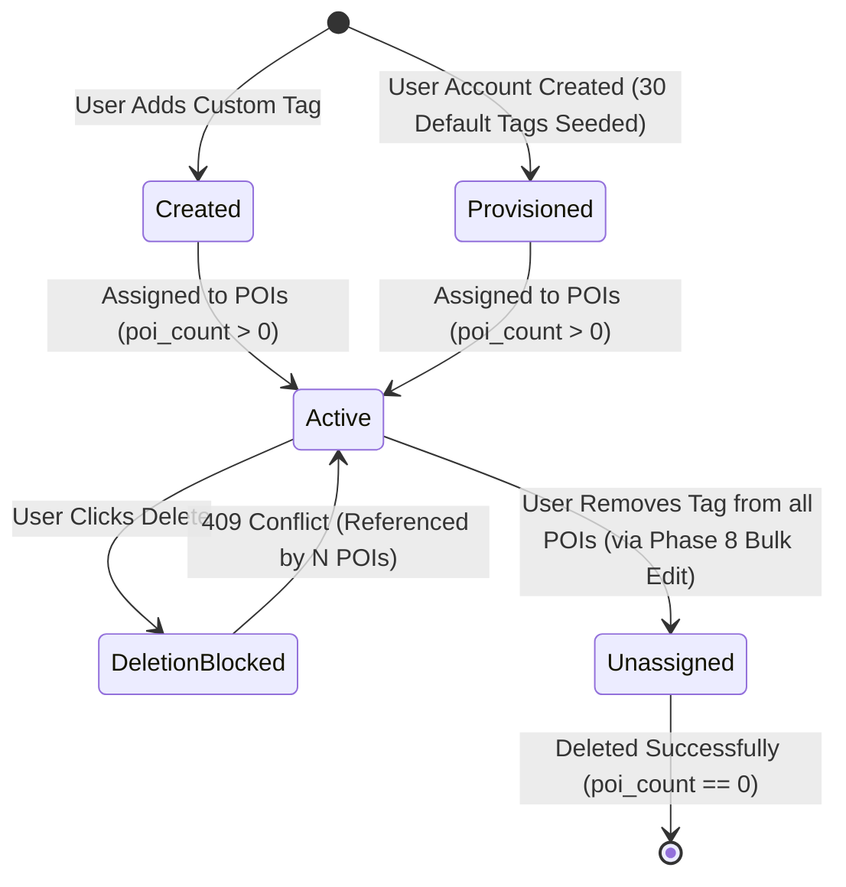
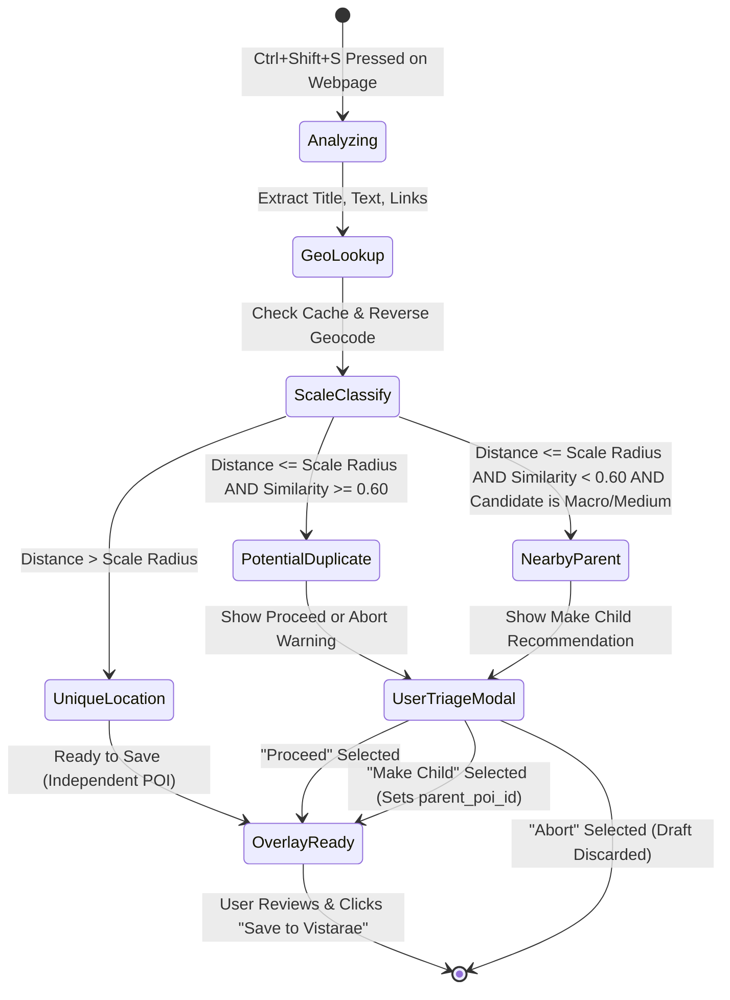

<!--
Copyright (c) 2026 Tim Olker

Licensed under the Apache License, Version 2.0 (the "License");
you may not use this file except in compliance with the License.
You may obtain a copy of the License at

    http://www.apache.org/licenses/LICENSE-2.0

Unless required by applicable law or agreed to in writing, software
distributed under the License is distributed on an "AS IS" BASIS,
WITHOUT WARRANTIES OR CONDITIONS OF ANY KIND, either express or implied.
See the License for the specific language governing permissions and
limitations under the License.

SPDX-License-Identifier: Apache-2.0
-->

# Phase 1 Data Model: Extension Enhancements, Tag Governance & Multi-Source Scraping

**Feature**: `009-extension-enhancements`  
**Date**: 2026-10-22  
**Status**: Completed

---

## 1. Database Schema & Alembic Migration Specification

### Migration Identifier: `0007_tag_governance_and_scraping_preferences.py`

- **Revision ID**: `0007`
- **Revises**: `0006` (or previous head)
- **Engine**: SQLAlchemy 2.0 / PostgreSQL 16+ / PostGIS 3.4+

```python
"""Tag governance slugification, alias arrays, and scraping preferences.

Revision ID: 0007
Revises: 0006
Create Date: 2026-10-22
"""

from alembic import op
import sqlalchemy as sa
from sqlalchemy.dialects import postgresql

def upgrade() -> None:
    # 1. Update tags table: add slug and aliases
    op.add_column("tags", sa.Column("slug", sa.String(length=64), nullable=True))
    op.add_column(
        "tags",
        sa.Column(
            "aliases",
            postgresql.JSONB(astext_type=sa.Text()),
            nullable=False,
            server_default=sa.text("'[]'::jsonb"),
        ),
    )

    # 2. Backfill existing tag slugs from name: slug = lower(replace(name, ' ', '_'))
    op.execute(
        """
        UPDATE tags
        SET slug = regexp_replace(lower(trim(name)), '[^a-z0-9]+', '_', 'g')
        WHERE slug IS NULL;
        """
    )
    op.alter_column("tags", "slug", nullable=False)

    # 3. Create unique constraint on (user_id, slug)
    op.create_unique_constraint("uq_tags_user_slug", "tags", ["user_id", "slug"])
    op.create_index("idx_tags_user_slug", "tags", ["user_id", "slug"])

    # 4. Update user_preferences table: add valid_scraping_domains
    op.add_column(
        "user_preferences",
        sa.Column(
            "valid_scraping_domains",
            postgresql.JSONB(astext_type=sa.Text()),
            nullable=False,
            server_default=sa.text(
                "'[\"wikipedia.org\", \"tripadvisor.com\", \"atlasobscura.com\", \"google.com/maps\", \"roadtrippers.com\"]'::jsonb"
            ),
        ),
    )

def downgrade() -> None:
    op.drop_column("user_preferences", "valid_scraping_domains")
    op.drop_index("idx_tags_user_slug", table_name="tags")
    op.drop_constraint("uq_tags_user_slug", "tags", type_="unique")
    op.drop_column("tags", "aliases")
    op.drop_column("tags", "slug")
```

---

## 2. SQLAlchemy 2.0 Table Definitions (`packages/core`)

### `TagTable` (`tags`)

```python
class TagTable(Base):
    """User-scoped taxonomy marker with slugified ID and alias support."""

    __tablename__ = "tags"

    id: Mapped[uuid.UUID] = mapped_column(
        UUID(as_uuid=True),
        primary_key=True,
        server_default=func.gen_random_uuid(),
        default=uuid.uuid4,
    )
    user_id: Mapped[uuid.UUID] = mapped_column(
        UUID(as_uuid=True),
        ForeignKey("users.id", ondelete="CASCADE"),
        nullable=False,
    )
    slug: Mapped[str] = mapped_column(String(64), nullable=False)
    name: Mapped[str] = mapped_column(String(64), nullable=False)
    aliases: Mapped[list[str]] = mapped_column(
        JSONB,
        nullable=False,
        default=list,
        server_default=text("'[]'::jsonb"),
    )
    created_at: Mapped[datetime] = mapped_column(
        DateTime(timezone=True), server_default=func.now(), nullable=False
    )

    pois: Mapped[list[POITable]] = relationship(
        "POITable", secondary="poi_tags", back_populates="tags"
    )

    __table_args__ = (
        UniqueConstraint("user_id", "slug", name="uq_tags_user_slug"),
        Index("idx_tags_user_id", "user_id"),
        Index("idx_tags_user_slug", "user_id", "slug"),
    )
```

### `UserPreferencesTable` (`user_preferences` extension)

```python
class UserPreferencesTable(Base):
    # Existing columns ...
    valid_scraping_domains: Mapped[list[str]] = mapped_column(
        JSONB,
        nullable=False,
        default=lambda: [
            "wikipedia.org",
            "tripadvisor.com",
            "atlasobscura.com",
            "google.com/maps",
            "roadtrippers.com",
        ],
        server_default=text(
            "'[\"wikipedia.org\", \"tripadvisor.com\", \"atlasobscura.com\", \"google.com/maps\", \"roadtrippers.com\"]'::jsonb"
        ),
    )
```

---

## 3. Pydantic v2 Core Domain Schemas (`packages/core`)

All models inherit from `vistarae_core.domain.base.StrictBaseModel` with `extra="forbid"`, `validate_assignment=True`, and `str_strip_whitespace=True`.

```python
class TagCreateRequest(StrictBaseModel):
    name: str = Field(min_length=1, max_length=64, description="Human readable display name")
    slug: str | None = Field(
        default=None,
        min_length=1,
        max_length=64,
        pattern=r"^[a-z0-9_]+$",
        description="Immutable slug identifier (auto-derived from name if omitted)",
    )
    aliases: list[str] = Field(
        default_factory=list,
        description="Array of searchable synonym aliases",
    )

class TagResponse(StrictBaseModel):
    id: uuid.UUID
    slug: str
    name: str
    aliases: list[str]
    poi_count: int = 0
    created_at: datetime

class ScrapingSourcesResponse(StrictBaseModel):
    valid_scraping_domains: list[str]

class ScrapingSourcesUpdateRequest(StrictBaseModel):
    valid_scraping_domains: list[str] = Field(
        min_length=1,
        description="List of domain suffixes authorized for secondary scraping",
    )

class DeduplicationVerdict(StrictBaseModel):
    status: Literal["UNIQUE_LOCATION", "POTENTIAL_DUPLICATE", "NEARBY_PARENT"]
    distance_meters: float | None = None
    similarity_score: float | None = None
    existing_poi_id: uuid.UUID | None = None
    existing_poi_name: str | None = None
    scale_classification: Literal["macro", "medium", "micro"] | None = None
    recommended_action: Literal["proceed", "make_child", "abort"]
```

---

## 4. Entity State Machine: Tag Lifecycle & Deletion Guard



---

## 5. Early Duplicate & Nesting Triage State Machine


