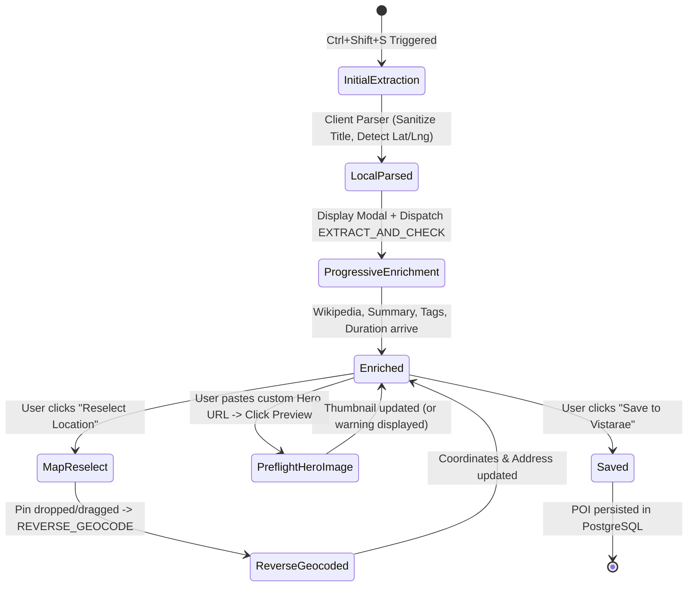

# Data Model: Extension Capture Bug Fixes & Verification Controls

**Feature**: `010-extension-capture-bug-fix`  
**Date**: 2026-10-26  
**Status**: Completed  

---

## 1. Schema Parity & Backend Invariants

In accordance with Constitution Principle 5 (API Contract, Validation & Error Standard):
- All payloads are strictly validated using Pydantic v2 `StrictBaseModel` with `extra="forbid"`.
- Coordinates are canonically represented in WGS-84 (`latitude: float` between -90 and 90, `longitude: float` between -180 and 180).
- Address records adhere strictly to `AddressRecord` value objects.

---

## 2. Extraction & Triage Request / Response Schemas

### 2.1 `ExtractAndCheckRequest` (Enhanced)

Passed by the extension service worker to `POST /api/pois/extract-and-check`:

```python
class ExtractAndCheckRequest(StrictBaseModel):
    """Request payload for multi-source web extraction and deduplication triage."""

    source_url: str = Field(..., description="Canonical URL of the captured page")
    page_title: str | None = Field(default=None, description="Raw HTML document title")
    selected_text: str | None = Field(
        default=None, description="User highlighted or selection snippet"
    )
    latitude: float | None = Field(
        default=None, ge=-90.0, le=90.0, description="Latitude detected by client-side parser"
    )
    longitude: float | None = Field(
        default=None, ge=-180.0, le=180.0, description="Longitude detected by client-side parser"
    )
    raw_address: str | None = Field(
        default=None, description="Raw address text scraped on client before cleansing"
    )
    category: str | None = Field(
        default=None, description="Place category inferred by client-side parser"
    )
```

### 2.2 `POICandidateSchema`

Normalized candidate entity returned in `ExtractAndCheckResponse`:

```python
class POICandidateSchema(StrictBaseModel):
    """Normalized POI extraction candidate schema maintaining 1:1 parity with POI Editor."""

    name: str = Field(..., description="Normalized standard English POI name without platform branding")
    description: str = Field(..., description="Concise multi-line summary of the destination")
    category: str = Field(default="experience", description="Normalized category slug")
    addresses: list[AddressRecord] = Field(
        default_factory=list, description="Structured addresses parsed and reverse-geocoded"
    )
    latitude: float | None = Field(default=None, ge=-90.0, le=90.0)
    longitude: float | None = Field(default=None, ge=-180.0, le=180.0)
    official_website_url: str | None = Field(default=None, description="Clean official website URL")
    wikipedia_url: str | None = Field(default=None, description="Authoritative Wikipedia article URL")
    hero_image_url: str | None = Field(default=None, description="Canonical hero image URL")
    estimated_duration_hours: float | None = Field(
        default=None, ge=0.0, le=24.0, description="Estimated visit duration in hours"
    )
    estimated_duration_days: int | None = Field(
        default=None, ge=0, le=365, description="Estimated visit duration in days"
    )
    rating: int | None = Field(default=None, ge=1, le=5, description="Parsed star rating (1-5)")
```

### 2.3 `ReverseGeocodeRequest` & `ReverseGeocodeResponse`

Used when the user adjusts the pinpoint on the mini-map via `POST /api/v1/geocoding/reverse`:

```python
class ReverseGeocodeRequest(StrictBaseModel):
    """Payload to reverse-geocode coordinates into a structured address."""

    latitude: float = Field(..., ge=-90.0, le=90.0, description="WGS-84 latitude")
    longitude: float = Field(..., ge=-180.0, le=180.0, description="WGS-84 longitude")


class ReverseGeocodeResponse(StrictBaseModel):
    """Structured reverse-geocoded address result."""

    formatted_address: str = Field(..., description="Clean, human-readable address line")
    country: str = Field(..., description="Sovereign country name (e.g. Germany)")
    country_code: str = Field(..., description="ISO 3166-1 alpha-2 country code (e.g. DE)")
    city: str | None = Field(default=None, description="Locality or municipality")
    postcode: str | None = Field(default=None, description="Postal or ZIP code")
    addresses: list[AddressRecord] = Field(default_factory=list, description="Structured address records")
```

---

## 3. Extension Client State Model (Shadow DOM)

Maintained in `extension/content/content_script.js` during the capture overlay lifecycle:

```typescript
interface CaptureOverlayState {
  // Identification
  poiName: string;                  // Clean destination name
  description: string;              // Summary description

  // Spatial & Mapping
  latitude: number | null;          // Active latitude
  longitude: number | null;         // Active longitude
  isReselectingMap: boolean;        // True when map click/drag reselection mode is active
  mapInstance: any | null;          // Leaflet L.Map instance
  mapMarker: any | null;           // Leaflet L.Marker instance

  // Addresses
  addresses: AddressRecord[];       // Structured addresses
  formattedAddressDisplay: string;  // Cleansed string display

  // External Links & Media
  officialWebsiteUrl: string;       // Official site URL
  wikipediaUrl: string;             // Canonical Wikipedia article URL
  heroImageUrl: string;             // Hero image URL
  heroImageStatus: 'empty' | 'loading' | 'valid' | 'error'; // Preflight probe state

  // Metadata
  durationHours: number | null;     // Estimated hours (e.g. 2.5)
  durationDays: number | null;      // Estimated days (e.g. 0)
  rating: number | null;            // 1-5 or null
  selectedTags: Set<string>;        // Slugs of active vetted tags
  availableTags: TagRecord[];       // Vetted tag taxonomy choices

  // Triage & Hierarchy
  parentPoiId: string | null;       // Parent POI UUID if nested
  parentPoiName: string | null;     // Parent POI name
  deduplicationVerdict: any | null; // Duplicate check status
}
```

---

## 4. Entity Lifecycle & State Transitions


