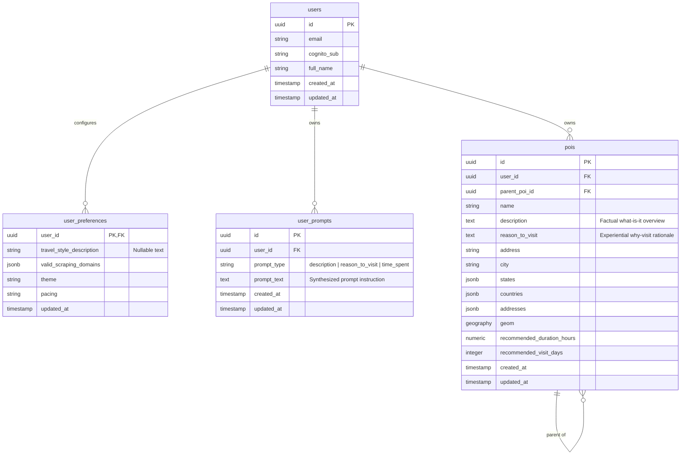
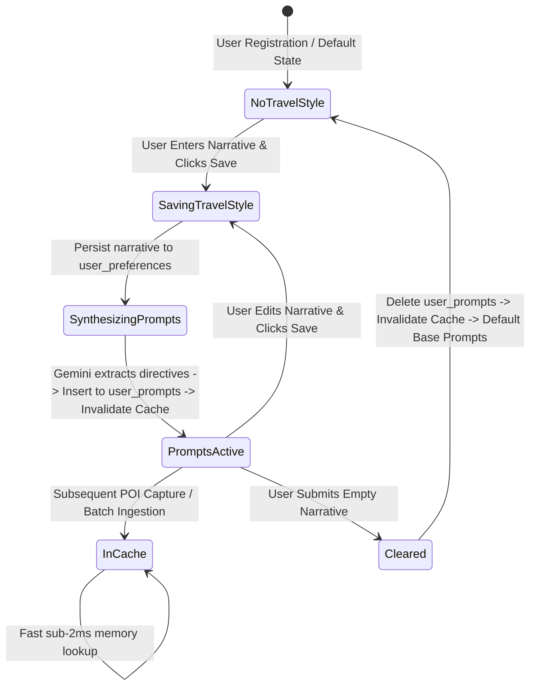

<!--
Copyright (c) 2026 Tim Olker

Licensed under the Apache License, Version 2.0 (the "License");
you may not use this file except in compliance with the License.
You may obtain a copy of the License at

    http://www.apache.org/licenses/LICENSE-2.0

Unless required by applicable law or agreed to in writing, software
distributed under the License is distributed on an "AS IS" BASIS,
WITHOUT WARRANTIES OR CONDITIONS OF ANY KIND, either express or implied.
See the License for the specific language governing permissions and
limitations under the License.

SPDX-License-Identifier: Apache-2.0
-->

# Phase 1 Data Model: Unique User Context & Reason to Visit POI Enrichment

**Feature**: `011-unique-user-context`  
**Date**: 2026-10-27  
**Status**: Completed

---

## 1. Domain Entities & Database Schema Architecture



---

## 2. Relational Table Specifications (PostgreSQL 16+ / PostGIS)

### 2.1 Table: `user_prompts` (New Table)

Stores modular prompt directives synthesized from the traveler's freeform travel style narrative.

| Column        | Type          | Nullable | Default             | Constraints / References                                                           | Description                               |
| :------------ | :------------ | :------- | :------------------ | :--------------------------------------------------------------------------------- | :---------------------------------------- |
| `id`          | `UUID`        | No       | `gen_random_uuid()` | Primary Key                                                                        | Unique prompt directive record ID         |
| `user_id`     | `UUID`        | No       | None                | FK `users(id)` ON DELETE CASCADE                                                   | Owning tenant UUID                        |
| `prompt_type` | `VARCHAR(32)` | No       | None                | Check constraint `prompt_type IN ('description', 'reason_to_visit', 'time_spent')` | Prompt target category (Python `StrEnum`) |
| `prompt_text` | `TEXT`        | No       | None                | Min length 1                                                                       | Prompt directive instructions             |
| `created_at`  | `TIMESTAMPTZ` | No       | `NOW()`             | None                                                                               | Creation timestamp                        |
| `updated_at`  | `TIMESTAMPTZ` | No       | `NOW()`             | None                                                                               | Update timestamp                          |

**Indexes & Constraints**:

- `CONSTRAINT uq_user_prompts_user_type UNIQUE (user_id, prompt_type)`
- `CREATE INDEX idx_user_prompts_user_id ON user_prompts (user_id);`
- `CONSTRAINT ck_user_prompts_type CHECK (prompt_type IN ('description', 'reason_to_visit', 'time_spent'))`

---

### 2.2 Table: `user_preferences` (Column Addition)

Extends the tenant preferences table to retain the raw travel style narrative.

| Column                     | Type   | Nullable | Default | Constraints / References | Description                                          |
| :------------------------- | :----- | :------- | :------ | :----------------------- | :--------------------------------------------------- |
| `travel_style_description` | `TEXT` | Yes      | `NULL`  | Max 2000 chars           | Freeform narrative describing travel goals and style |

---

### 2.3 Table: `pois` (Column Addition & Search Indices)

Extends the core points of interest table with experiential visit rationale and updated full-text indices.

| Column            | Type   | Nullable | Default | Constraints / References | Description                                              |
| :---------------- | :----- | :------- | :------ | :----------------------- | :------------------------------------------------------- |
| `reason_to_visit` | `TEXT` | Yes      | `NULL`  | None                     | Multiline experiential rationale explaining why to visit |

**Indexes & Constraints**:

- `CREATE INDEX idx_pois_reason_to_visit_trgm ON pois USING gin (reason_to_visit gin_trgm_ops);`
- `CREATE INDEX idx_pois_description_trgm ON pois USING gin (description gin_trgm_ops);`
- Composite search queries evaluate `(name ILIKE :q OR address ILIKE :q OR city ILIKE :q OR description ILIKE :q OR reason_to_visit ILIKE :q)`.

---

## 3. Core Domain Enumerations & Value Objects

### 3.1 Enumeration: `PromptType`

```python
from enum import StrEnum

class PromptType(StrEnum):
    """Enumeration of modular prompt directive targets.

    Adheres to Constitution Principle 4:
    Typed as Python StrEnum backed by PostgreSQL VARCHAR(32).
    """
    DESCRIPTION = "description"
    REASON_TO_VISIT = "reason_to_visit"
    TIME_SPENT = "time_spent"
```

### 3.2 Value Object: `UserPrompt`

```python
from dataclasses import dataclass
from datetime import datetime
from uuid import UUID

@dataclass(frozen=True)
class UserPrompt:
    """Pure domain representation of an extracted prompt directive."""
    id: UUID
    user_id: UUID
    prompt_type: PromptType
    prompt_text: str
    created_at: datetime
    updated_at: datetime
```

---

## 4. Boundary Pydantic v2 Schemas

All schemas inherit from `StrictBaseModel` with `extra="forbid"`, `validate_assignment=True`, and `str_strip_whitespace=True` (Constitution Principle 5).

### 4.1 User Context Schemas (`vistarae_core.schemas.user`)

```python
from uuid import UUID
from datetime import datetime
from pydantic import Field
from vistarae_core.schemas.base import StrictBaseModel

class TravelStyleUpdateRequest(StrictBaseModel):
    """Request payload for updating the traveler's travel style description."""
    travel_style_description: str | None = Field(
        default=None,
        max_length=2000,
        description="Freeform narrative describing the traveler's interests, pace, and goals."
    )

class UserPromptItem(StrictBaseModel):
    """Read-only representation of an active prompt directive."""
    prompt_type: str = Field(..., description="Target category: description, reason_to_visit, or time_spent")
    prompt_text: str = Field(..., description="Synthesized prompt instructions used in AI queries")
    updated_at: datetime = Field(..., description="Timestamp when directive was synthesized")

class TravelStyleResponse(StrictBaseModel):
    """Full travel style context response returned to traveler."""
    travel_style_description: str | None = Field(default=None, description="Current narrative description")
    prompts: list[UserPromptItem] = Field(
        default_factory=list,
        description="List of active read-only prompt directives"
    )

class ExtractedPromptDirectives(StrictBaseModel):
    """Internal Gemini Flash-Lite structured JSON extraction schema."""
    description: str = Field(..., description="Prompt modifier focusing on destination details and traveler themes")
    reason_to_visit: str = Field(..., description="Prompt modifier focusing on experiential tourist motivations")
    time_spent: str = Field(..., description="Pacing and duration guidance modifier")
```

### 4.2 Updated POI & Scraping Schemas (`vistarae_core.schemas.poi` & `scraping`)

```python
# Updates to POIResponse, POICreateRequest, POIUpdateRequest
class POIResponse(StrictBaseModel):
    # Existing fields...
    id: UUID
    user_id: UUID
    name: str
    description: str | None = Field(default=None, description="Rich factual description or markdown")
    reason_to_visit: str | None = Field(default=None, description="Experiential rationale for visiting")
    # ...remaining fields

class POICreateRequest(StrictBaseModel):
    # Existing fields...
    name: str
    description: str | None = None
    reason_to_visit: str | None = Field(default=None, description="Experiential rationale for visiting")
    # ...remaining fields

class POIUpdateRequest(StrictBaseModel):
    name: str | None = None
    description: str | None = None
    reason_to_visit: str | None = None
    # ...remaining fields

class POICandidateSchema(StrictBaseModel):
    name: str
    description: str | None = None
    reason_to_visit: str | None = None
    # ...remaining fields
```

---

## 5. Lifecycle & State Transitions


