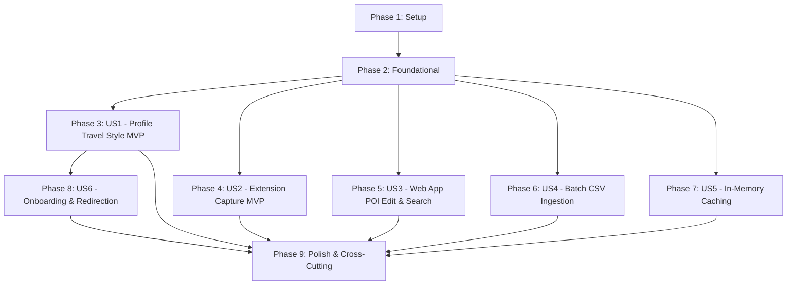

<!--
Copyright (c) 2026 Tim Olker

Licensed under the Apache License, Version 2.0 (the "License");
you may not use this file except in compliance with the License.
You may obtain a copy of the License at

    http://www.apache.org/licenses/LICENSE-2.0

Unless required by applicable law or agreed to in writing, software
distributed under the License is distributed on an "AS IS" BASIS,
WITHOUT WARRANTIES OR CONDITIONS OF ANY KIND, either express or implied.
See the License for the specific language governing permissions and
limitations under the License.

SPDX-License-Identifier: Apache-2.0
-->

# Implementation Tasks: Phase 11 — Unique User Context (Personalized LLM Prompt Extensions & "Reason to Visit" POI Enrichment)

**Feature Identifier**: `011-unique-user-context`  
**Feature Branch**: `011-unique-user-context`  
**Date**: 2026-10-27  
**Status**: Ready for Implementation  
**Specification**: [spec.md](./spec.md) | **Implementation Plan**: [plan.md](./plan.md) | **Research**: [research.md](./research.md) | **Data Model**: [data-model.md](./data-model.md) | **Contracts**: [contracts/user-context-api.yaml](./contracts/user-context-api.yaml) | **Quickstart**: [quickstart.md](./quickstart.md) | **Checklists**: [checklists/user-context.md](./checklists/user-context.md)

---

## Phase 1: Setup (Shared Infrastructure)

**Purpose**: Database migration scaffolding, contract synchronization, and shared configuration.

- [x] T-001 Create Alembic migration script in `db/migrations/versions/20261027_011_unique_user_context.py` adding `reason_to_visit` (`TEXT`, nullable) to table `pois`, adding `travel_style_description` (`TEXT`, nullable) to table `user_preferences`, creating table `user_prompts` (`id UUID PK`, `user_id UUID FK users(id) ON DELETE CASCADE`, `prompt_type VARCHAR(32) NOT NULL`, `prompt_text TEXT NOT NULL`, `created_at TIMESTAMPTZ NOT NULL`, `updated_at TIMESTAMPTZ NOT NULL`, `UNIQUE(user_id, prompt_type)`), and creating GiST/trigram indices on `pois.reason_to_visit` and `pois.description`. [REQ: REQ-CTX-014, REQ-CTX-015, REQ-CTX-020, REQ-CTX-026]
- [x] T-002 [P] Export OpenAPI specification to `openapi.json` and generate TypeScript client definitions in `frontend/src/types/user-context-api.ts` using `npx openapi-typescript ./specs/011-unique-user-context/contracts/user-context-api.yaml -o frontend/src/types/user-context-api.ts`. [REQ: REQ-CTX-021, REQ-CTX-022]

---

## Phase 2: Foundational (Blocking Prerequisites)

**Purpose**: Core domain value objects, database entities, repository interfaces, boundary schemas, and base caching infrastructure required across all user stories.

**⚠️ CRITICAL**: No user story implementation work can begin until this foundational phase is complete.

- [x] T-003 [P] Define `PromptType` enumeration subclassing Python `enum.StrEnum` with members `DESCRIPTION = "description"`, `REASON_TO_VISIT = "reason_to_visit"`, and `TIME_SPENT = "time_spent"` in `packages/core/vistarae_core/domain/value_objects.py`. [REQ: REQ-CTX-015]
- [x] T-004 [P] Update domain entities in `packages/core/vistarae_core/domain/entities.py` adding `reason_to_visit: str | None = None` to the `POI` entity and creating the `UserPrompt` dataclass entity (`id: UUID`, `user_id: UUID`, `prompt_type: PromptType`, `prompt_text: str`, `created_at: datetime`, `updated_at: datetime`). [REQ: REQ-CTX-014, REQ-CTX-020, REQ-CTX-021]
- [x] T-005 [P] Update SQLAlchemy table mappings in `packages/core/vistarae_core/adapters/db/tables.py`: add `reason_to_visit = Column(Text, nullable=True)` to `POITable`, add `travel_style_description = Column(Text, nullable=True)` to `UserPreferencesTable`, and define `UserPromptTable` with foreign key `users.id` (`ondelete="CASCADE"`), `VARCHAR(32)` `prompt_type`, and composite unique constraint `uq_user_prompts_user_type`. [REQ: REQ-CTX-014, REQ-CTX-015, REQ-CTX-020]
- [x] T-006 [P] Update Pydantic schemas in `packages/core/vistarae_core/schemas/poi.py` adding `reason_to_visit: str | None = None` to `POICreateRequest`, `POIUpdateRequest`, and `POIResponse` under strict `extra="forbid"` and `str_strip_whitespace=True`. [REQ: REQ-CTX-021]
- [x] T-007 [P] Update `POICandidateSchema` in `packages/core/vistarae_core/schemas/scraping.py` adding `reason_to_visit: str | None = None` and ensuring `description` and `reason_to_visit` are included in extraction schemas. [REQ: REQ-CTX-022, REQ-CTX-023]
- [x] T-008 [P] Define `TravelStyleUpdateRequest`, `TravelStyleResponse`, and `UserPromptItem` schemas in `packages/core/vistarae_core/schemas/user.py` inheriting from `StrictBaseModel`. [REQ: REQ-CTX-002, REQ-CTX-004, REQ-CTX-007]
- [x] T-009 [P] Define `IUserPromptRepository` protocol in `packages/core/vistarae_core/ports/repositories.py` specifying methods `list_by_user(user_id: UUID) -> Sequence[UserPrompt]`, `upsert_prompts(user_id: UUID, prompts: dict[PromptType, str]) -> Sequence[UserPrompt]`, and `delete_by_user(user_id: UUID) -> None`. [REQ: REQ-CTX-001, REQ-CTX-014]
- [x] T-010 Implement `SqlAlchemyUserPromptRepository` in `packages/core/vistarae_core/adapters/repositories/user_prompt_repo.py` enforcing strict tenant filtering (`WHERE user_id = :current_user_id`), cascade deletes, and composite upserts. [REQ: REQ-CTX-001, REQ-CTX-014]
- [x] T-011 Implement thread-safe in-memory cache `UserPromptCache` with TTL expiration, per-tenant invalidation (`invalidate_user(user_id)`), and graceful fallback to DB in `packages/core/vistarae_core/services/prompt_cache.py`. [REQ: REQ-CTX-016, REQ-CTX-017, REQ-CTX-018, REQ-CTX-019]

**Checkpoint**: Foundation ready — domain models, relational tables, repository interfaces, schemas, and in-memory cache live.

---

## Phase 3: User Story 1 - Traveler Configures Travel Style and Inspects Generated Prompts (Priority: P1) 🎯 MVP

**Goal**: Travelers input a freeform travel style narrative on `/profile`, which Gemini Flash-Lite decomposes into modular prompt directives (`description`, `reason_to_visit`, `time_spent`) saved to `user_prompts` and displayed as read-only cards on the profile.

**Independent Test**: Navigate to `/profile`, input a culinary travel style narrative, click "Save Travel Style", assert HTTP 200 with 3 generated prompt directives, verify read-only preview cards render on the page, and assert prompt records exist in `user_prompts`.

### Tests for User Story 1

- [x] T-012 [P] [US1] Unit tests for Gemini prompt decomposition in `tests/unit/services/user/test_prompt_synthesizer.py` verifying structured output for `description`, `reason_to_visit`, and `time_spent`, `thinking_budget = 0`, prompt injection delimiter protection, and brief/empty input handling. [REQ: REQ-CTX-005, REQ-CTX-006, SC-004]
- [x] T-013 [P] [US1] Unit and route integration tests for travel style endpoints (`PUT /api/user/profile/travel-style`, `GET /api/user/profile/travel-style`, `DELETE /api/user/profile/travel-style`) in `tests/unit/services/user/test_profile_travel_style.py` verifying tenant isolation, schema validation, and cache invalidation. [REQ: REQ-CTX-001, REQ-CTX-003, REQ-CTX-004, REQ-CTX-006, SC-007]
- [x] T-014 [P] [US1] Frontend component tests for Travel Style form and read-only prompt preview cards in `frontend/src/pages/__tests__/ProfilePage.test.tsx`. [REQ: REQ-CTX-002, REQ-CTX-007]

### Implementation for User Story 1

- [x] T-015 [US1] Implement `UserPromptSynthesizer` service in `services/user/services/prompt_synthesizer.py` using Google AI Studio `google-genai` SDK with model `gemini-2.5-flash-lite`, explicit `thinking_budget = 0`, Pydantic output schema, XML boundary isolation for prompt injection mitigation, and directional `MSG` logging markers. [REQ: REQ-CTX-005, SC-004]
- [x] T-016 [US1] Implement API routes `PUT`, `GET`, and `DELETE` for `/api/user/profile/travel-style` in `services/user/routes/profile.py` delegating to `UserPreferencesRepository`, `UserPromptSynthesizer`, and `UserPromptCache`, returning RFC 7807 `ProblemDetails` on error. [REQ: REQ-CTX-001, REQ-CTX-003, REQ-CTX-004, REQ-CTX-006, REQ-CTX-008]
- [x] T-017 [US1] Mount user profile routes in the user service application router `services/user/main.py`. [REQ: REQ-CTX-003]
- [x] T-018 [US1] Implement "Travel Style & Preferences" card and read-only prompt directive preview cards in `frontend/src/pages/ProfilePage.tsx` with multiline textarea, save button, loading state, toast feedback, and clear button. [REQ: REQ-CTX-002, REQ-CTX-007]

**Checkpoint**: User Story 1 complete — Travel style narrative saved, decomposed into modular directives, persisted, cached, and visible on the user profile.

---

## Phase 4: User Story 2 - Capturing POIs with Personalized Description and Reason to Visit via Extension (Priority: P1) 🎯 MVP

**Goal**: Web scraping capture pipeline augments extraction prompts with the traveler's active prompt directives, synthesizing both objective `description` and experiential `reason_to_visit` (positioned directly below `Description` in the extension capture overlay).

**Independent Test**: Configure a food-centric travel style profile, open a landmark webpage in the browser, trigger capture shortcut (`Ctrl+Shift+S`), and assert the capture overlay renders `Description` with culinary emphasis followed immediately by `Reason to Visit`, with pacing-adjusted duration.

### Tests for User Story 2

- [x] T-019 [P] [US2] Unit tests for personalized prompt extension injection in `tests/unit/services/poi/test_scraping_personalized.py` verifying description augmentation, reason to visit generation, visit duration adjustments, secondary source aggregation, and anti-hallucination guardrails for non-overlapping themes. [REQ: REQ-CTX-027, REQ-CTX-028, REQ-CTX-029, REQ-CTX-030, REQ-CTX-031, REQ-CTX-032]
- [x] T-020 [P] [US2] Unit tests for `POST /api/pois/extract-and-check` in `tests/unit/services/poi/test_triage_personalized.py` ensuring `reason_to_visit` is returned in the response payload. [REQ: REQ-CTX-021, REQ-CTX-022, SC-001]
- [x] T-021 [P] [US2] Chrome Extension Shadow DOM overlay rendering and ordering tests in `extension/tests/overlay_reason_to_visit.test.js` verifying `Reason to Visit` multiline textarea appears immediately below `Description`. [REQ: REQ-CTX-034, SC-005]

### Implementation for User Story 2

- [x] T-022 [US2] Update `ScrapingOrchestrator` in `services/poi/scraping/orchestrator.py` to retrieve active user prompt directives from `UserPromptCache` (or DB fallback) and inject them into Gemini Flash-Lite extraction prompts for `description`, `reason_to_visit`, and duration calculation. [REQ: REQ-CTX-027, REQ-CTX-028, REQ-CTX-029, REQ-CTX-030, REQ-CTX-031, REQ-CTX-032]
- [x] T-023 [US2] Update triage route `POST /api/pois/extract-and-check` in `services/poi/routes/triage.py` to populate `reason_to_visit` on `POICandidateSchema` and return it to callers. [REQ: REQ-CTX-021, REQ-CTX-022, SC-001]
- [x] T-024 [US2] Update `extension/content/content_script.js` to render the editable `Reason to Visit` multiline textarea positioned directly below `Description` in the Shadow DOM capture overlay and include `reason_to_visit` in the save POI payload. [REQ: REQ-CTX-034, SC-005]
- [x] T-025 [US2] Update `extension/content/overlay.css` to style the `Reason to Visit` textarea with visual hierarchy and spacing consistent with `Description`. [REQ: REQ-CTX-034]
- [x] T-026 [US2] Update companion script `extension/browser/browser.js` to handle `reason_to_visit` in extension popup review view. [REQ: REQ-CTX-034]

**Checkpoint**: User Story 2 complete — Chrome extension capture extracts personalized description and reason to visit, displaying both in strict visual order.

---

## Phase 5: User Story 3 - Web App POI Editing, Detail View, and Search on Description & Reason to Visit (Priority: P1)

**Goal**: Full editing parity for `reason_to_visit` in Web App forms (Edit Drawer, Manual Add Modal, Detail Drawer), optional table column, and unified backend and frontend search across both `description` and `reason_to_visit`.

**Independent Test**: Add unique keywords to `reason_to_visit` via the POI Edit Drawer, verify the updated record saves, perform a keyword search on the Web App for those keywords, and assert the POI is returned in search results.

### Tests for User Story 3

- [x] T-027 [P] [US3] Repository unit tests in `tests/unit/repositories/test_poi_search_reason.py` verifying keyword searches matching text exclusively in `reason_to_visit` return 100% of matching POIs using trigram indices. [REQ: REQ-CTX-024, REQ-CTX-026, SC-002]
- [x] T-028 [P] [US3] Frontend component tests in `frontend/src/components/poi/__tests__/POIEditDrawer.test.tsx` and `frontend/src/components/poi/__tests__/POIDetailDrawer.test.tsx` verifying visual ordering (`Reason to Visit` directly below `Description`) and form submission. [REQ: REQ-CTX-035, REQ-CTX-036, SC-005]
- [x] T-029 [P] [US3] Frontend table filtering tests in `frontend/src/components/poi/__tests__/POITable.test.tsx` verifying client-side search matches against both `description` and `reason_to_visit`. [REQ: REQ-CTX-025, REQ-CTX-037]

### Implementation for User Story 3

- [x] T-030 [US3] Update `SqlAlchemyPOIRepository.list_pois()` in `packages/core/vistarae_core/adapters/repositories/poi_repo.py` to include `POITable.reason_to_visit.ilike(f"%{q}%")` in search filter conjunctions. [REQ: REQ-CTX-024]
- [x] T-031 [US3] Update POI route handlers (`POST /api/pois`, `GET /api/pois/{poi_id}`, `PATCH /api/pois/{poi_id}`) in `services/poi/routes/pois.py` to persist, retrieve, and update `reason_to_visit`. [REQ: REQ-CTX-020, REQ-CTX-021]
- [x] T-032 [US3] Update `frontend/src/components/poi/POIEditDrawer.tsx` adding the `Reason to Visit` multiline textarea positioned directly below `Description`. [REQ: REQ-CTX-035, SC-005]
- [x] T-033 [US3] Update `frontend/src/components/poi/ManualAddPOIModal.tsx` adding the `Reason to Visit` multiline textarea positioned directly below `Description`. [REQ: REQ-CTX-035, SC-005]
- [x] T-034 [US3] Update `frontend/src/components/poi/POIDetailDrawer.tsx` adding a dedicated "Why Visit" card displaying `reason_to_visit` immediately following the description block. [REQ: REQ-CTX-036]
- [x] T-035 [US3] Update `frontend/src/components/poi/POITable.tsx` to add an optional column toggle for `Reason to Visit` alongside `Description`, and include `reason_to_visit` in table text search filtering. [REQ: REQ-CTX-025, REQ-CTX-037]

**Checkpoint**: User Story 3 complete — Reason to Visit is editable, viewable in detail, togglable in table, and fully searchable.

---

## Phase 6: User Story 4 - Batch CSV Ingestion and Web App Manual Imports with Personalized Context (Priority: P2)

**Goal**: Batch CSV ingestion worker and manual URL imports apply the traveler's active prompt extensions from the in-memory cache to populate personalized `description` and `reason_to_visit`.

**Independent Test**: Upload a 2-row test CSV via `/import` with an active culinary travel style; verify the worker completes and created POIs contain personalized `description` and `reason_to_visit`.

### Tests for User Story 4

- [x] T-036 [P] [US4] Unit tests for CSV parser mapping in `tests/unit/services/ingest/test_csv_parser_reason.py` verifying parsing of `reason_to_visit` column if present in uploaded CSV files. [REQ: REQ-CTX-033]
- [x] T-037 [P] [US4] Worker integration tests in `tests/unit/services/worker/test_processor_personalized.py` verifying that the background ingestion processor loads prompt directives and produces personalized POI attributes. [REQ: REQ-CTX-033]

### Implementation for User Story 4

- [x] T-038 [US4] Update `CSVParser` in `services/ingest/services/csv_parser.py` to recognize and map optional `reason_to_visit` and `why_visit` CSV column headers. [REQ: REQ-CTX-033]
- [x] T-039 [US4] Update SQS background worker in `services/worker/processor.py` to retrieve the batch owner's prompt extensions via `UserPromptCache` and pass them into the scraping and enrichment orchestrator. [REQ: REQ-CTX-033]

**Checkpoint**: User Story 4 complete — Batch CSV ingestion and manual imports apply personalized prompt directives.

---

## Phase 7: User Story 5 - Fast In-Memory Caching and Invalidation of Prompt Extensions (Priority: P2)

**Goal**: In-process memory store caches prompt extensions with TTL, resolving prompt directives in under 2ms for 99% of capture requests, with immediate per-tenant cache eviction upon narrative mutation or account deletion.

**Independent Test**: Measure prompt resolution time on sequential captures (< 2ms on cache hit), update travel narrative, verify next capture invalidates cache and queries fresh directives.

### Tests for User Story 5

- [x] T-040 [P] [US5] Unit tests for `UserPromptCache` in `tests/unit/core/test_prompt_cache.py` verifying cache hits, cache misses, TTL expiration, thread safety, tenant eviction on update/delete, and DB fallback on cache failure. [REQ: REQ-CTX-016, REQ-CTX-017, REQ-CTX-018, REQ-CTX-019, SC-003]
- [x] T-041 [P] [US5] Benchmark test in `tests/unit/core/test_prompt_cache_benchmark.py` verifying cache retrieval executes in < 2ms for 99% of requests. [REQ: SC-003]

### Implementation for User Story 5

- [x] T-042 [US5] Integrate `UserPromptCache` into `services/poi/scraping/orchestrator.py` and `services/worker/processor.py` to wrap prompt lookups with in-memory caching. [REQ: REQ-CTX-016, REQ-CTX-017, SC-003]
- [x] T-043 [US5] Wire cache eviction calls (`prompt_cache.invalidate_user(user_id)`) into travel style update, delete, and user deletion handlers in `services/user/routes/profile.py`. [REQ: REQ-CTX-006, REQ-CTX-018]

**Checkpoint**: User Story 5 complete — Sub-2ms in-memory cache active with strict per-tenant eviction hooks.

---

## Phase 8: User Story 6 - Onboarding & Login Redirection for Unpopulated Travel Style (Priority: P2)

**Goal**: Automatically display a friendly onboarding modal upon Web App login when `travel_style_description` is null or empty, redirecting the traveler to `/profile#travel-style` with textarea focused, while keeping Chrome Extension capture non-blocking.

**Independent Test**: Log into the Web App with an account having `travel_style_description = NULL`, verify `TravelStyleOnboardingModal` displays, click "Set Up Travel Style", verify navigation to `/profile` with narrative textarea focused. In contrast, trigger extension capture and verify capture proceeds without modal interruptions.

### Tests for User Story 6

- [x] T-044 [P] [US6] Vitest component tests in `frontend/src/components/profile/__tests__/TravelStyleOnboardingModal.test.tsx` verifying modal rendering on null/empty travel style, redirection to `/profile#travel-style` on CTA click, focus behavior, and session dismissal via "Remind Me Later". [REQ: REQ-CTX-009, REQ-CTX-010, REQ-CTX-011, REQ-CTX-012, SC-006]
- [x] T-045 [P] [US6] Extension unit test in `extension/tests/capture_unconfigured.test.js` verifying that unconfigured travel styles do not trigger modal popups or block capture. [REQ: REQ-CTX-013]

### Implementation for User Story 6

- [x] T-046 [US6] Implement `TravelStyleOnboardingModal.tsx` in `frontend/src/components/profile/TravelStyleOnboardingModal.tsx` displaying the personalization prompt, "Set Up Travel Style" redirect button, and "Remind Me Later" dismissal button. [REQ: REQ-CTX-010, REQ-CTX-011, REQ-CTX-012, SC-006]
- [x] T-047 [US6] Update `frontend/src/context/AuthContext.tsx` to evaluate `user.travel_style_description` post-login and trigger `TravelStyleOnboardingModal` if null or whitespace-only (once per authenticated session). [REQ: REQ-CTX-009, REQ-CTX-010]
- [x] T-048 [US6] Update `frontend/src/pages/ProfilePage.tsx` to handle anchor `#travel-style` by auto-scrolling to and focusing the travel style narrative textarea on mount. [REQ: REQ-CTX-011]
- [x] T-049 [US6] Ensure `extension/content/content_script.js` silently passes default base prompts when active travel style is unconfigured without displaying modals or interrupting capture. [REQ: REQ-CTX-013]

**Checkpoint**: User Story 6 complete — Web App login onboarding modal active with seamless redirection, extension capture remains silent and non-intrusive.

---

## Phase 9: Polish & Cross-Cutting Concerns

**Purpose**: Automated end-to-end regression validation, performance auditing, documentation updates, and compliance verification.

- [x] T-050 [P] Execute end-to-end quickstart validation scenarios defined in `specs/011-unique-user-context/quickstart.md` using `curl` and browser inspection. [REQ: SC-001, SC-002, SC-003, SC-004, SC-005, SC-006, SC-007]
- [x] T-051 [P] Run full test suite with coverage enforcement (`pytest --cov --cov-fail-under=90` and `npm --prefix frontend test`) ensuring $\ge 90\%$ branch and line coverage per Constitution Principle 8. [REQ: SC-007]
- [x] T-052 Verify directional `MSG` logging markers (`MSG: -->|`, `MSG: <--|`) on Gemini Flash-Lite prompt synthesis in `services/user/services/prompt_synthesizer.py` per Constitution Principle 7.
- [x] T-053 [P] Update API documentation and user guide in `docs/user-guide/travel-style-personalization.md`.

---

## Dependencies & Execution Order

### Phase Dependencies

- **Phase 1 (Setup)**: Can start immediately.
- **Phase 2 (Foundational)**: Depends on Phase 1 completion; **BLOCKS all user stories**.
- **User Stories (Phases 3–8)**: Can proceed in parallel once Phase 2 is complete.
  - Phase 3 (US1) & Phase 4 (US2) form the primary **MVP**.
  - Phase 5 (US3) builds on foundational POI schema.
  - Phase 6 (US4) builds on ingestion schemas.
  - Phase 7 (US5) optimizes caching across US1/US2/US4.
  - Phase 8 (US6) connects post-login auth to US1 profile route.
- **Phase 9 (Polish)**: Runs after desired user stories are functional.

### Parallel Opportunities

- Within Phase 1: T-002 can run in parallel with T-001.
- Within Phase 2: Domain value objects (T-003), entities (T-004), tables (T-005), POI schemas (T-006), scraping schemas (T-007), user schemas (T-008), repository protocols (T-009), and cache (T-011) can all execute in parallel.
- Across Stories: Once Phase 2 is complete, User Story 1 (Profile & Synthesis), User Story 2 (Extension Capture), and User Story 3 (Web App Edit & Search) can be implemented concurrently by independent engineers.

---

## Implementation Strategy

### MVP First (Phases 1, 2, 3, 4)

1. **Step 1**: Complete Phase 1 (Setup) and Phase 2 (Foundational).
2. **Step 2**: Implement User Story 1 (Traveler Profile Travel Style & Prompt Decomposition). Validate independently.
3. **Step 3**: Implement User Story 2 (Chrome Extension Capture with Reason to Visit). Validate independently.
4. **MVP Milestone Complete**: Travelers can save their travel style, see synthesized prompt directives, and capture POIs via the Chrome extension with personalized descriptions and reasons to visit.

### Incremental Delivery (Phases 5, 6, 7, 8, 9)

5. **Step 4**: Deliver User Story 3 (Web App POI Edit, Detail View, and Trigram Search on `reason_to_visit`).
6. **Step 5**: Deliver User Story 4 (Batch CSV & Manual Import Enrichment).
7. **Step 6**: Deliver User Story 5 (Sub-2ms In-Memory Caching & Eviction).
8. **Step 7**: Deliver User Story 6 (Web App Login Onboarding Modal & Redirection).
9. **Step 8**: Complete Phase 9 (Regression testing, $\ge 90\%$ test coverage validation, quickstart validation).
