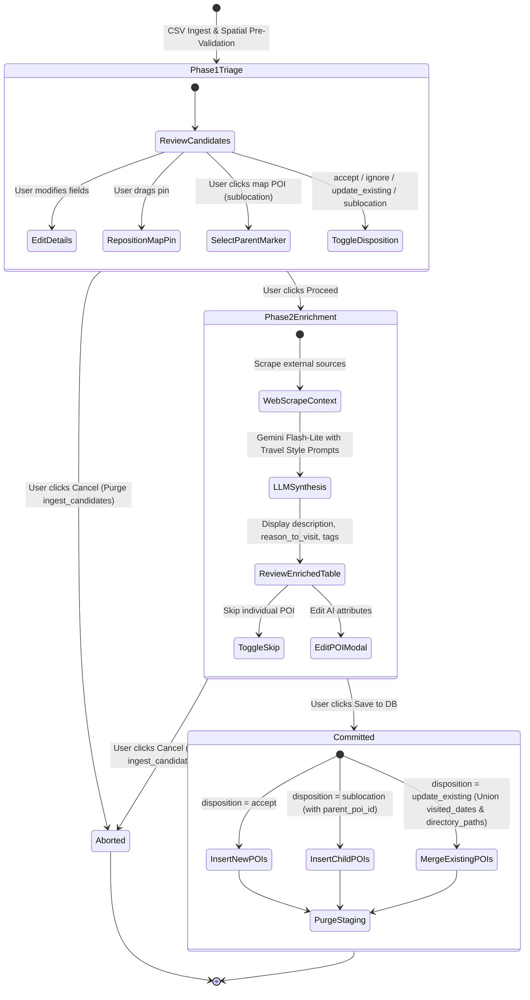

<!--
Copyright (c) 2026 Tim Olker

Licensed under the Apache License, Version 2.0 (the "License");
you may not use this file except in compliance with the License.
You may obtain a copy of the License at

    http://www.apache.org/licenses/LICENSE-2.0

Unless required by applicable law or agreed to in writing, software
distributed under the License is distributed on an "AS IS" BASIS,
WITHOUT WARRANTIES OR CONDITIONS OF ANY KIND, either express or implied.
See the License for the specific language governing permissions and
limitations under the License.

SPDX-License-Identifier: Apache-2.0
-->

# Data Model & Schema Specifications: Phase 12 — Photo Scraper CLI & Two-Phase Interactive CSV Ingestion

**Feature Identifier**: `012-photo-scraper`  
**Feature Branch**: `012-photo-scraper`  
**Date**: 2026-10-28  
**Status**: Completed  

---

## 1. Domain Entities & Value Objects (`packages/core/vistarae_core`)

### 1.1 Enumerations (`vistarae_core/domain/value_objects.py`)

All enumerations are implemented as Python `StrEnum` backed by PostgreSQL `VARCHAR(n)` columns per Vistarae Constitution Principle 4 (strictly avoiding native PostgreSQL `ENUM` types).

```python
class IngestDisposition(StrEnum):
    """Interactive disposition assigned to staged CSV/photo candidates."""

    ACCEPT = "accept"
    IGNORE = "ignore"
    UPDATE_EXISTING = "update_existing"
    SUBLOCATION = "sublocation"


class IngestCandidatePhaseState(StrEnum):
    """Lifecycle stage of a staged candidate record."""

    PHASE_1_TRIAGE = "phase_1_triage"
    PHASE_2_ENRICHED = "phase_2_enriched"
    COMMITTED = "committed"
    ABORTED = "aborted"
```

---

### 1.2 Shared CSV Export Record (`vistarae_core/schemas/poi_export.py`)

Standardized boundary schema shared across the Photo Scraper CLI and Web Application CSV ingestion parser.

```python
class POIExportRecord(StrictBaseModel):
    """Standardized representation of a POI row for RFC 4180 CSV export and import."""

    poi_name: str = Field(..., max_length=255, description="Standardized name of the attraction")
    street_address: list[str] = Field(default_factory=list, description="Semicolon-aligned street addresses")
    town_city: list[str] = Field(default_factory=list, description="Semicolon-aligned city or locality names")
    state_province: list[str] = Field(default_factory=list, description="Semicolon-aligned state or province names")
    zip_code: list[str] = Field(default_factory=list, description="Semicolon-aligned postal or zip codes")
    country: list[str] = Field(default_factory=list, description="Semicolon-aligned English country names")
    tags: list[str] = Field(default_factory=list, description="Thematic or contextual tags (empty for photo scraper)")
    latitude: Decimal | None = Field(None, ge=-90, le=90, description="WGS-84 decimal latitude")
    longitude: Decimal | None = Field(None, ge=-180, le=180, description="WGS-84 decimal longitude")
    dates_visited: list[str] = Field(default_factory=list, description="ISO-8601 visit dates (YYYY-MM-DD)")
    photo_directory: str = Field(..., description="Original filesystem directory path of the POI")
    location_confidence_percent: int = Field(0, ge=0, le=100, description="Location certainty score (0-100)")
```

---

### 1.3 LLM Location Resolution Schema (`services/scraper/location_resolver.py`)

Structured response model enforced on Google Gemini Flash-Lite via `google-genai` SDK with `thinking_budget = 0`.

```python
class POIStandardizedLocationSchema(StrictBaseModel):
    """Structured response from Gemini location resolver."""

    poi_name: str = Field(..., description="Standardized, properly capitalized POI name")
    street: str | None = Field(None, description="Street address line if determinable")
    city: str | None = Field(None, description="Town or city name")
    state_province: str | None = Field(None, description="State, province, or region")
    postal_code: str | None = Field(None, description="Postal or ZIP code if determinable")
    country: str = Field(..., description="Standard English country name")
    location_confidence_percent: int = Field(
        ...,
        ge=0,
        le=100,
        description="Confidence percentage (0-100). Penalize generic labels and multi-location brands.",
    )
    confidence_rationale: str = Field(..., description="Brief explanation of confidence score")
```

---

## 2. Database Schema & Alembic Migration

### 2.1 Staging Table: `ingest_candidates`

A dedicated PostgreSQL staging table isolated strictly by `user_id` and `job_id` per Constitution Principle 3 (`WHERE user_id = :current_user_id`).

```sql
CREATE TABLE ingest_candidates (
    id UUID PRIMARY KEY DEFAULT gen_random_uuid(),
    user_id UUID NOT NULL REFERENCES users(id) ON DELETE CASCADE,
    job_id UUID NOT NULL REFERENCES ingest_jobs(id) ON DELETE CASCADE,
    row_index INTEGER NOT NULL,
    poi_name VARCHAR(255) NOT NULL,
    recommended_disposition VARCHAR(32) NOT NULL DEFAULT 'accept',
    user_disposition VARCHAR(32) NULL,
    matched_existing_poi_id UUID NULL REFERENCES pois(id) ON DELETE SET NULL,
    parent_poi_id UUID NULL REFERENCES pois(id) ON DELETE SET NULL,
    geom GEOGRAPHY(Point, 4326) NULL,
    latitude NUMERIC(10, 7) NULL,
    longitude NUMERIC(10, 7) NULL,
    street_address VARCHAR(255) NULL,
    city VARCHAR(100) NULL,
    state_province VARCHAR(100) NULL,
    postal_code VARCHAR(32) NULL,
    country VARCHAR(100) NULL,
    addresses JSONB NOT NULL DEFAULT '[]'::jsonb,
    dates_visited JSONB NOT NULL DEFAULT '[]'::jsonb,
    photo_directory TEXT NOT NULL,
    confidence_score INTEGER NOT NULL DEFAULT 0,
    tags JSONB NOT NULL DEFAULT '[]'::jsonb,
    description TEXT NULL,
    reason_to_visit TEXT NULL,
    update_coordinates BOOLEAN NOT NULL DEFAULT FALSE,
    is_skipped BOOLEAN NOT NULL DEFAULT FALSE,
    phase_state VARCHAR(32) NOT NULL DEFAULT 'phase_1_triage',
    created_at TIMESTAMPTZ NOT NULL DEFAULT clock_timestamp(),
    updated_at TIMESTAMPTZ NOT NULL DEFAULT clock_timestamp()
);

-- Compound index for fast tenant and job lookups
CREATE INDEX idx_ingest_candidates_user_job ON ingest_candidates(user_id, job_id);

-- Spatial index for nearest candidate searches
CREATE INDEX idx_ingest_candidates_geom ON ingest_candidates USING GIST (geom);
```

---

### 2.2 SQLAlchemy Table Mapping (`packages/core/vistarae_core/adapters/db/tables.py`)

```python
ingest_candidates_table = Table(
    "ingest_candidates",
    Base.metadata,
    Column("id", PGUUID(as_uuid=True), primary_key=True, default=uuid4),
    Column("user_id", PGUUID(as_uuid=True), ForeignKey("users.id", ondelete="CASCADE"), nullable=False),
    Column("job_id", PGUUID(as_uuid=True), ForeignKey("ingest_jobs.id", ondelete="CASCADE"), nullable=False),
    Column("row_index", Integer, nullable=False),
    Column("poi_name", String(255), nullable=False),
    Column("recommended_disposition", String(32), nullable=False, default=IngestDisposition.ACCEPT),
    Column("user_disposition", String(32), nullable=True),
    Column("matched_existing_poi_id", PGUUID(as_uuid=True), ForeignKey("pois.id", ondelete="SET NULL"), nullable=True),
    Column("parent_poi_id", PGUUID(as_uuid=True), ForeignKey("pois.id", ondelete="SET NULL"), nullable=True),
    Column("geom", Geography(geometry_type="POINT", srid=4326), nullable=True),
    Column("latitude", Numeric(10, 7), nullable=True),
    Column("longitude", Numeric(10, 7), nullable=True),
    Column("street_address", String(255), nullable=True),
    Column("city", String(100), nullable=True),
    Column("state_province", String(100), nullable=True),
    Column("postal_code", String(32), nullable=True),
    Column("country", String(100), nullable=True),
    Column("addresses", JSONB, nullable=False, default=list),
    Column("dates_visited", JSONB, nullable=False, default=list),
    Column("photo_directory", Text, nullable=False),
    Column("confidence_score", Integer, nullable=False, default=0),
    Column("tags", JSONB, nullable=False, default=list),
    Column("description", Text, nullable=True),
    Column("reason_to_visit", Text, nullable=True),
    Column("update_coordinates", Boolean, nullable=False, default=False),
    Column("is_skipped", Boolean, nullable=False, default=False),
    Column("phase_state", String(32), nullable=False, default=IngestCandidatePhaseState.PHASE_1_TRIAGE),
    Column("created_at", DateTime(timezone=True), nullable=False, default=lambda: datetime.now(UTC)),
    Column("updated_at", DateTime(timezone=True), nullable=False, default=lambda: datetime.now(UTC), onupdate=lambda: datetime.now(UTC)),
)
```

---

## 3. Entity Lifecycle & Multi-Visit Merging State Machine



---

## 4. Multi-Visit Merge Algorithm (`update existing POI`)

When committing an entry classified as `update existing POI`:

1. **Visit Dates**: `existing_poi.visited_dates = sorted(list(set(existing_poi.visited_dates + candidate.dates_visited)))`
2. **Directory Paths**: `existing_poi.directory_paths = sorted(list(set(existing_poi.directory_paths + [candidate.photo_directory])))`
3. **Tags**: `existing_poi.tags = sorted(list(set(existing_poi.tags + candidate.tags)))`
4. **Coordinates & Address**:
   - If `candidate.update_coordinates == True`: overwrite `geom`, `latitude`, `longitude`, `address`, `city`, `states`, `countries` with candidate values.
   - If `candidate.update_coordinates == False` (Default): preserve `existing_poi.geom`, `latitude`, `longitude`, and primary address intact, appending distinct candidate address to `existing_poi.addresses`.
5. **Descriptions & Reasons**: Preserves existing `description` and `reason_to_visit` to protect user-curated content.

