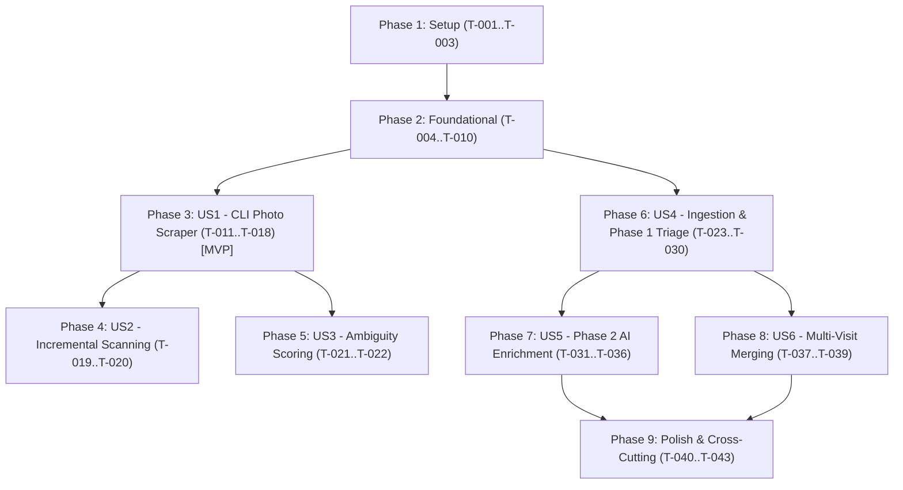

<!--
Copyright (c) 2026 Tim Olker

Licensed under the Apache License, Version 2.0 (the "License");
you may not use this file except in compliance with the License.
You may obtain a copy of the License at

    http://www.apache.org/licenses/LICENSE-2.0

Unless required by applicable law or agreed to in writing, software
distributed under the License is distributed on an "AS IS" BASIS,
WITHOUT WARRANTIES OR CONDITIONS OF ANY KIND, either express or implied.
See the License for the specific language governing permissions and
limitations under the License.

SPDX-License-Identifier: Apache-2.0
-->

# Implementation Tasks: Phase 12 — Photo Scraper CLI & Two-Phase Interactive CSV Ingestion

**Feature Identifier**: `012-photo-scraper`  
**Feature Branch**: `012-photo-scraper`  
**Date**: 2026-10-28  
**Status**: Ready for Implementation  
**Specification**: [spec.md](./spec.md) | **Implementation Plan**: [plan.md](./plan.md) | **Research**: [research.md](./research.md) | **Data Model**: [data-model.md](./data-model.md) | **Contracts**: [contracts/photo-scraper-api.yaml](./contracts/photo-scraper-api.yaml) | **Quickstart**: [quickstart.md](./quickstart.md) | **Checklists**: [checklists/photo-scraper.md](./checklists/photo-scraper.md)

---

## Phase 1: Setup (Shared Infrastructure)

**Purpose**: Database migrations, shared schemas, contract definitions, and export engine components.

- [x] T-001 Create Alembic migration script in `db/migrations/versions/20261028_add_ingest_candidates.py` creating table `ingest_candidates` (`id UUID PK`, `user_id UUID FK users(id) ON DELETE CASCADE`, `job_id UUID FK ingest_jobs(id) ON DELETE CASCADE`, `row_index INTEGER NOT NULL`, `poi_name VARCHAR(255) NOT NULL`, `recommended_disposition VARCHAR(32) NOT NULL DEFAULT 'accept'`, `user_disposition VARCHAR(32) NULL`, `matched_existing_poi_id UUID NULL FK pois(id) ON DELETE SET NULL`, `parent_poi_id UUID NULL FK pois(id) ON DELETE SET NULL`, `geom GEOGRAPHY(Point, 4326) NULL`, `latitude NUMERIC(10, 7) NULL`, `longitude NUMERIC(10, 7) NULL`, `street_address VARCHAR(255) NULL`, `city VARCHAR(100) NULL`, `state_province VARCHAR(100) NULL`, `postal_code VARCHAR(32) NULL`, `country VARCHAR(100) NULL`, `addresses JSONB NOT NULL DEFAULT '[]'`, `dates_visited JSONB NOT NULL DEFAULT '[]'`, `photo_directory TEXT NOT NULL`, `confidence_score INTEGER NOT NULL DEFAULT 0`, `tags JSONB NOT NULL DEFAULT '[]'`, `description TEXT NULL`, `reason_to_visit TEXT NULL`, `update_coordinates BOOLEAN NOT NULL DEFAULT FALSE`, `is_skipped BOOLEAN NOT NULL DEFAULT FALSE`, `phase_state VARCHAR(32) NOT NULL DEFAULT 'phase_1_triage'`, `created_at TIMESTAMPTZ NOT NULL`, `updated_at TIMESTAMPTZ NOT NULL`), with compound index on `(user_id, job_id)` and GiST index on `geom`. [REQ: REQ-ING-011, REQ-ING-015, REQ-ING-023] [Test: `tests/unit/services/ingest/test_staging_service.py`]
- [x] T-002 [P] Export OpenAPI contract from `specs/012-photo-scraper/contracts/photo-scraper-api.yaml` and generate TypeScript client definitions in `frontend/src/types/ingest-staging-api.ts` using `npx openapi-typescript ./specs/012-photo-scraper/contracts/photo-scraper-api.yaml -o frontend/src/types/ingest-staging-api.ts`. [REQ: REQ-ING-011, REQ-ING-019] [Validation: `frontend/src/types/ingest-staging-api.ts`]
- [x] T-003 [P] Create sample media test fixtures in `tests/fixtures/sample_photos/` containing valid images (`.jpg`, `.png`, `.heic`), companion sidecar files (`.xmp`, `.json`), trip subdirectories (`Trip To India`, `Japan 4-03`, `1-Tokyo`, `03 Oaxaca`), and noise folders (`bad`, `thumbs`, `RESOURCE.FRK`, `New Folder (2)`, `Tim`). [REQ: REQ-SCR-004, REQ-SCR-017, REQ-SCR-019, REQ-SCR-020] [Validation: `tests/fixtures/sample_photos/`]

---

## Phase 2: Foundational (Blocking Prerequisites)

**Purpose**: Core domain value objects, database table mappings, repository protocols, shared CSV exporter, and local SQLite cache manager required across all subsystems.

**⚠️ CRITICAL**: No user story implementation work can begin until this foundational phase is complete.

- [x] T-004 [P] Define `IngestDisposition` and `IngestCandidatePhaseState` enumerations subclassing Python `enum.StrEnum` in `packages/core/vistarae_core/domain/value_objects.py`. [REQ: REQ-ING-011, REQ-ING-016] [Test: `tests/unit/services/ingest/test_staging_service.py`]
- [x] T-005 [P] Define `POIExportRecord` schema in `packages/core/vistarae_core/schemas/poi_export.py` inheriting from `StrictBaseModel` with fields `poi_name`, `street_address: list[str]`, `town_city: list[str]`, `state_province: list[str]`, `zip_code: list[str]`, `country: list[str]`, `tags: list[str]`, `latitude: Decimal | None`, `longitude: Decimal | None`, `dates_visited: list[str]`, `photo_directory: str`, `location_confidence_percent: int`. [REQ: REQ-SCR-029, REQ-SCR-034] [Test: `tests/unit/services/scraper/test_csv_exporter.py`]
- [x] T-006 [P] Update SQLAlchemy table mappings in `packages/core/vistarae_core/adapters/db/tables.py` defining `ingest_candidates_table` with `user_id` FK (`ondelete="CASCADE"`), `job_id` FK (`ondelete="CASCADE"`), `geom` Point geography, and composite tenant index. [REQ: REQ-ING-001, REQ-ING-015] [Test: `tests/unit/services/ingest/test_staging_service.py`]
- [x] T-007 [P] Define `IIngestCandidateRepository` protocol in `packages/core/vistarae_core/ports/repositories.py` specifying methods `create_batch`, `list_by_job`, `update_candidate`, `advance_to_phase2`, `commit_job`, and `purge_by_job`. [REQ: REQ-ING-011, REQ-ING-015, REQ-ING-023] [Test: `tests/unit/services/ingest/test_staging_service.py`]
- [x] T-008 Implement `SqlAlchemyIngestCandidateRepository` in `packages/core/vistarae_core/adapters/repositories/ingest_candidate_repo.py` enforcing strict tenant filter `WHERE user_id = :current_user_id` and atomic lifecycle methods. [REQ: REQ-ING-001, REQ-ING-015, REQ-ING-023] [Test: `tests/unit/services/ingest/test_staging_service.py`]
- [x] T-009 [P] Implement shared RFC 4180 exporter `generate_standard_poi_csv(records: list[POIExportRecord]) -> str` in `packages/core/vistarae_core/services/csv_exporter.py` with formula injection sanitization (`'`, `=`, `+`, `-`, `@`, `\t`, `\r`) and semicolon alignment across multi-address lists. [REQ: REQ-SCR-031, REQ-SCR-036, REQ-SCR-038] [Test: `tests/unit/services/scraper/test_csv_exporter.py`]
- [x] T-010 [P] Implement local SQLite cache manager `ScraperCacheManager` in `services/scraper/cache.py` managing `.scraper_cache.db` with SHA-256 keying of `(path_tokens, coords, tags)` -> JSON response. [REQ: REQ-SCR-033] [Test: `tests/unit/services/scraper/test_location_resolver.py`]

**Checkpoint**: Foundation ready — domain models, tables, repository interfaces, shared CSV exporter, and SQLite cache live.

---

## Phase 3: User Story 1 - Traveler Scans Irregular Photo Archive with CLI Scraper (Priority: P1) 🎯 MVP

**Goal**: Traveler runs `python -m services.scraper.photo_scraper --input-dir <dir>` to recursively scan photo archives, skip noise folders, parse path heuristics, extract EXIF/IPTC/XMP/sidecar metadata without modifying media, resolve locations via Gemini Flash-Lite, and export standardized CSV.

**Independent Test**: Execute `python -m services.scraper.photo_scraper --input-dir ./tests/fixtures/sample_photos --output-csv ./vistarae_pois.csv`, assert zero filesystem mutations in the fixture directory, verify noise folders are ignored, and verify `./vistarae_pois.csv` contains 12 standardized columns with correctly parsed POI names, coordinates, earliest visit dates, and confidence scores.

### Tests for User Story 1

- [x] T-011 [P] [US1] Unit tests for path cleaning heuristics (`services/scraper/path_parser.py`) in `tests/unit/services/scraper/test_path_parser.py` testing prefix stripping (`1-Tokyo`, `03 Oaxaca`), trip/country extraction (`Trip To India`, `Japan 4-03`), parenthetical alternate names (`Senso-ji (Asakusa Kannon Temple)`), and noise pruning (`bad`, `thumbs`, `New Folder (2)`, `Tim`). [REQ: REQ-SCR-004, REQ-SCR-005, REQ-SCR-006, REQ-SCR-007, REQ-SCR-010, REQ-SCR-012, REQ-SCR-013, REQ-SCR-014] [Test: `tests/unit/services/scraper/test_path_parser.py`]
- [x] T-012 [P] [US1] Unit tests for multi-standard metadata extraction (`services/scraper/metadata_extractor.py`) in `tests/unit/services/scraper/test_metadata_extractor.py` testing EXIF GPS tag decoding, embedded IPTC/XMP parsing, Adobe `.xmp` and Google Photos `.json` sidecar parsing, coordinate precedence, earliest date selection across multi-date folders, and read-only preservation. [REQ: REQ-SCR-017, REQ-SCR-018, REQ-SCR-019, REQ-SCR-020, REQ-SCR-021, REQ-SCR-022, REQ-SCR-025, REQ-SCR-027] [Test: `tests/unit/services/scraper/test_metadata_extractor.py`]
- [x] T-013 [P] [US1] Unit tests for Gemini location resolver (`services/scraper/location_resolver.py`) in `tests/unit/services/scraper/test_location_resolver.py` testing structured JSON parsing, confidence scoring, SQLite cache hits/misses, and strict `GOOGLE_API_KEY` online requirement. [REQ: REQ-SCR-028, REQ-SCR-029, REQ-SCR-030, REQ-SCR-033] [Test: `tests/unit/services/scraper/test_location_resolver.py`]
- [x] T-014 [P] [US1] Integration tests for CLI entrypoint in `tests/unit/services/scraper/test_photo_scraper_cli.py` testing full traversal, CSV generation, and zero filesystem mutations via SHA-256 tree hashing before and after scanning. [REQ: REQ-SCR-001, REQ-SCR-002, REQ-SCR-034, REQ-SCR-035, REQ-SCR-038] [Test: `tests/unit/services/scraper/test_photo_scraper_cli.py`]

### Implementation for User Story 1

- [x] T-015 [P] [US1] Implement `services/scraper/path_parser.py` with `clean_path_segments`, `prune_noise_folders`, `extract_trip_country_context`, `strip_numerical_prefixes`, and `split_alternate_names` using embedded ISO-3166 gazetteer and Illinois regional landmark fallback. [REQ: REQ-SCR-004, REQ-SCR-005, REQ-SCR-006, REQ-SCR-007, REQ-SCR-010, REQ-SCR-011, REQ-SCR-012, REQ-SCR-013, REQ-SCR-014, REQ-SCR-016] [Test: `tests/unit/services/scraper/test_path_parser.py`]
- [x] T-016 [P] [US1] Implement `services/scraper/metadata_extractor.py` with pure-Python Pillow + `exifread` for EXIF GPS/dates, `defusedxml` for secure XMP/XML sidecar parsing, and `json` for Google Photos Takeout sidecars, strictly enforcing `open(file, 'rb')` read-only mode and lowest date visited calculation. [REQ: REQ-SCR-001, REQ-SCR-017, REQ-SCR-018, REQ-SCR-019, REQ-SCR-020, REQ-SCR-021, REQ-SCR-022, REQ-SCR-023, REQ-SCR-024, REQ-SCR-025, REQ-SCR-026, REQ-SCR-027] [Test: `tests/unit/services/scraper/test_metadata_extractor.py`]
- [x] T-017 [US1] Implement `services/scraper/location_resolver.py` calling Google Gemini Flash-Lite via `google-genai` SDK with `thinking_budget = 0`, structured schema `POIStandardizedLocationSchema`, directional dev logging `MSG: |-->`, and SQLite cache lookup. [REQ: REQ-SCR-028, REQ-SCR-029, REQ-SCR-030, REQ-SCR-033] [Test: `tests/unit/services/scraper/test_location_resolver.py`]
- [x] T-018 [US1] Implement `services/scraper/photo_scraper.py` standalone CLI with arguments `--input-dir`, `--output-csv`, `--cache-dir`, recursive directory discovery (skipping noise), metadata extraction, location resolution, and CSV export via `generate_standard_poi_csv`. [REQ: REQ-SCR-001, REQ-SCR-002, REQ-SCR-003, REQ-SCR-034, REQ-SCR-035, REQ-SCR-036, REQ-SCR-037, REQ-SCR-038] [Test: `tests/unit/services/scraper/test_photo_scraper_cli.py`]

**Checkpoint**: User Story 1 (CLI MVP) complete and testable independently.

---

## Phase 4: User Story 2 - Incremental Scanning via Previous Execution Output (Priority: P1)

**Goal**: When re-running the CLI with `--previous-csv <path>`, already-processed directories recorded in the `Photo directory` column are skipped without making redundant LLM or geocoding calls.

**Independent Test**: Run CLI with `--previous-csv` pointing to an existing CSV output, verify listed directories are skipped with 0 LLM queries, and assert delta output contains only newly added directories.

### Tests for User Story 2

- [x] T-019 [P] [US2] Unit tests for previous execution diffing in `tests/unit/services/scraper/test_incremental_scanner.py` verifying directory membership checks, skip logging, and `--rescan-existing` flag override. [REQ: REQ-SCR-008, REQ-SCR-009] [Test: `tests/unit/services/scraper/test_incremental_scanner.py`]

### Implementation for User Story 2

- [x] T-020 [US2] Update `services/scraper/photo_scraper.py` to parse `--previous-csv` argument, load all existing `Photo directory` paths into an in-memory set, and skip traversal of matching folders unless `--rescan-existing` is supplied. [REQ: REQ-SCR-008, REQ-SCR-009] [Test: `tests/unit/services/scraper/test_incremental_scanner.py`]

**Checkpoint**: User Stories 1 and 2 functional and testable independently.

---

## Phase 5: User Story 3 - Ambiguous Location Scoring & Low Confidence Flagging (Priority: P2)

**Goal**: Generic folder names lacking GPS coordinates (`Sledding`, `Beach`) receive low confidence scores ($\le 15$), and multi-location commercial brands (`McDonalds`, `Starbucks`) without coordinates receive penalized confidence scores ($\le 30$).

**Independent Test**: Process test folders `Sledding` and `McDonalds` without GPS, assert `location_confidence_percent` $\le 15$ and $\le 30$ respectively, and verify empty address fields.

### Tests for User Story 3

- [x] T-021 [P] [US3] Unit tests for ambiguity penalty scoring in `tests/unit/services/scraper/test_confidence_scoring.py` asserting generic activity scoring $\le 15$ and brand ambiguity scoring $\le 30$. [REQ: REQ-SCR-031, REQ-SCR-032] [Test: `tests/unit/services/scraper/test_confidence_scoring.py`]

### Implementation for User Story 3

- [x] T-022 [US3] Update Gemini system prompt and heuristic post-processor in `services/scraper/location_resolver.py` to enforce strict confidence bounds on generic activities lacking GPS and multi-location commercial brands. [REQ: REQ-SCR-031, REQ-SCR-032] [Test: `tests/unit/services/scraper/test_confidence_scoring.py`]

**Checkpoint**: User Stories 1, 2, and 3 functional and testable independently.

---

## Phase 6: User Story 4 - Web App Ingestion Progress & Phase 1 Validation Triage (Priority: P1)

**Goal**: Web application ingests photo scraper CSV, streams progress via SQS worker, executes reverse/forward geocoding fallbacks and deduplication, stages records in `ingest_candidates`, and opens the Phase 1 Validation Window allowing field editing, disposition changes, and interactive map parent POI selection for sublocations.

**Independent Test**: Upload a 5-row test CSV via `CSVUploadModal.tsx`, assert progress bar reaches 100%, assert `CSVTriageModal.tsx` opens displaying recommended dispositions (`accept`, `ignore`, `update existing POI`, `sublocation`), click an existing POI map marker to link parent POI for a sublocation, click Proceed, and assert non-ignored rows advance.

### Tests for User Story 4

- [x] T-023 [P] [US4] Unit tests for updated CSV streaming parser in `tests/unit/services/ingest/test_csv_parser.py` testing header validation, semicolon-delimited list extraction, formula sanitization, and 2MB / 2,000 row limits. [REQ: REQ-ING-001, REQ-SCR-036, REQ-SCR-038] [Test: `tests/unit/services/ingest/test_csv_parser.py`]
- [x] T-024 [P] [US4] Unit tests for candidate staging and deduplication in `tests/unit/services/ingest/test_staging_service.py` verifying spatial ($\le 50\text{m}$) and trigram ($\ge 0.60$) duplicate detection, sublocation nesting detection, and geocoding fallbacks. [REQ: REQ-ING-003, REQ-ING-004, REQ-ING-005, REQ-ING-006, REQ-ING-007, REQ-ING-008, REQ-ING-009, REQ-ING-010] [Test: `tests/unit/services/ingest/test_staging_service.py`]
- [x] T-025 [P] [US4] Contract tests for Phase 1 staging endpoints in `tests/unit/services/ingest/test_staging_routes.py` testing `GET /api/ingest/jobs/{job_id}/candidates`, `PATCH /api/ingest/jobs/{job_id}/candidates/{candidate_id}`, `POST /api/ingest/jobs/{job_id}/phase1/proceed`, and `POST /api/ingest/jobs/{job_id}/phase1/cancel`. [REQ: REQ-ING-011, REQ-ING-012, REQ-ING-013, REQ-ING-015, REQ-ING-016] [Test: `tests/unit/services/ingest/test_staging_routes.py`]
- [x] T-026 [P] [US4] Component tests for Phase 1 triage UI in `frontend/src/tests/ingest/CSVTriageModal.test.tsx` testing table rendering, disposition dropdown changes, and map marker click parent selection. [REQ: REQ-ING-011, REQ-ING-012, REQ-ING-013, REQ-ING-014] [Test: `frontend/src/tests/ingest/CSVTriageModal.test.tsx`]

### Implementation for User Story 4

- [x] T-027 [US4] Update `services/ingest/services/csv_parser.py` to parse standardized `POIExportRecord` columns, extracting semicolon-aligned address lists, visit dates, and directory paths. [REQ: REQ-ING-001, REQ-SCR-034, REQ-SCR-036] [Test: `tests/unit/services/ingest/test_csv_parser.py`]
- [x] T-028 [US4] Implement `services/ingest/services/staging_service.py` handling hierarchical reverse geocoding (street -> city -> state -> country), forward geocoding fallbacks, spatial deduplication against user's existing POIs, and staging row creation in `ingest_candidates`. [REQ: REQ-ING-003, REQ-ING-004, REQ-ING-005, REQ-ING-006, REQ-ING-007, REQ-ING-008, REQ-ING-009, REQ-ING-010] [Test: `tests/unit/services/ingest/test_staging_service.py`]
- [x] T-029 [US4] Implement Phase 1 endpoints in `services/ingest/routes/staging.py`: `GET /api/ingest/jobs/{job_id}/candidates`, `PATCH /api/ingest/jobs/{job_id}/candidates/{candidate_id}`, `POST /api/ingest/jobs/{job_id}/phase1/proceed`, and `POST /api/ingest/jobs/{job_id}/phase1/cancel` (purging staging on cancel). [REQ: REQ-ING-011, REQ-ING-012, REQ-ING-013, REQ-ING-015, REQ-ING-016] [Test: `tests/unit/services/ingest/test_staging_routes.py`]
- [x] T-030 [US4] Implement `frontend/src/components/ingest/CSVTriageModal.tsx` rendering candidate table with disposition selector (`accept`, `ignore`, `update existing POI`, `sublocation`), editable address fields, interactive map pin dragging, and direct click on existing POI map markers to link `parent_poi_id`. [REQ: REQ-ING-011, REQ-ING-012, REQ-ING-013, REQ-ING-014, REQ-ING-015, REQ-ING-016] [Test: `frontend/src/tests/ingest/CSVTriageModal.test.tsx`]

**Checkpoint**: User Story 4 complete — Phase 1 validation, staging, and sublocation map binding live.

---

## Phase 7: User Story 5 - Phase 2 AI Enrichment & Final Confirmation (Priority: P1)

**Goal**: Non-ignored candidates from Phase 1 undergo external web scraping and personalized LLM enrichment (incorporating Phase 11 travel style directives from `user_prompts`), presenting the Phase 2 Review Window with skip toggles, edit modal, map sync, and atomic database commit.

**Independent Test**: Proceed from Phase 1 with 2 accepted POIs, verify Phase 2 modal opens with generated `description` and personalized `reason_to_visit`, toggle skip on 1 POI, click Save to DB, assert unskipped POI is committed to `pois`, and assert `ingest_candidates` staging is purged.

### Tests for User Story 5

- [x] T-031 [P] [US5] Contract tests for Phase 2 endpoints in `tests/unit/services/ingest/test_phase2_routes.py` testing `POST /api/ingest/jobs/{job_id}/phase2/commit` and `POST /api/ingest/jobs/{job_id}/phase2/cancel`. [REQ: REQ-ING-023, REQ-ING-024] [Test: `tests/unit/services/ingest/test_phase2_routes.py`]
- [x] T-032 [P] [US5] Integration tests for personalized Phase 2 enrichment in `tests/unit/services/poi/test_phase2_enrichment.py` asserting user travel style directives from `user_prompts` are appended to Gemini prompts when generating `description` and `reason_to_visit`. [REQ: REQ-ING-017, REQ-ING-018] [Test: `tests/unit/services/poi/test_phase2_enrichment.py`]
- [x] T-033 [P] [US5] Component tests for Phase 2 review modal in `frontend/src/tests/ingest/CSVPhase2ReviewModal.test.tsx` testing skip toggles, edit modal opening, map pin synchronization, and commit payload dispatch. [REQ: REQ-ING-019, REQ-ING-020, REQ-ING-021, REQ-ING-022, REQ-ING-023, REQ-ING-024] [Test: `frontend/src/tests/ingest/CSVPhase2ReviewModal.test.tsx`]

### Implementation for User Story 5

- [x] T-034 [US5] Implement Phase 2 enrichment worker logic in `services/ingest/services/staging_service.py` integrating with `services/poi/scraping/orchestrator.py` to scrape web context and query Gemini Flash-Lite using user prompt directives (`user_prompts`) to populate `description`, `reason_to_visit`, and tags in `ingest_candidates`. [REQ: REQ-ING-017, REQ-ING-018] [Test: `tests/unit/services/poi/test_phase2_enrichment.py`]
- [x] T-035 [US5] Implement Phase 2 endpoints in `services/ingest/routes/staging.py`: `POST /api/ingest/jobs/{job_id}/phase2/commit` and `POST /api/ingest/jobs/{job_id}/phase2/cancel`, executing transactional insert into `pois` table and clean purge of `ingest_candidates`. [REQ: REQ-ING-023, REQ-ING-024] [Test: `tests/unit/services/ingest/test_phase2_routes.py`]
- [x] T-036 [US5] Implement `frontend/src/components/ingest/CSVPhase2ReviewModal.tsx` rendering enriched candidates with generated descriptions and reasons to visit, skip toggles per row, POI edit drawer launcher, synchronized interactive map, and **Save to DB** / **Cancel** actions. [REQ: REQ-ING-019, REQ-ING-020, REQ-ING-021, REQ-ING-022, REQ-ING-023, REQ-ING-024] [Test: `frontend/src/tests/ingest/CSVPhase2ReviewModal.test.tsx`]

**Checkpoint**: User Story 5 complete — Phase 2 enrichment, review UI, and atomic DB commit live.

---

## Phase 8: User Story 6 - Cross-Year Multi-Visit Merging (Priority: P2)

**Goal**: When a candidate matches an existing POI (`update existing POI`), final commit unions `visited_dates`, `directory_paths`, and `tags` into the existing POI, preserving existing primary coordinates and address by default unless the user explicitly toggles `update_coordinates`.

**Independent Test**: Commit an update candidate against an existing POI with dates `['2002-06-15']` and photo path `M:\Photos\2002\Park`, asserting post-commit `visited_dates` contains both `2002-06-15` and `2005-09-20`, `directory_paths` contains both paths, and primary coordinates remain unaltered when `update_coordinates` is False.

### Tests for User Story 6

- [x] T-037 [P] [US6] Unit tests for multi-visit merging in `tests/unit/services/ingest/test_multi_visit_merger.py` verifying union of `visited_dates`, union of `directory_paths`, tag aggregation, coordinate preservation by default, and conditional coordinate overwrite when `update_coordinates=True`. [REQ: REQ-ING-023, Clarification Q4] [Test: `tests/unit/services/ingest/test_multi_visit_merger.py`]

### Implementation for User Story 6

- [x] T-038 [US6] Implement multi-visit merge handler in `services/ingest/services/staging_service.py` performing set-unions of `visited_dates`, `directory_paths`, and `tags`, appending distinct address records to `addresses`, and conditionally updating `geom`/`latitude`/`longitude` only if `update_coordinates` is enabled. [REQ: REQ-ING-023, Clarification Q4] [Test: `tests/unit/services/ingest/test_multi_visit_merger.py`]
- [x] T-039 [US6] Add "Update Coordinates" toggle to the POI edit modal in `CSVTriageModal.tsx` and `CSVPhase2ReviewModal.tsx` for rows with disposition `update existing POI`. [REQ: REQ-ING-012, REQ-ING-021, Clarification Q4] [Test: `frontend/src/tests/ingest/CSVTriageModal.test.tsx`]

**Checkpoint**: User Stories 1 through 6 complete.

---

## Phase 9: Polish & Cross-Cutting Concerns

**Purpose**: Test coverage compliance, end-to-end quickstart validation, and zero-mutation safety verification.

- [x] T-040 [P] Implement end-to-end test in `tests/integration/test_photo_scraper_e2e.py` validating CLI scan -> CSV export -> Web App upload -> Phase 1 triage -> Phase 2 enrichment -> DB commit. [REQ: REQ-SCR-001, REQ-ING-023] [Test: `tests/integration/test_photo_scraper_e2e.py`]
- [x] T-041 [P] Verify PyTest line and branch coverage $\ge 90\%$ across `services/scraper/` and `services/ingest/` via `pytest tests/unit/services/scraper tests/unit/services/ingest --cov=services/scraper --cov=services/ingest --cov-fail-under=90`. [REQ: Constitution Principle 8] [Validation: PyTest Coverage Report]
- [x] T-042 [P] Verify scanned media archive cryptographic immutability by asserting pre-scan and post-scan SHA-256 tree hashes match across all test photo fixtures. [REQ: REQ-SCR-001, SC-002] [Validation: `tests/unit/services/scraper/test_photo_scraper_cli.py`]
- [x] T-043 Synchronize OpenAPI TypeScript definitions via `python -m scripts.export_openapi` and verify `git diff --exit-code ./frontend/src/types/` returns zero diff per Constitution Principle 5. [REQ: Constitution Principle 5] [Validation: `git diff --exit-code`]

---

## Dependencies & Execution Order

### Phase Dependencies

### User Story Dependencies

- **User Story 1 (P1)**: Starts immediately after Foundational (Phase 2). Delivers standalone CLI MVP.
- **User Story 2 (P1)**: Extends CLI scanning with `--previous-csv` diffing. Depends on US1.
- **User Story 3 (P2)**: Calibrates confidence scoring penalties for ambiguous labels. Depends on US1.
- **User Story 4 (P1)**: Implements Web App CSV ingestion and Phase 1 interactive triage. Can start immediately after Foundational (Phase 2) in parallel with US1.
- **User Story 5 (P1)**: Implements Phase 2 AI enrichment and final commit. Depends on US4.
- **User Story 6 (P2)**: Implements multi-visit merging and coordinate preservation. Depends on US4.

---

## Parallel Execution Opportunities

- **Phase 1 Setup**: T-002 (OpenAPI TS generation) and T-003 (test media fixtures) can execute in parallel with T-001 (Alembic migration).
- **Phase 2 Foundational**: T-004 (Enums), T-005 (Export schema), T-006 (Table mapping), T-007 (Repo protocol), T-009 (CSV exporter), and T-010 (SQLite cache) can all execute in parallel.
- **CLI vs Web App Streams**: Once Phase 2 is complete, the CLI track (US1, US2, US3) and Web App Ingestion track (US4, US5, US6) can execute completely in parallel.
- **Within User Stories**: Test tasks marked `[P]` (e.g. T-011, T-012, T-013) can be authored in parallel before implementation.

---

## Implementation Strategy

### MVP First (Phase 1 through Phase 3)
1. Complete Phase 1 (Setup) and Phase 2 (Foundational).
2. Complete Phase 3 (User Story 1: CLI Photo Scraper).
3. **STOP and VALIDATE**: Run `python -m services.scraper.photo_scraper` against test photo archives; verify clean 12-column CSV output, multi-standard EXIF/sidecar extraction, and zero filesystem mutations.

### Incremental Delivery (Web App Ingestion Track)
1. Implement Phase 6 (User Story 4: Web App Ingest & Phase 1 Validation Modal).
2. Implement Phase 7 (User Story 5: Phase 2 AI Enrichment & Final DB Commit).
3. Implement Phase 8 (User Story 6: Multi-Visit Merging).
4. Run Phase 9 (Polish, $\ge 90\%$ test coverage verification, quickstart end-to-end scenarios).

