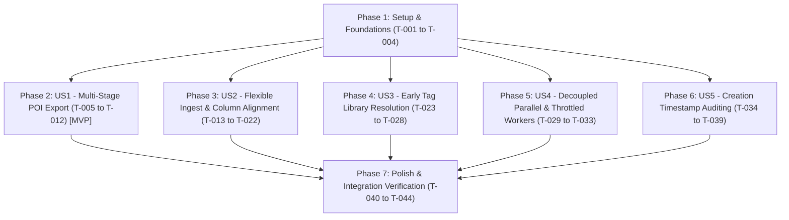

<!--
Copyright (c) 2026 Tim Olker

Licensed under the Apache License, Version 2.0 (the "License");
you may not use this file except in compliance with the License.
You may obtain a copy of the License at

    http://www.apache.org/licenses/LICENSE-2.0

Unless required by applicable law or agreed to in writing, software
distributed under the License is distributed on an "AS IS" BASIS,
WITHOUT WARRANTIES OR CONDITIONS OF ANY KIND, either express or implied.
See the License for the specific language governing permissions and
limitations under the License.

SPDX-License-Identifier: Apache-2.0
-->

# Tasks: Phase 13 — Multi-Stage POI Export, Flexible Multi-Fidelity Import & Ingestion Enhancements

**Branch**: `013-poi-export-import-enhancements` | **Date**: 2026-10-31  
**Inputs**: Design documents from `specs/013-poi-export-import-enhancements/` ([spec.md](./spec.md), [plan.md](./plan.md), [research.md](./research.md), [data-model.md](./data-model.md), [contracts/poi-exchange-api.yaml](./contracts/poi-exchange-api.yaml))  
**Governance**: Adheres strictly to [.specify/memory/constitution.md](../../.specify/memory/constitution.md)

---

## Task Formatting Conventions

- **Checklist format**: `- [ ] [TaskID] [P?] [Story?] Description with file path`
- **[P]**: Parallelizable task (independent files, no shared blocking dependency)
- **[Story]**: Mapped user story: `[US1]`, `[US2]`, `[US3]`, `[US4]`, `[US5]`
- **EARS Mapping**: Explicit requirement reference (`[REQ-...]`) mapped to every task
- **Test Mapping**: Associated unit, contract, or component test file mapped to every task

---

## Phase 1: Setup & Foundational Prerequisites

**Purpose**: Core schema extensions, base data models, and rate-limiting infrastructure required across all stories.

- [X] T-001 Create Alembic migration script for `pois.created_at TIMESTAMP WITH TIME ZONE NOT NULL DEFAULT NOW()` and index `idx_pois_user_created_at ON pois (user_id, created_at DESC)` in `db/migrations/versions/20261031_add_poi_created_at.py` [REQ-AUD-001] [Test: `tests/unit/adapters/db/test_migrations.py`]
- [X] T-002 [P] Define `TagResolutionAction` StrEnum and `SelectiveEnrichmentOverrides` in `packages/core/vistarae_core/domain/enums.py` [REQ-VAL-003, REQ-REC-003] [Test: `tests/unit/domain/test_enums.py`]
- [X] T-003 [P] Implement `POIExchangeRecord` in `packages/core/vistarae_core/schemas/poi_exchange.py` inheriting from `StrictBaseModel` with dynamic field introspection support [REQ-EXP-005, REQ-EXP-006] [Test: `tests/unit/schemas/test_poi_exchange.py`]
- [X] T-004 [P] Implement thread-safe `AsyncTokenBucket` rate limiter (capacity 1, refill rate 1.0 token/sec) in `services/worker/rate_limiter.py` [REQ-WRK-002] [Test: `tests/unit/services/worker/test_rate_limiter.py`]

---

## Phase 2: User Story 1 - Multi-Stage Incremental POI Export Engine (Priority: P1) [MVP]

**Goal**: Enable travelers to selectively export checked POI records across Explorer, Phase 1 Triage, and Phase 2 Review into CSV (UTF-8 BOM), JSON, and YAML formats, aborting with a prompt if 0 rows are checked.

**Independent Test**: Scenario 1 in [quickstart.md](./quickstart.md) (Attempting export with 0 rows aborts; selecting 3 rows downloads valid CSV with `\xef\xbb\xbf` BOM, formula escaping, and all core schema fields).

### Tests for User Story 1 (Write First)

- [X] T-005 [P] [US1] Unit test `test_poi_exporter.py` in `tests/unit/services/ingest/test_poi_exporter.py` verifying dynamic introspection of all `POIExchangeRecord` fields, UTF-8 BOM prepending, formula injection escaping (`'`, `=`, `+`, `-`, `@`), and JSON/YAML serialization [REQ-EXP-002, REQ-EXP-005, REQ-EXP-006, REQ-EXP-007]
- [X] T-006 [P] [US1] Unit test `test_export_routes.py` in `tests/unit/services/ingest/test_export_routes.py` verifying 400 Bad Request when `poi_ids` or `candidate_ids` array is empty, and HTTP 200 chunked streaming response when records are provided [REQ-EXP-003, REQ-EXP-004, REQ-EXP-008]

### Implementation for User Story 1

- [X] T-007 [US1] Implement streaming serializer in `packages/core/vistarae_core/services/poi_exporter.py` generating CSV (with `\xef\xbb\xbf` BOM and single-quote formula escaping), JSON array stream, and YAML document stream [REQ-EXP-002, REQ-EXP-005, REQ-EXP-006, REQ-EXP-007, REQ-EXP-008]
- [X] T-008 [US1] Implement export endpoints in `services/ingest/routes/export.py` (`POST /api/v1/export/pois`, `POST /api/v1/export/candidates/phase1`, `POST /api/v1/export/candidates/phase2`) returning chunked `StreamingResponse` and aborting with RFC 7807 problem details if selection count is 0 [REQ-EXP-001, REQ-EXP-003, REQ-EXP-004, REQ-EXP-008]
- [X] T-009 [P] [US1] Create frontend API client in `frontend/src/services/exportApi.ts` supporting blob streaming downloads for CSV, JSON, and YAML files [REQ-EXP-002, REQ-EXP-008]
- [X] T-010 [US1] Update `frontend/src/components/poi/POITable.tsx` to add "Export Selected" button (prompting with toast and aborting if 0 rows checked) and a "Select All Matching Current Filters" header toggle [REQ-EXP-003, REQ-EXP-004, REQ-EXP-009] [Test: `frontend/src/tests/poi/POITable.test.tsx`]
- [X] T-011 [P] [US1] Update `frontend/src/components/ingest/CSVTriageModal.tsx` to add "Export Selected" button (aborting if 0 candidates checked) and "Select All" toggle [REQ-EXP-005, REQ-EXP-009] [Test: `frontend/src/tests/ingest/CSVTriageModal.test.tsx`]
- [X] T-012 [P] [US1] Update `frontend/src/components/ingest/CSVPhase2ReviewModal.tsx` to add "Export Selected" button (aborting if 0 candidates checked) and "Select All" toggle [REQ-EXP-007, REQ-EXP-009] [Test: `frontend/src/tests/ingest/CSVPhase2ReviewModal.test.tsx`]

---

## Phase 3: User Story 2 - Flexible Multi-Format Ingest, Column Alignment & Pre-Validation (Priority: P1)

**Goal**: Ingest CSV (`utf-8-sig`), JSON, and YAML files; auto-alias headers; display Interactive Column Mapping Modal with 3-row previews for unmapped columns; validate coordinate and date types with a "Skip Invalid Rows & Continue" dialog.

**Independent Test**: Scenario 2 in [quickstart.md](./quickstart.md) (Uploading file with non-standard headers launches column mapping; invalid coordinate on row 2 triggers error modal; clicking "Skip" stages the 2 valid rows).

### Tests for User Story 2 (Write First)

- [X] T-013 [P] [US2] Unit test `test_poi_importer.py` in `tests/unit/services/ingest/test_poi_importer.py` verifying format sniffing (`.csv`, `.json`, `.yaml`), `utf-8-sig` BOM handling, canonical alias dictionary resolution, and pre-import type validation [REQ-IMP-001, REQ-IMP-002, REQ-IMP-004, REQ-IMP-005]
- [X] T-014 [P] [US2] Unit test `test_column_mapping.py` in `tests/unit/services/ingest/test_column_mapping.py` verifying `NEEDS_COLUMN_MAPPING` response payload when headers are unrecognized, and skip invalid rows processing [REQ-IMP-003, REQ-IMP-005]
- [X] T-015 [P] [US2] Component test `ColumnMappingModal.test.tsx` in `frontend/src/tests/ingest/ColumnMappingModal.test.tsx` testing 3-row data previews, target field selection, and ignore column toggles [REQ-IMP-003]
- [X] T-016 [P] [US2] Component test `ImportValidationErrorModal.test.tsx` in `frontend/src/tests/ingest/ImportValidationErrorModal.test.tsx` verifying display of offending rows/columns and triggers for "Skip Invalid Rows" and "Abort" [REQ-IMP-005]

### Implementation for User Story 2

- [X] T-017 [US2] Implement flexible parser and alias dictionary in `packages/core/vistarae_core/services/poi_importer.py` supporting CSV (`utf-8-sig`), JSON, YAML, and type/range sanity validation [REQ-IMP-001, REQ-IMP-002, REQ-IMP-004, REQ-IMP-005]
- [X] T-018 [US2] Update `services/ingest/routes/upload.py` to add `POST /api/v1/ingest/upload-flexible` handling format sniffing, column mapping detection, and pre-validation reporting [REQ-IMP-001, REQ-IMP-003, REQ-IMP-005]
- [X] T-019 [US2] Implement tenant-scoped ID reconciliation in `services/ingest/services/staging_service.py` (`WHERE id = :poi_id AND user_id = :current_user_id`), marking existing matches as `update_existing` and assigning fresh UUIDs for foreign or missing IDs [REQ-IMP-007] [Test: `tests/unit/services/ingest/test_staging_service.py`]
- [X] T-020 [P] [US2] Build `frontend/src/components/ingest/ColumnMappingModal.tsx` rendering column names, 3 sample row values, target field dropdowns, and an `[Ignore]` option [REQ-IMP-003]
- [X] T-021 [P] [US2] Build `frontend/src/components/ingest/ImportValidationErrorModal.tsx` rendering specific offending columns, row numbers, invalid values, and "Skip [N] Invalid Rows & Continue" / "Abort Import" actions [REQ-IMP-005]
- [X] T-022 [US2] Update `frontend/src/components/ingest/CSVUploadModal.tsx` to accept `.csv`, `.json`, `.yaml`, `.yml`, trigger column mapping/validation error modals, and forward user selections [REQ-IMP-001, REQ-IMP-003, REQ-IMP-005]

---

## Phase 4: User Story 3 - Early Tag Library Resolution Dialog (Priority: P2)

**Goal**: Inspect incoming tags against the user's active Tag Library before writing candidates to the database; present the Early Tag Validation Dialog with one-click "Approve & Add All to Library", "Strip", and "Abort" actions.

**Independent Test**: Scenario 3 in [quickstart.md](./quickstart.md) (Uploading file with unvetted tag `Onsen` opens dialog; clicking "Approve & Add All" persists `Onsen` to `tags` table and stages candidates with both tags).

### Tests for User Story 3 (Write First)

- [X] T-023 [P] [US3] Unit test `test_tag_resolution.py` in `tests/unit/services/ingest/test_tag_resolution.py` testing detection of unapproved tags, case-insensitive library comparison, and resolution actions (`APPROVE_AND_ADD`, `STRIP_UNAPPROVED`, `ABORT`) [REQ-VAL-001, REQ-VAL-002, REQ-VAL-003, REQ-VAL-004, REQ-VAL-005]
- [X] T-024 [P] [US3] Component test `TagValidationWarningModal.test.tsx` in `frontend/src/tests/ingest/TagValidationWarningModal.test.tsx` asserting tag count display and callback dispatches [REQ-VAL-002, REQ-VAL-003, REQ-VAL-004, REQ-VAL-005]

### Implementation for User Story 3

- [X] T-025 [US3] Implement pre-flight tag validator in `services/ingest/services/staging_service.py` querying tenant's `tags` table case-insensitively and halting before candidate insertion if unvetted tags exist [REQ-VAL-001, REQ-VAL-002]
- [X] T-026 [US3] Implement tag resolution endpoint in `services/ingest/routes/tags.py` (`POST /api/v1/ingest/resolve-tags`) executing `APPROVE_AND_ADD` (bulk insert into `tags`), `STRIP_UNAPPROVED`, or `ABORT` [REQ-VAL-003, REQ-VAL-004, REQ-VAL-005]
- [X] T-027 [US3] Build `frontend/src/components/ingest/TagValidationWarningModal.tsx` displaying unapproved tag pills with occurrence counts and the 3 action buttons [REQ-VAL-002, REQ-VAL-003, REQ-VAL-004, REQ-VAL-005]
- [X] T-028 [US3] Integrate `TagValidationWarningModal` into `frontend/src/components/ingest/CSVUploadModal.tsx` upload workflow [REQ-VAL-002]

---

## Phase 5: User Story 4 - Decoupled Parallel & Throttled Worker Execution (Priority: P2)

**Goal**: Process imported POIs as decoupled async tasks; throttle Nominatim geocoding via shared token bucket (1 req/sec); bound LLM concurrency ($\le 5$); evaluate missing fields dynamically; allow selective field re-calculation overrides.

**Independent Test**: Scenario 4 in [quickstart.md](./quickstart.md) (Parallel execution of 50 POIs never exceeds 1 req/sec for Nominatim; selective re-calculation preserves original tags while re-generating descriptions).

### Tests for User Story 4 (Write First)

- [X] T-029 [P] [US4] Unit test `test_candidate_enricher_throttling.py` in `tests/unit/services/worker/test_candidate_enricher_throttling.py` asserting that concurrent geocoding tasks pace at $\ge 1.0\text{s}$ intervals and LLM concurrency semaphore limits parallel calls to 5 [REQ-WRK-001, REQ-WRK-002, REQ-WRK-003]
- [X] T-030 [P] [US4] Unit test `test_selective_recalculation.py` in `tests/unit/services/worker/test_selective_recalculation.py` asserting that populated fields are preserved by default and re-generated only when explicit override flags are true [REQ-IMP-006, REQ-REC-001, REQ-REC-002]

### Implementation for User Story 4

- [X] T-031 [US4] Integrate `AsyncTokenBucket` rate limiter into `services/worker/processor.py` for all outbound Nominatim geocoding queries [REQ-WRK-001, REQ-WRK-002]
- [X] T-032 [US4] Implement dynamic per-field presence resolution and selective field re-calculation overrides in `services/worker/candidate_enricher.py` using `asyncio.Semaphore(5)` for Gemini Flash-Lite calls [REQ-IMP-006, REQ-WRK-003, REQ-REC-001, REQ-REC-002]
- [X] T-033 [US4] Add "Selective Enrichment Overrides" accordion to `frontend/src/components/ingest/CSVUploadModal.tsx` allowing user toggles for Description, Reason to Visit, Tags, Duration, and Links [REQ-REC-002]

---

## Phase 6: User Story 5 - POI Creation Timestamp Auditing (`created_at`) (Priority: P3)

**Goal**: Expose sortable "Date Added" (`created_at`) column in the Explorer table, and provide quick date range filters (`Today`, `Last 7 Days`, `Last 30 Days`, `Custom`).

**Independent Test**: Filter Explorer view by `Added: Today`; verify only POIs added today appear and that "Date Added" displays formatted timestamp (`MMM D, YYYY, h:mm A`).

### Tests for User Story 5 (Write First)

- [X] T-034 [P] [US5] Unit test `test_poi_repository_created_at.py` in `tests/unit/adapters/db/test_poi_repository_created_at.py` asserting that inserted POIs default to UTC now and that `created_after` / `created_before` filter queries operate efficiently [REQ-AUD-001, REQ-AUD-002]
- [X] T-035 [P] [US5] Component test `POIFilterBar.test.tsx` in `frontend/src/tests/poi/POIFilterBar.test.tsx` testing Date Added dropdown selection and callback payload [REQ-AUD-002]

### Implementation for User Story 5

- [X] T-036 [US5] Update `packages/core/vistarae_core/adapters/db/tables.py` and `POI` domain entity to include `created_at: datetime` mapped to `pois.created_at` [REQ-AUD-001]
- [X] T-037 [US5] Update POI repository in `packages/core/vistarae_core/adapters/db/repositories/poi_repository.py` to support `created_after` and `created_before` parameters in `list_pois()` [REQ-AUD-002]
- [X] T-038 [US5] Add "Date Added" column and sorting support in `frontend/src/components/poi/POITable.tsx` [REQ-AUD-002]
- [X] T-039 [US5] Add Date Added filter presets (`Today`, `Last 7 Days`, `Last 30 Days`, `Custom Range`) to `frontend/src/components/poi/POIFilterBar.tsx` [REQ-AUD-002]

---

## Phase 7: Polish, Verification & Integration

**Purpose**: Cross-cutting contract synchronization, full test suite execution, and validation against design documents.

- [X] T-040 Export OpenAPI 3.1 contract and regenerate frontend TypeScript bindings via `python -m scripts.export_openapi && npx openapi-typescript ./openapi.json -o ./frontend/src/types/api.ts` [REQ-EXP-001]
- [X] T-041 [P] Verify and enforce standard Apache 2.0 copyright headers on all newly created `.py`, `.ts`, and `.tsx` files via `python -m scripts.check_headers` [Constitution Principle 1]
- [X] T-042 Execute full backend test suite verifying $\ge 90\%$ line and branch coverage across ingest and worker packages: `.venv\Scripts\python -m pytest tests/unit/services/ingest/ tests/unit/services/worker/ --cov=services/ingest --cov=services/worker --cov-report=term-missing` [Constitution Principle 8]
- [X] T-043 Execute full frontend test suite: `npm --prefix frontend run test:unit` and verify production build: `npm --prefix frontend run build` [Constitution Principle 5]
- [X] T-044 Execute complete end-to-end verification scenarios defined in `specs/013-poi-export-import-enhancements/quickstart.md`

---

## Dependencies & Execution Order

---

## Parallel Opportunities

- **Phase 1**: `T-002`, `T-003`, and `T-004` can execute in parallel while database migration `T-001` is being prepared.
- **Phase 2 (US1)**: Test tasks `T-005` and `T-006` can be written in parallel; frontend components `T-009`, `T-011`, and `T-012` can be developed in parallel once route `T-008` is defined.
- **Phase 3 (US2)**: Test tasks `T-013`, `T-014`, `T-015`, and `T-016` can run in parallel; frontend modals `T-020` and `T-021` can be created in parallel.
- **Phase 4 (US3)**: Tests `T-023` and `T-024` can run in parallel; endpoint `T-026` and modal `T-027` can run in parallel.
- **Phase 5 (US4)**: Tests `T-029` and `T-030` can run in parallel.
- **Phase 6 (US5)**: Tests `T-034` and `T-035` can run in parallel.

---

## Implementation Strategy: MVP First

1. **Step 1**: Complete **Phase 1** (Foundations: `T-001` – `T-004`).
2. **Step 2 (MVP Delivery)**: Implement **Phase 2 (US1)** (`T-005` – `T-012`). Validate Scenario 1 in [quickstart.md](./quickstart.md). Travelers can immediately start taking incremental backups and exporting selected POIs with full schema parity and zero-selection safety!
3. **Step 3**: Deliver **Phase 3 (US2)** (`T-013` – `T-022`) for flexible third-party file mapping and format error handling.
4. **Step 4**: Deliver **Phase 4 (US3)** (`T-023` – `T-028`) for early tag library validation.
5. **Step 5**: Deliver **Phase 5 (US4)** (`T-029` – `T-033`) for throttled parallel processing.
6. **Step 6**: Deliver **Phase 6 (US5)** (`T-034` – `T-039`) for creation timestamp auditing.
7. **Step 7**: Complete **Phase 7** (`T-040` – `T-044`) for end-to-end integration and verification.

