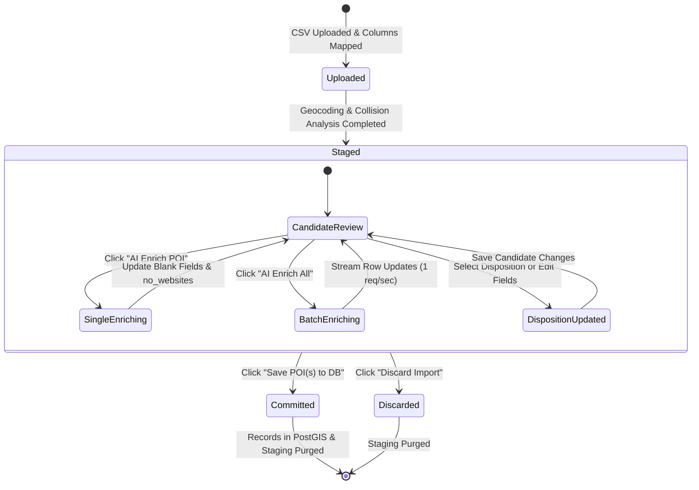

# Data Model: Unified POI Import Staging Workbench

**Feature**: `014-unified-import-staging-workbench`  
**Date**: 2026-11-02  
**Status**: Completed  

---

## 1. Domain Entities & Value Objects

### CandidateDisposition (StrEnum)
Represents the actionable disposition assigned to an import candidate.

```python
class CandidateDisposition(StrEnum):
    ACCEPT = "accept"                     # Commit as a new standalone POI
    SUBLOCATION = "sublocation"           # Commit as a child/sublocation of a parent POI
    IN_BATCH_MERGE = "in_batch_merge"     # Merge unique attributes into another candidate in the same batch
    UPDATE_EXISTING = "update_existing"   # Update an existing POI in the permanent database
    EXCLUDE = "exclude"                   # Exclude from import (e.g. falls in exclusion zone)
    IGNORE = "ignore"                     # User or AI decision to skip/discard
```

---

### IngestCandidate (Domain Entity)
Located in `packages/core/vistarae_core/domain/entities.py`.

```python
@dataclass
class IngestCandidate:
    id: str
    job_id: str
    user_id: str
    row_index: int
    poi_name: str
    latitude: Optional[float] = None
    longitude: Optional[float] = None
    street_address: Optional[str] = None
    city: Optional[str] = None
    state_province: Optional[str] = None
    country: Optional[str] = None
    postal_code: Optional[str] = None
    
    # Enriched content
    hero_image_url: Optional[str] = None
    official_url: Optional[str] = None
    wiki_url: Optional[str] = None
    related_websites: list[dict[str, Any]] = field(default_factory=list)
    no_websites: bool = False
    
    # Planning & metadata
    recommended_duration_hours: Optional[float] = None
    recommended_visit_days: Optional[int] = None
    estimated_visit_time_notes: Optional[str] = None
    tags: list[str] = field(default_factory=list)
    description: Optional[str] = None
    reason_to_visit: Optional[str] = None
    
    # Triage & Hierarchical disposition
    disposition: CandidateDisposition = CandidateDisposition.ACCEPT
    disposition_justification: Optional[str] = None
    is_user_overridden: bool = False
    parent_poi_id: Optional[str] = None          # Reference to permanent POI in DB
    parent_candidate_id: Optional[str] = None    # Reference to another candidate in same batch
    merge_target_id: Optional[str] = None        # Target candidate if IN_BATCH_MERGE
    
    # Scoring & Status
    confidence_score: float = 1.0
    is_duplicate: bool = False
    created_at: Optional[datetime] = None
    updated_at: Optional[datetime] = None
```

---

### IngestStagingJob (Domain Entity)
Represents the import session container.

```python
@dataclass
class IngestStagingJob:
    id: str
    user_id: str
    filename: str
    total_rows: int
    candidate_count: int
    status: str  # "staged", "enriching", "committed", "discarded"
    created_at: Optional[datetime] = None
    updated_at: Optional[datetime] = None
```

---

## 2. Database Schema & Tables

### Table: `ingest_candidates`
Located in `packages/core/vistarae_core/adapters/db/tables.py`.

```python
IngestCandidateTable = Table(
    "ingest_candidates",
    metadata,
    Column("id", UUID(as_uuid=False), primary_key=True),
    Column("job_id", UUID(as_uuid=False), ForeignKey("ingest_staging_jobs.id", ondelete="CASCADE"), nullable=False, index=True),
    Column("user_id", UUID(as_uuid=False), nullable=False, index=True),
    Column("row_index", Integer, nullable=False),
    Column("poi_name", String(255), nullable=False),
    Column("latitude", Numeric(9, 6), nullable=True),
    Column("longitude", Numeric(9, 6), nullable=True),
    Column("street_address", String(500), nullable=True),
    Column("city", String(100), nullable=True),
    Column("state_province", String(100), nullable=True),
    Column("country", String(100), nullable=True),
    Column("postal_code", String(20), nullable=True),
    
    Column("hero_image_url", String(2000), nullable=True),
    Column("official_url", String(2000), nullable=True),
    Column("wiki_url", String(2000), nullable=True),
    Column("related_websites", JSONB, nullable=False, server_default="[]"),
    Column("no_websites", Boolean, nullable=False, server_default=false()),
    
    Column("recommended_duration_hours", Numeric(5, 2), nullable=True),
    Column("recommended_visit_days", Integer, nullable=True),
    Column("estimated_visit_time_notes", Text, nullable=True),
    Column("tags", ARRAY(String), nullable=False, server_default="{}"),
    Column("description", Text, nullable=True),
    Column("reason_to_visit", Text, nullable=True),
    
    Column("disposition", String(50), nullable=False, server_default="accept"),
    Column("disposition_justification", Text, nullable=True),
    Column("is_user_overridden", Boolean, nullable=False, server_default=false()),
    Column("parent_poi_id", UUID(as_uuid=False), ForeignKey("pois.id", ondelete="SET NULL"), nullable=True),
    Column("parent_candidate_id", UUID(as_uuid=False), ForeignKey("ingest_candidates.id", ondelete="SET NULL"), nullable=True),
    Column("merge_target_id", UUID(as_uuid=False), ForeignKey("ingest_candidates.id", ondelete="SET NULL"), nullable=True),
    
    Column("confidence_score", Float, nullable=False, server_default="1.0"),
    Column("is_duplicate", Boolean, nullable=False, server_default=false()),
    Column("created_at", DateTime(timezone=True), nullable=False, server_default=func.now()),
    Column("updated_at", DateTime(timezone=True), nullable=False, server_default=func.now(), onupdate=func.now()),
)
```

---

## 3. State Machine & Invariants



### Validation Invariants
1. **Sublocation Referential Integrity**:
   - `disposition == SUBLOCATION` $\implies$ (`parent_poi_id is not None` OR `parent_candidate_id is not None`).
   - If both are `None`, raise `422 Unprocessable Entity`: `"Sublocation requires an assigned parent POI"`.
2. **Acyclic Hierarchy Invariant**:
   - When setting `parent_candidate_id`, system recursively traverses parent links. If `id` exists in ancestor chain, reject with `422 Unprocessable Entity`: `"Circular hierarchy detected"`.
3. **No Websites Idempotency**:
   - `no_websites == True` $\implies$ enrichment engine skips Wikidata & external web scraping.
   - User adds website URL $\implies$ `no_websites` immediately resets to `False`.
4. **In-Batch Merge Cascade Guard**:
   - If candidate A is target of candidate B, candidate A's disposition cannot be set to `EXCLUDE` or `IGNORE` until candidate B is reassigned or promoted.

