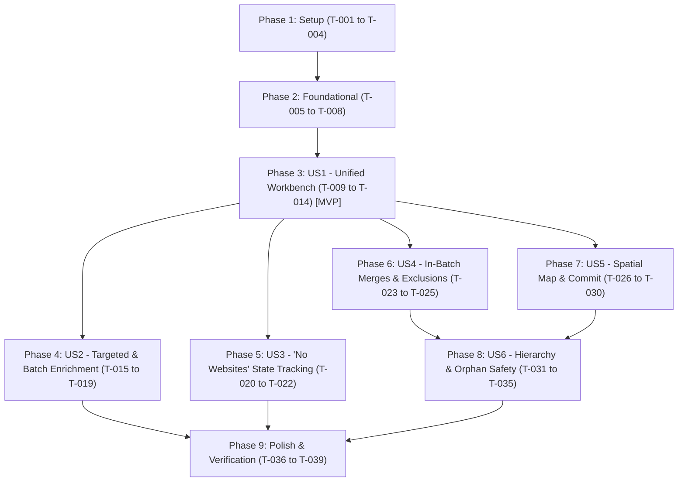

# Tasks: Unified POI Import Staging Workbench

**Feature Branch**: `014-poi-export-import-enhancements-v2`  
**Input**: Design documents from `specs/014-unified-import-staging-workbench/`  
**Prerequisites**: [plan.md](./plan.md), [spec.md](./spec.md), [research.md](./research.md), [data-model.md](./data-model.md), [contracts/import-staging-workbench-api.yaml](./contracts/import-staging-workbench-api.yaml)  

---

## Phase 1: Setup (Shared Infrastructure)

**Purpose**: Initialize schema migration and establish core workspace package baseline.

- [X] T-001 Create Alembic database schema migration `db/migrations/versions/20261102_add_workbench_fields.py` adding `no_websites` (BOOLEAN DEFAULT FALSE), `disposition_justification` (TEXT NULL), `is_user_overridden` (BOOLEAN DEFAULT FALSE), `parent_candidate_id` (UUID NULL), and `merge_target_id` (UUID NULL) with fully reversible `downgrade()`. (FR-004, FR-019, FR-020)
- [X] T-002 [P] Update domain models in `packages/core/vistarae_core/domain/entities.py` adding `no_websites: bool`, `disposition_justification: Optional[str]`, `is_user_overridden: bool`, `parent_candidate_id: Optional[str]`, and `merge_target_id: Optional[str]` to `IngestCandidate`. (FR-004, FR-025)
- [X] T-003 [P] Add `CandidateDisposition` StrEnum to `packages/core/vistarae_core/domain/enums.py` with values `ACCEPT`, `SUBLOCATION`, `IN_BATCH_MERGE`, `UPDATE_EXISTING`, `EXCLUDE`, and `IGNORE`. (FR-002, FR-021)
- [X] T-004 [P] Update SQLAlchemy ORM definitions in `packages/core/vistarae_core/adapters/db/tables.py` for `IngestCandidateTable` mapping all new columns. (FR-004, FR-025)

---

## Phase 2: Foundational (Blocking Prerequisites)

**Purpose**: Core backend repository methods, boundary schemas, and active session protection that block all user stories.

- [X] T-005 Update `packages/core/vistarae_core/schemas/ingest_staging.py` defining Pydantic v2 `CandidateUpdateRequest`, `BatchEditCandidatesRequest`, and `IngestCandidateResponse` with `extra="forbid"`. (FR-004, FR-011, FR-024)
- [X] T-006 Update `packages/core/vistarae_core/adapters/repositories/ingest_candidate_repo.py` to persist and retrieve new candidate attributes, support candidate-to-candidate foreign key lookups, and query active uncommitted sessions. (FR-004, FR-023, FR-031)
- [X] T-007 Implement active session upload guard in `services/ingest/routes/upload.py` rejecting `POST /api/ingest/upload` with HTTP 409 Conflict if an uncommitted job is active. (FR-031; Validation: `tests/unit/services/ingest/test_staging_routes.py`)
- [X] T-008 Synchronize API contracts: export updated `openapi.json` via `python -m scripts.export_openapi` and regenerate TypeScript definitions in `frontend/src/types/api.ts`. (FR-001, FR-004)

---

## Phase 3: User Story 1 - Single-Stage Workbench Navigation & Inspection (Priority: P1) [MVP]

**Goal**: Deliver the unified `CSVImportWorkbenchModal` replacing both Phase 1 and Phase 2 modals, allowing inspection and editing without backtracking.

**Independent Test**: Upload a CSV file, verify all candidates display in a single filterable table with completeness badges, edit any row in the right-hand panel, and save changes using the pinned footer button.

- [X] T-009 [P] [US1] Create unit tests in `tests/unit/services/ingest/test_staging_routes.py` for `GET /api/ingest/jobs/{job_id}/candidates` and `PUT /api/ingest/jobs/{job_id}/candidates/{candidate_id}`. (FR-002, FR-005, FR-011)
- [X] T-010 [US1] Refactor candidate query endpoints in `services/ingest/routes/staging.py` supporting unified filtering by completeness status (`incomplete`, `missing_photo`, `missing_location`, `missing_websites`), disposition, and text search. (FR-002; Validation: `tests/unit/services/ingest/test_staging_routes.py`)
- [X] T-011 [US1] Implement candidate update service method in `services/ingest/services/staging_service.py` to validate and update basic coordinates, address, and enriched fields. (FR-011)
- [X] T-012 [P] [US1] Update API client in `frontend/src/services/ingestApi.ts` adding `updateStagingCandidate` and `listStagingCandidates` with unified filtering parameters. (FR-002, FR-011)
- [X] T-013 [US1] Create `frontend/src/components/ingest/CSVImportWorkbenchModal.tsx` containing the split layout: left master table with sortable columns, completeness badges, disposition selectors, and right detail editor with fixed header, scrollable body, and pinned "Save Candidate Changes" button. (FR-001, FR-002, FR-003, FR-005, FR-011; Validation: `frontend/src/tests/ingest/CSVImportWorkbenchModal.test.tsx`)
- [X] T-014 [US1] Update `frontend/src/components/ingest/ColumnMappingModal.tsx` to launch directly into `CSVImportWorkbenchModal`, deprecating references to `CSVTriageModal` and `CSVPhase2ReviewModal`. (FR-001)

---

## Phase 4: User Story 2 - Targeted Single-POI and Batch AI Enrichment (Priority: P1)

**Goal**: Enable on-demand targeted single-POI enrichment ("AI Enrich POI") and non-blocking asynchronous batch enrichment with live row updates.

**Independent Test**: Select an incomplete candidate, click "AI Enrich POI", verify missing fields populate within 3.5s without resetting the UI, and verify "AI Enrich All" streams progress without freezing the table.

- [X] T-015 [P] [US2] Write unit tests in `tests/unit/services/ingest/test_single_enrichment.py` verifying `POST /api/ingest/jobs/{job_id}/candidates/{candidate_id}/enrich` populates only blank fields and respects existing inputs. (FR-006; Validation: `tests/unit/services/ingest/test_single_enrichment.py`)
- [X] T-016 [US2] Implement targeted single-POI enrichment endpoint in `services/ingest/routes/staging.py` invoking `CandidateEnricher.enrich_candidate` synchronously for fast on-demand returns. (FR-006)
- [X] T-017 [US2] Implement non-blocking batch enrichment endpoint `POST /api/ingest/jobs/{job_id}/enrich-all` in `services/ingest/routes/staging.py` enqueuing background tasks with 1.0s external rate limiting. (FR-007, FR-030)
- [X] T-018 [P] [US2] Add single-POI and batch enrichment API methods in `frontend/src/services/ingestApi.ts`. (FR-006, FR-007)
- [X] T-019 [US2] Add the **"AI Enrich POI"** button with active loading spinner inside the candidate editor of `frontend/src/components/ingest/CSVImportWorkbenchModal.tsx` and wire background polling for batch updates. (FR-006, FR-017, FR-030; Validation: `frontend/src/tests/ingest/CSVImportWorkbenchModal.test.tsx`)

---

## Phase 5: User Story 3 - "No Websites" Idempotency & State Tracking (Priority: P2)

**Goal**: Prevent redundant external website search requests by tracking confirmed absence of web presence.

**Independent Test**: Enrich an obscure candidate yielding 0 websites, confirm "No Websites" is automatically checked, verify re-running enrichment bypasses website scraping, and confirm adding a URL unchecks and disables the box.

- [X] T-020 [P] [US3] Write unit tests in `tests/unit/services/worker/test_candidate_enricher.py` verifying external website lookups are skipped when `candidate.no_websites == True` and set to `True` when 0 sites are found. (FR-008, FR-015)
- [X] T-021 [US3] Update `services/worker/candidate_enricher.py` and secondary scraping orchestrator to check `candidate.no_websites` before querying Wikidata / Nominatim and set `no_websites = True` if results are empty. (FR-008, FR-015)
- [X] T-022 [US3] Implement the reactive "No Websites" checkbox in `frontend/src/components/ingest/CSVImportWorkbenchModal.tsx` in the Related Websites section: disable when $\ge 1$ site exists, enable when 0 sites exist, and auto-reset to False on URL add. (FR-008, FR-009, FR-010, FR-022; Validation: `frontend/src/tests/ingest/CSVImportWorkbenchModal.test.tsx`)

---

## Phase 6: User Story 4 - Duplicate Detection, In-Batch Merging & Exclusion Zones (Priority: P2)

**Goal**: Automate duplicate candidate detection, In-Batch Merge grouping, and exclusion zone tagging with readable explanations.

**Independent Test**: Import CSV with duplicate entries and points in exclusion zones; verify primary candidate is set to `Accept`, duplicates to `In-Batch Merge`, and exclusion points to `Exclude`, displaying read-only justification notes.

- [X] T-023 [P] [US4] Write unit tests in `tests/unit/services/ingest/test_deduplication.py` asserting first duplicate is primary, subsequent are `In-Batch Merge` pointing to primary ID, and exclusion zones set `Exclude`. (FR-019, FR-020; Validation: `tests/unit/services/ingest/test_deduplication.py`)
- [X] T-024 [US4] Update staging analysis in `services/ingest/services/staging_service.py` to identify intra-batch duplicates, assign `merge_target_id`, check exclusion zones, and populate `disposition_justification`. (FR-019, FR-020, FR-025)
- [X] T-025 [US4] Implement read-only disposition justification box and "User Overridden" badge in `frontend/src/components/ingest/CSVImportWorkbenchModal.tsx`. (FR-021, FR-025; Validation: `frontend/src/tests/ingest/CSVImportWorkbenchModal.test.tsx`)

---

## Phase 7: User Story 5 - Spatial Proximity, Parent-Child Linking & Commit (Priority: P2)

**Goal**: Provide interactive radius map searching, parent-child sublocation validation, batch metadata editing, and database commit.

**Independent Test**: Use proximity slider (100 ft to 100 miles) to inspect nearby POIs, verify save is rejected if Sublocation lacks parent, batch edit location fields, and commit accepted POIs to PostGIS.

- [X] T-026 [P] [US5] Write unit tests in `tests/unit/services/ingest/test_commit_staging.py` verifying Sublocation save rejection without parent, batch location update, and PostGIS commit transaction. (FR-012, FR-018, FR-024; Validation: `tests/unit/services/ingest/test_commit_staging.py`)
- [X] T-027 [US5] Implement `POST /api/ingest/jobs/{job_id}/batch-edit` in `services/ingest/routes/staging.py` updating Country, State/Province, City/Town, and Date Visited across selected candidate IDs. (FR-014, FR-024)
- [X] T-028 [US5] Implement `POST /api/ingest/jobs/{job_id}/commit` in `services/ingest/routes/staging.py` committing accepted candidates to `pois` table, creating spatial access points, and purging staging records. (FR-012)
- [X] T-029 [US5] Add logarithmic proximity slider (100 ft to 100 miles) with live count badge in `frontend/src/components/ingest/CSVImportWorkbenchModal.tsx` querying nearby existing POIs and batch candidates. (FR-013, FR-026)
- [X] T-030 [US5] Add batch edit toolbar and inline validation enforcing parent selection when disposition is `Sublocation` in `frontend/src/components/ingest/CSVImportWorkbenchModal.tsx`. (FR-014, FR-018; Validation: `frontend/src/tests/ingest/CSVImportWorkbenchModal.test.tsx`)

---

## Phase 8: User Story 6 - In-Batch Merges, Dual-Scope Parent Hierarchy & Orphan Safety (Priority: P2)

**Goal**: Enforce referential safety on in-batch merges, support multi-level sublocations, and dual-scope parent selection.

**Independent Test**: Select a parent from either DB or batch candidates, verify circular references are rejected, and verify excluding a primary merge candidate blocks until secondaries are reassigned.

- [X] T-031 [P] [US6] Write unit tests in `tests/unit/services/ingest/test_hierarchy_safety.py` testing recursive acyclic cycle detection, parent selection across DB + batch, and merge attribute aggregation. (FR-023, FR-027, FR-028, FR-029)
- [X] T-032 [US6] Implement recursive ancestor traversal in `services/ingest/services/staging_service.py` rejecting circular sublocation assignments with HTTP 422. (FR-029)
- [X] T-033 [US6] Implement attribute aggregation logic in `services/ingest/services/staging_service.py` combining unique websites, tags, and visit notes from `In-Batch Merge` candidates into primary candidates during commit. (FR-028)
- [X] T-034 [US6] Implement orphan prevention guard in `services/ingest/services/staging_service.py` blocking `Ignore` or `Exclude` on primary candidates until secondary candidates are reassigned. (FR-027)
- [X] T-035 [US6] Implement dual-scope parent search modal in `frontend/src/components/ingest/CSVImportWorkbenchModal.tsx` querying both existing POIs and eligible batch candidates. (FR-023; Validation: `frontend/src/tests/ingest/CSVImportWorkbenchModal.test.tsx`)

---

## Phase 9: Polish & Cross-Cutting Concerns

**Purpose**: Verification, test suite compliance, and documentation alignment.

- [X] T-036 [P] Execute end-to-end validation scenarios documented in `specs/014-unified-import-staging-workbench/quickstart.md`. (SC-001, SC-002, SC-003, SC-004)
- [X] T-037 [P] Clean up legacy references to `CSVTriageModal.tsx` and `CSVPhase2ReviewModal.tsx` across the frontend workspace. (FR-001)
- [X] T-038 Run backend unit test suite verifying $\ge 90\%$ branch and line coverage: `uv run pytest tests/unit/services/ingest/ -v --cov=services/ingest --cov-report=term-missing`. (Constitution Check 8)
- [X] T-039 Run frontend unit tests and typecheck: `npm --prefix frontend run test:unit` and `npm --prefix frontend run build`. (Constitution Check 5)

---

## Dependencies & Execution Order

---

## Implementation Strategy: MVP First

1. **Sprint 1 (MVP)**: Complete Setup (T-001 to T-004), Foundational (T-005 to T-008), and User Story 1 (T-009 to T-014). This replaces the two-phase modals with the single unified workbench immediately.
2. **Sprint 2 (Enrichment & Idempotency)**: Complete User Story 2 (T-015 to T-019) and User Story 3 (T-020 to T-022), unlocking targeted single-POI enrichment and the "No Websites" rate-limit optimization.
3. **Sprint 3 (Integrity & Commit)**: Complete User Story 4, 5, and 6 (T-023 to T-035), enabling full in-batch merge aggregation, sublocation hierarchy, and PostGIS commit.
4. **Sprint 4 (Polish)**: Complete Phase 9 validation and test coverage checks.

