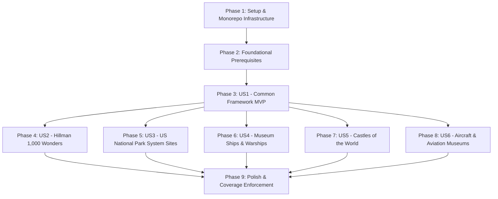

# Tasks: Unified CLI Extractors & Scraper Toolkit (016-cli-extractors)

**Input**: Design documents from `specs/016-cli-extractors/` (`spec.md`, `plan.md`, `data-model.md`, `research.md`, `contracts/`, `quickstart.md`)  
**Prerequisites**: Python 3.12+, `packages/core` editable install, `click`, `beautifulsoup4`, `httpx`, `pytest`, `pytest-cov`  
**Constitution Governance**: Strict compliance with `.specify/memory/constitution.md` (Apache 2.0 copyright headers, Google docstrings, cognitive complexity $\le 15$, $\ge 90\%$ pytest coverage, 2,000-row file partitioning, formula injection defense).  

---

## Task Format: `- [ ] [TaskID] [P?] [Story?] Description with file path [Traceability]`

- **[P]**: Parallelizable task (independent files and dependencies).
- **[Story]**: User story identifier mapping to `spec.md` (`[US1]`, `[US2]`, `[US3]`, `[US4]`, `[US5]`, `[US6]`).
- Every task includes exact file paths, EARS requirement mappings (`[Spec §FR-###]`), and validation targets.

---

## Phase 1: Setup & Monorepo Infrastructure

**Purpose**: Project initialization, workspace directories, dependency registration, and fixture scaffolding.

- [X] T-001 [P] Ensure CLI dependencies (`click>=8.1.0`, `beautifulsoup4>=4.12.0`, `httpx>=0.27.0`) are active in root `pyproject.toml` and reinstall `packages/core` in editable mode (`pip install -e ./packages/core`) [Spec §FR-001, Plan §Technical Context]
- [X] T-002 [P] Create package directory layout for `extractor_scripts/common/` and test directories `tests/unit/extractor_scripts/fixtures/` with standardized `__init__.py` files and Apache 2.0 copyright headers [Spec §FR-001, Constitution Principle 1]
- [X] T-003 [P] Create local static HTML test fixture files in `tests/unit/extractor_scripts/fixtures/` (`hillman_index.html`, `hillman_detail.html`, `nps_directory.html`, `museum_ships_wiki.html`, `castles_selection.html`, `aviation_museums_wiki.html`) [Spec §FR-032, Plan §Project Structure]

---

## Phase 2: Foundational (Blocking Prerequisites)

**Purpose**: Core transfer schemas, formula injection neutralization, resilient HTTP client, and CSV partitioning exporter that all extractors depend upon.

**⚠️ CRITICAL**: Must be completed before any user story scraper can be executed.

- [X] T-004 [P] Implement core Pydantic transfer schemas `WebsiteRecord` (`name`, `url`), `AdditionalAddressRecord` (secondary location fields, lat/long), and `ExtractorRecord` (all 19 target attributes) with strict validation in `packages/core/vistarae_core/schemas/extractor.py` [Spec §FR-003, Spec §FR-004, Spec §FR-007, Data-Model §1]
- [X] T-005 [P] Implement spreadsheet formula injection neutralization function `neutralize_formula_injection(value: str) -> str` prepending `'` to `=`, `+`, `-`, `@`, `\t`, `\r` in `packages/core/vistarae_core/schemas/extractor.py` [Spec §FR-011, Data-Model §4]
- [X] T-006 [P] Implement runtime configuration and result models `ExtractorConfig` (runtime options) and `ExtractionResult` (execution metrics) in `extractor_scripts/common/models.py` [Spec §FR-002, Data-Model §2]
- [X] T-007 Implement resilient HTTP client `ResilientHttpClient` in `extractor_scripts/common/http_client.py` supporting custom `User-Agent: VistaraeDataExtractor/1.0`, polite delay ($\ge 1.0$s per domain), 3-attempt exponential backoff retry for 429/5xx, and disk caching under `.cache/extractors/` [Spec §FR-012, Spec §FR-013, Spec §FR-014, Research §2]
- [X] T-008 Implement RFC 4180 CSV exporter `CSVExporter` in `extractor_scripts/common/exporter.py` supporting formula neutralization, JSON encoding for `Websites` and `Additional Address` columns, and automatic 2,000-row file partitioning into `{basename}_part{n}.csv` [Spec §FR-003, Spec §FR-009, Spec §FR-015, Data-Model §3]
- [X] T-009 [P] Implement optional OpenStreetMap Nominatim client `NominatimGeoClient` in `extractor_scripts/common/geo.py` with 1 req/sec rate limiting for the `--geocode` flag [Spec §FR-031, Research §1]
- [X] T-010 Implement abstract base class `BaseExtractor` and Click CLI decorators in `extractor_scripts/common/base.py` providing standardized CLI arguments (`--output`, `--limit`, `--delay`, `--deep/--shallow`, `--cache/--no-cache`, `--split-size`, `--geocode`, `--tag`, `--dry-run`), three-tier tag resolution pipeline, and execution lifecycle [Spec §FR-001, Spec §FR-002, Spec §FR-008, Contract §cli-interface.md]
- [X] T-011 Write unit tests for foundational components in `tests/unit/extractor_scripts/test_common_exporter.py` and `tests/unit/extractor_scripts/test_common_http_client.py` testing formula neutralization, 2,000-row chunking, JSON column formatting, and HTTP retry/cache behavior [Spec §FR-003, Spec §FR-011, Spec §FR-015, Spec §FR-032]

**Checkpoint**: Core extraction and export engine fully verified with 100% passing tests.

---

## Phase 3: User Story 1 - Standardized Common Extractor Framework Execution (Priority: P1) 🎯 MVP

**Goal**: Prove the standardized Click CLI interface, argument handling, dry-run reporting, and export formatting function end-to-end.

**Independent Test**: Execute `python extractor_scripts/hillman_wonders.py --help` and verify all options display correctly. Run sample extraction with `--dry-run` and verify terminal summary table output without disk writes.

- [X] T-012 [US1] Implement reusable Click CLI option decorator `extractor_options` and execution runner `run_extractor_cli` in `extractor_scripts/common/base.py` [Spec §FR-002, Contract §cli-interface.md]
- [X] T-013 [US1] Write unit tests in `tests/unit/extractor_scripts/test_common_base.py` testing Click CLI invocation, parameter validation, exit codes (`0`, `1`, `2`), and `--dry-run` console output [Spec §FR-002, Contract §cli-interface.md, Spec §FR-032]
- [X] T-014 [US1] Implement package initialization and public exports in `extractor_scripts/common/__init__.py` [Spec §FR-001]

**Checkpoint**: User Story 1 framework complete and testable independently.

---

## Phase 4: User Story 2 - Hillman 1,000 Wonders Extraction (Priority: P1)

**Goal**: Extract ranked global wonders from Hillman Wonders with tier tagging (`HillmanWonder:Gold`, `HillmanWonder:Silver`, `HillmanWonder:Bronze`), country normalization, and reference links.

**Independent Test**: Run `python extractor_scripts/hillman_wonders.py --limit 20 --output hillman_test.csv` against canned fixture and verify `hillman_test.csv` contains 20 rows, valid wonder tiers, and no base `Wonder` tag.

- [X] T-015 [P] [US2] Create unit test suite `tests/unit/extractor_scripts/test_hillman_wonders.py` using fixtures `hillman_index.html` and `hillman_detail.html` asserting wonder extraction, rank parsing, tier tagging, country normalization, and single JSON `Websites` column [Spec §FR-016, Spec §FR-017, Spec §FR-018, Spec §FR-032]
- [X] T-016 [US2] Implement `HillmanWondersExtractor` in `extractor_scripts/hillman_wonders.py` parsing index tables (`https://www.hillmanwonders.com/top_1000/index.htm`), extracting rank and overview, assigning tier tags (`HillmanWonder:Gold/Silver/Bronze`), and supporting `--deep` subpage scraping [Spec §FR-016, Spec §FR-017, Spec §FR-018]
- [X] T-017 [US2] Implement Click entrypoint `cli()` in `extractor_scripts/hillman_wonders.py` using `extractor_options` and execute test suite to verify 100% pass rate [Spec §FR-002, Spec §FR-016]

**Checkpoint**: User Stories 1 and 2 functional and independently testable.

---

## Phase 5: User Story 3 - US National Park System Sites Extraction (Priority: P2)

**Goal**: Extract all US National Park Service units with baseline `NPS` tag, official designation conditional tags, coordinates, and multi-location `Additional Address` JSON encoding.

**Independent Test**: Run `python extractor_scripts/nps_sites.py --limit 25 --output nps_test.csv` against canned fixture and verify country is "United States" (`US`), tags include `NPS; National Park`, and secondary locations populate `Additional Address`.

- [X] T-018 [P] [US3] Create unit test suite `tests/unit/extractor_scripts/test_nps_sites.py` using fixture `nps_directory.html` asserting park name parsing, `US` country code, `NPS` baseline tag, designation tags, primary/secondary address splitting, and `.nps.gov` JSON website links [Spec §FR-019, Spec §FR-020, Spec §FR-021, Spec §FR-032]
- [X] T-019 [US3] Implement `NPSSitesExtractor` in `extractor_scripts/nps_sites.py` parsing park directories, assigning `Country="United States"`, `country_code="US"`, state codes, `NPS` baseline tag, official designation tags, coordinates, and multi-location `Additional Address` JSON encoding [Spec §FR-019, Spec §FR-020, Spec §FR-021]
- [X] T-020 [US3] Implement Click entrypoint `cli()` in `extractor_scripts/nps_sites.py` and run tests to verify 100% pass rate [Spec §FR-002, Spec §FR-019]

**Checkpoint**: User Stories 1, 2, and 3 functional and independently testable.

---

## Phase 6: User Story 4 - Global Museum Ships & Historic Warships Extraction (Priority: P2)

**Goal**: Extract global museum ships with baseline `Ship` tag, conditional `Military` tag for warships (omitting naval classification tags), home ports, coordinates, and reference links.

**Independent Test**: Run `python extractor_scripts/museum_ships.py --limit 20 --output ships_test.csv` against canned fixture and verify ships have `Ship` tag, warships have `Military` tag, and naval classifications (e.g. Battleship) are omitted from tags.

- [X] T-021 [P] [US4] Create unit test suite `tests/unit/extractor_scripts/test_museum_ships.py` using fixture `museum_ships_wiki.html` asserting vessel extraction, country normalization, home port parsing, `Ship` baseline tag, conditional `Military` tag, exclusion of naval classification tags, and JSON `Websites` [Spec §FR-022, Spec §FR-023, Spec §FR-024, Spec §FR-032]
- [X] T-022 [US4] Implement `MuseumShipsExtractor` in `extractor_scripts/museum_ships.py` harvesting global ship registries, extracting vessel name as `POI Name`, home port as `Town/City`, normalizing country, applying `Ship` baseline and `Military` conditional tags, and serializing museum URLs [Spec §FR-022, Spec §FR-023, Spec §FR-024]
- [X] T-023 [US4] Implement Click entrypoint `cli()` in `extractor_scripts/museum_ships.py` and run tests to verify 100% pass rate [Spec §FR-002, Spec §FR-022]

**Checkpoint**: User Stories 1 through 4 functional and independently testable.

---

## Phase 7: User Story 5 - Castles of the World Extraction (Priority: P3)

**Goal**: Extract international castles and fortresses with baseline `Fortification` tag (omitting architectural classification tags), hero exterior photo URLs, regional locations, and coordinates.

**Independent Test**: Run `python extractor_scripts/castles.py --limit 20 --output castles_test.csv` against canned fixture and verify castle names, `Fortification` tag (no architectural classifications), and hero photo URLs.

- [X] T-024 [P] [US5] Create unit test suite `tests/unit/extractor_scripts/test_castles.py` using fixture `castles_selection.html` asserting castle name extraction, sovereign country normalization, `Fortification` baseline tag, omission of architectural classification tags, and `Hero Image URL` capture [Spec §FR-025, Spec §FR-026, Spec §FR-027, Spec §FR-032]
- [X] T-025 [US5] Implement `CastlesExtractor` in `extractor_scripts/castles.py` harvesting castle directories (`https://www.castlesworld.com/selection/list.php`), capturing castle name as `POI Name`, province/region, nearest town, baseline `Fortification` tag, hero images, and description notes [Spec §FR-025, Spec §FR-026, Spec §FR-027]
- [X] T-026 [US5] Implement Click entrypoint `cli()` in `extractor_scripts/castles.py` and run tests to verify 100% pass rate [Spec §FR-002, Spec §FR-025]

**Checkpoint**: User Stories 1 through 5 functional and independently testable.

---

## Phase 8: User Story 6 - Aircraft & Aviation Museums Extraction (Priority: P3)

**Goal**: Extract international aviation museums with baseline `Aircraft` tag (omitting collection focus tags), airfield/city locations, coordinates, and official/encyclopedia links.

**Independent Test**: Run `python extractor_scripts/aircraft_museums.py --limit 25 --output aviation_test.csv` against canned fixture and verify museum names, sovereign countries, `Aircraft` tag, and JSON `Websites`.

- [X] T-027 [P] [US6] Create unit test suite `tests/unit/extractor_scripts/test_aircraft_museums.py` using fixture `aviation_museums_wiki.html` asserting museum name parsing, country normalization, airfield/town extraction, `Aircraft` baseline tag, omission of collection focus tags, coordinates, and official website links [Spec §FR-028, Spec §FR-029, Spec §FR-030, Spec §FR-032]
- [X] T-028 [US6] Implement `AircraftMuseumsExtractor` in `extractor_scripts/aircraft_museums.py` harvesting aviation museum directories (`https://en.wikipedia.org/wiki/List_of_aviation_museums`), capturing museum name as `POI Name`, sovereign country, city/airfield, baseline `Aircraft` tag, coordinates, and reference links [Spec §FR-028, Spec §FR-029, Spec §FR-030]
- [X] T-029 [US6] Implement Click entrypoint `cli()` in `extractor_scripts/aircraft_museums.py` and run tests to verify 100% pass rate [Spec §FR-002, Spec §FR-028]

**Checkpoint**: All 6 user stories complete and functional independently.

---

## Phase 9: Polish, Cross-Cutting & Governance Verification

**Purpose**: End-to-end integration proof, full test coverage enforcement, formula safety verification, and pre-commit compliance.

- [X] T-030 [P] Execute quickstart end-to-end verification script from `specs/016-cli-extractors/quickstart.md` validating extraction across all 5 CLIs, 2,000-row file partitioning, formula injection neutralization, and Vistarae `csv_parser.py` import compatibility [Quickstart §1, Quickstart §2, Quickstart §3]
- [X] T-031 Run pytest with coverage enforcement across the entire extractor suite (`pytest tests/unit/extractor_scripts/ --cov=extractor_scripts --cov=packages/core/vistarae_core/schemas/extractor.py --cov-fail-under=90`) asserting $\ge 90\%$ branch and line coverage [Constitution Principle 8, Plan §Constitution Check]
- [X] T-032 Run pre-commit hooks and code quality linters (`ruff check`, `ruff format`, copyright header verification) ensuring zero lint errors, cognitive complexity $\le 15$, and strict compliance with Vistarae Constitution Principle 1 [Constitution Principle 1]

---

## Dependencies & Execution Order

### Phase Dependencies

- **Setup (Phase 1)**: Can start immediately.
- **Foundational (Phase 2)**: Depends on Phase 1; blocks all scrapers.
- **US1 Framework (Phase 3)**: Depends on Phase 2; provides common Click CLI decorators and execution engine.
- **User Stories 2–6 (Phases 4–8)**: Can proceed in parallel once Phase 3 is complete.
- **Polish (Phase 9)**: Runs after all user stories are complete to verify coverage and constitution compliance.

---

## Parallel Opportunities

1. **Phase 1**: Tasks `T-001`, `T-002`, and `T-003` can execute in parallel.
2. **Phase 2**: Tasks `T-004`, `T-005`, `T-006`, and `T-009` can execute in parallel.
3. **Phases 4–8 (User Stories)**: Once Phase 3 (`T-012`–`T-014`) completes, each user story scraper and its test suite can be implemented independently and in parallel by different developers or agent sessions.
4. **Test-First Implementation**: For every user story, the unit test task (`T-015`, `T-018`, `T-021`, `T-024`, `T-027`) is written first against canned HTML fixtures and asserted to fail before writing the scraper implementation.

---

## Implementation Strategy: MVP First

1. **Step 1**: Complete Phase 1 (Setup) and Phase 2 (Foundational: schemas, formula defense, resilient HTTP, CSV partitioner).
2. **Step 2**: Complete Phase 3 (US1 Common Framework) and Phase 4 (US2 Hillman Wonders).
3. **Step 3 (MVP Checkpoint)**: Run `python extractor_scripts/hillman_wonders.py --limit 20 --output hillman_test.csv` and verify import into Vistarae. You now have a working, importable extractor MVP!
4. **Step 4**: Incrementally deliver US3 (National Parks), US4 (Museum Ships), US5 (Castles), and US6 (Aircraft Museums).
5. **Step 5**: Run Phase 9 for 90% coverage enforcement, pre-commit linting, and constitution compliance verification.

