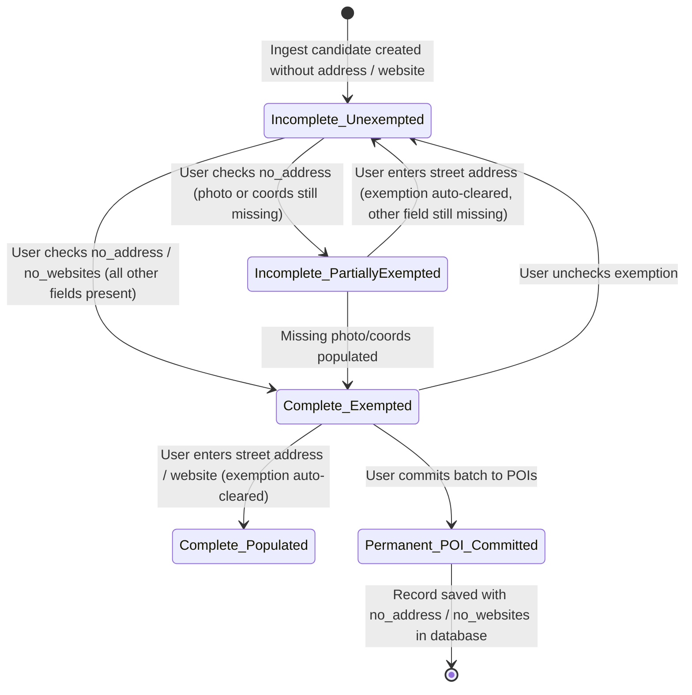

# Data Model: Incomplete Data Acknowledgment & Exemption Checkboxes (019-missing-address-data)

**Feature**: `019-missing-address-data`  
**Date**: 2026-11-18  
**Status**: Completed  

---

## 1. Relational Database Schema (`tables.py`)

### Table: `pois` (Permanent Points of Interest)

Add two new non-nullable boolean columns to the `pois` table definition:

```python
class POITable(Base):
    __tablename__ = "pois"

    # ... existing fields ...
    no_address: Mapped[bool] = mapped_column(
        Boolean,
        nullable=False,
        default=False,
        server_default=text("FALSE"),
    )
    no_websites: Mapped[bool] = mapped_column(
        Boolean,
        nullable=False,
        default=False,
        server_default=text("FALSE"),
    )
```

### Table: `ingest_candidates` (Import Staging Workbench Candidates)

Add one new non-nullable boolean column (`no_address`) to the `ingest_candidates` table definition (`no_websites` already exists):

```python
class IngestCandidateTable(Base):
    __tablename__ = "ingest_candidates"

    # ... existing fields ...
    no_address: Mapped[bool] = mapped_column(
        Boolean,
        nullable=False,
        default=False,
        server_default=text("FALSE"),
    )
    # Existing column:
    # no_websites: Mapped[bool] = mapped_column(
    #     Boolean, server_default=text("false"), default=False, nullable=False
    # )
```

---

## 2. Alembic Database Migration Specification

A new migration script must be placed in `db/migrations/versions/`:

- **Revision Name**: `add_missing_data_exemptions_to_pois_and_candidates`
- **Reversible Invariant (Constitution Principle 4)**: Must implement both `upgrade()` and `downgrade()` cleanly.

```python
"""Add no_address and no_websites columns to pois and ingest_candidates.

Revision ID: <auto_generated>
Revises: <previous_revision_id>
Create Date: 2026-11-18
"""

import sqlalchemy as sa
from alembic import op


def upgrade() -> None:
    # pois table additions
    op.add_column(
        "pois",
        sa.Column(
            "no_address",
            sa.Boolean(),
            nullable=False,
            server_default=sa.text("FALSE"),
        ),
    )
    op.add_column(
        "pois",
        sa.Column(
            "no_websites",
            sa.Boolean(),
            nullable=False,
            server_default=sa.text("FALSE"),
        ),
    )

    # ingest_candidates table addition
    op.add_column(
        "ingest_candidates",
        sa.Column(
            "no_address",
            sa.Boolean(),
            nullable=False,
            server_default=sa.text("FALSE"),
        ),
    )


def downgrade() -> None:
    # Clean rollback
    op.drop_column("ingest_candidates", "no_address")
    op.drop_column("pois", "no_websites")
    op.drop_column("pois", "no_address")
```

---

## 3. Pydantic Domain Schemas (`packages/core/vistarae_core/schemas/`)

### 3.1 POI Schemas (`packages/core/vistarae_core/schemas/poi.py`)

Update `POIBase`, `POICreate`, `POIUpdate`, and `POIResponse`:

```python
class POIBase(StrictBaseModel):
    # ... existing attributes ...
    no_address: bool = False
    no_websites: bool = False


class POIUpdate(StrictBaseModel):
    # ... existing optional attributes ...
    no_address: bool | None = None
    no_websites: bool | None = None
```

### 3.2 Ingest Staging Schemas (`packages/core/vistarae_core/schemas/ingest_staging.py`)

Update `CandidateItem`, `CandidateUpdateRequest`, and `BatchEditCandidatesRequest`:

```python
class CandidateItem(StrictBaseModel):
    # ... existing attributes ...
    no_address: bool = False
    no_websites: bool = False


class CandidateUpdateRequest(StrictBaseModel):
    # ... existing attributes ...
    no_address: bool | None = None
    no_websites: bool | None = None


class BatchEditCandidatesRequest(StrictBaseModel):
    candidate_ids: list[UUID]
    country: str | None = None
    state_province: str | None = None
    city: str | None = None
    date_visited: str | None = None
    add_tag: str | None = None
    remove_tag: str | None = None
    no_address: bool | None = None
    no_websites: bool | None = None
```

---

## 4. State Transitions & Completeness Matrix

### Completeness Evaluation Matrix

| Has Photo? | Has Coordinates? | Has Street Address? | `no_address` | Has Websites? | `no_websites` | Missing Fields List | Overall Completeness Status | Visible in `"Needs Action"`? | Visible in `"Exempted"`? |
| :---: | :---: | :---: | :---: | :---: | :---: | :---: | :---: | :---: | :---: |
| Yes | Yes | Yes | False | Yes | False | `[]` | **Complete** | No | No |
| Yes | Yes | **No** | **False** | Yes | False | `["Street Address"]` | **Incomplete** | **Yes** | No |
| Yes | Yes | **No** | **True** | Yes | False | `[]` | **Complete** | No | **Yes** |
| Yes | Yes | Yes | False | **No** | **False** | `["Websites"]` | **Incomplete** | **Yes** | No |
| Yes | Yes | Yes | False | **No** | **True** | `[]` | **Complete** | No | **Yes** |
| Yes | Yes | **No** | **True** | **No** | **True** | `[]` | **Complete** | No | **Yes** |
| **No** | Yes | **No** | **True** | Yes | False | `["Photo"]` | **Incomplete** | **Yes** | **Yes** |
| **No** | **No** | **No** | **False** | **No** | **False** | `["Photo", "Coordinates", "Street Address", "Websites"]` | **Incomplete** | **Yes** | No |

### State Transition Diagram



---

## 5. Tenancy & Query Guarantees (Constitution Principle 3)

All candidate updates, candidate queries, and batch edits must enforce user tenancy predicates:

```python
# Candidate update query structure:
stmt = (
    update(IngestCandidateTable)
    .where(
        IngestCandidateTable.user_id == user_id,
        IngestCandidateTable.job_id == job_id,
        IngestCandidateTable.id.in_(candidate_ids),
    )
    .values(values_dict)
)
```

No Row-Level Security (RLS) is used; isolation is strictly guaranteed by explicit parameter bindings.
