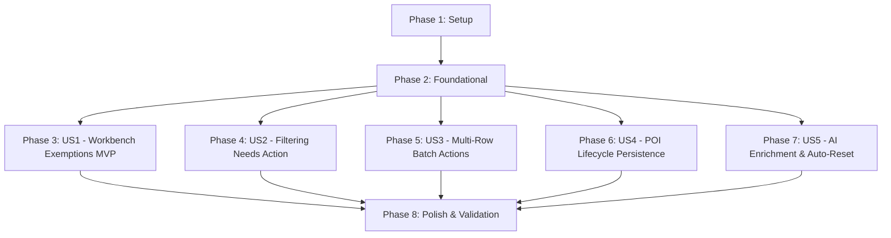

# Tasks: Incomplete Data Acknowledgment & Exemption Checkboxes (019-missing-address-data)

**Input**: Design documents from `/specs/019-missing-address-data/` (`spec.md`, `plan.md`, `research.md`, `data-model.md`, `contracts/`, `quickstart.md`)  
**Prerequisites**: `plan.md`, `spec.md`, `data-model.md`, `contracts/`, `quickstart.md`  

**Organization**: Tasks are grouped by user story in priority order (P1 → P2), with each task mapped directly to its EARS requirement ID (`[REQ-EXM-###]`) and test/validation file.

---

## Format: `- [ ] [TaskID] [P?] [Story?] [Requirements] Description with file path (Test: path/to/test)`

- **[P]**: Can run in parallel (different files, no blocking dependencies).
- **[Story]**: Mapped user story (`[US1]`, `[US2]`, `[US3]`, `[US4]`, `[US5]`).
- **[Requirements]**: Specific EARS requirement IDs fulfilled by this task.
- Exact file paths are provided for every implementation and test task.

---

## Phase 1: Setup (Shared Infrastructure)

**Purpose**: Environment verification and test fixtures initialization.

- [X] T001 Verify virtual environment, PostGIS connectivity, and frontend dependencies per quickstart prerequisites (Validation: `python -m pytest --version && npm --version`)
- [X] T002 [P] Create shared candidate and POI exemption test fixtures in `tests/fixtures/candidate_fixtures.py` (Validation: `tests/fixtures/candidate_fixtures.py`)

---

## Phase 2: Foundational (Blocking Prerequisites)

**Purpose**: Core database schema, SQLAlchemy models, Pydantic domain schemas, and OpenAPI contracts.

**⚠️ CRITICAL**: Must be completed before any user story implementation can begin.

- [X] T003 [P] [REQ-EXM-001] Create reversible Alembic database migration adding `no_address` and `no_websites` to `pois` and `no_address` to `ingest_candidates` with `DEFAULT FALSE` in `db/migrations/versions/add_missing_data_exemptions.py` (Test: `tests/unit/db/test_exemption_migrations.py`)
- [X] T004 [P] [REQ-EXM-001] Update SQLAlchemy ORM table definitions in `packages/core/vistarae_core/adapters/db/tables.py` adding `no_address` and `no_websites` to `POITable` and `no_address` to `IngestCandidateTable` (Test: `tests/unit/db/test_tables_schema.py`)
- [X] T005 [P] [REQ-EXM-002] Update Pydantic domain schemas in `packages/core/vistarae_core/schemas/poi.py` (`POIBase`, `POICreate`, `POIUpdate`, `POIResponse`) and `packages/core/vistarae_core/schemas/ingest_staging.py` (`CandidateItem`, `CandidateUpdateRequest`, `BatchEditCandidatesRequest`) (Test: `tests/unit/schemas/test_exemption_schemas.py`)
- [X] T006 [REQ-EXM-002] Export `./openapi.json` and synchronize TypeScript types in `frontend/src/types/api.ts` via `npx openapi-typescript ./openapi.json -o ./frontend/src/types/api.ts` (Validation: `git diff --exit-code ./frontend/src/types/api.ts`)

**Checkpoint**: Core data model and API contracts ready. User story implementation can proceed.

---

## Phase 3: User Story 1 - Candidate Incomplete Data Exemption in Staging Workbench (Priority: P1) 🎯 MVP

**Goal**: Allow travelers to manually check "No address available" and "No website available" on staged candidates in the workbench editor, satisfying completeness rules and preventing automated tools from setting exemptions.

**Independent Test**: Import a candidate lacking street address and website. Verify it initially flags as incomplete. Check "No address available" and "No website available" in the candidate editor. Verify completeness updates to "Complete" without errors.

### Tests for User Story 1
- [X] T007 [P] [US1] [REQ-EXM-006, REQ-EXM-007, REQ-EXM-008] Write unit tests for completeness calculation and exemption satisfaction rules in `tests/unit/services/ingest/test_completeness_exemptions.py` (Test: `tests/unit/services/ingest/test_completeness_exemptions.py`)
- [X] T008 [P] [US1] [REQ-EXM-010, REQ-EXM-011] Write React component tests for candidate editor exemption controls and status recalculation in `frontend/src/components/ingest/__tests__/CandidateDetailEditor.test.tsx` (Test: `frontend/src/components/ingest/__tests__/CandidateDetailEditor.test.tsx`)

### Implementation for User Story 1
- [X] T009 [US1] [REQ-EXM-006, REQ-EXM-007, REQ-EXM-008] Update `getCandidateMissingFields` and `isCandidateComplete` in `frontend/src/components/ingest/CSVImportWorkbenchModal.tsx` to exempt street address when `no_address === true` and websites when `no_websites === true` (Test: `frontend/src/components/ingest/__tests__/CSVImportWorkbenchModal.test.tsx`)
- [X] T010 [US1] [REQ-EXM-009] Implement visual exemption badge indicators in candidate completeness table column in `frontend/src/components/ingest/CSVImportWorkbenchModal.tsx` (Test: `frontend/src/components/ingest/__tests__/CSVImportWorkbenchModal.test.tsx`)
- [X] T011 [US1] [REQ-EXM-010, REQ-EXM-011] Add "Data Availability" section with `no_address` and `no_websites` checkboxes in right-hand candidate detail editor panel in `frontend/src/components/ingest/CSVImportWorkbenchModal.tsx` (Test: `frontend/src/components/ingest/__tests__/CandidateDetailEditor.test.tsx`)
- [X] T012 [US1] [REQ-EXM-004, REQ-EXM-005] Update backend candidate update endpoint in `services/ingest/routes/staging.py` and repository in `packages/core/vistarae_core/adapters/repositories/ingest_candidate_repo.py` to persist `no_address` and `no_websites` strictly on explicit user PATCH (Test: `tests/unit/services/ingest/test_candidate_update.py`)

**Checkpoint**: User Story 1 fully functional as MVP. Staged candidates can have exemptions set and evaluated.

---

## Phase 4: User Story 2 - Workbench Filtering for Action-Required vs. Exempted Records (Priority: P1)

**Goal**: Provide `"Needs Action"` and `"Exempted"` options in the completeness filter dropdown so travelers can filter out acknowledged missing data and focus on actionable records.

**Independent Test**: Load a staging batch with mixed complete, incomplete unexempted, and exempted records. Select `"Needs Action"` and verify only candidates with unexempted missing fields appear. Select `"Exempted"` and verify all records with $\ge 1$ exemption appear.

### Tests for User Story 2
- [X] T013 [P] [US2] [REQ-EXM-013, REQ-EXM-014, REQ-EXM-015] Write React component tests for `"Needs Action"` and `"Exempted"` dropdown filter options in `frontend/src/components/ingest/__tests__/WorkbenchFilter.test.tsx` (Test: `frontend/src/components/ingest/__tests__/WorkbenchFilter.test.tsx`)

### Implementation for User Story 2
- [X] T014 [US2] [REQ-EXM-013] Expand `CompletenessFilter` type and dropdown options to include `"needs_action"` and `"exempted"` in `frontend/src/components/ingest/CSVImportWorkbenchModal.tsx` (Test: `frontend/src/components/ingest/__tests__/WorkbenchFilter.test.tsx`)
- [X] T015 [US2] [REQ-EXM-014, REQ-EXM-015] Implement filtering predicate logic for `"needs_action"` (shows candidates with $\ge 1$ unexempted missing required field) and `"exempted"` (shows candidates with `no_address = true` or `no_websites = true`) in `frontend/src/components/ingest/CSVImportWorkbenchModal.tsx` (Test: `frontend/src/components/ingest/__tests__/WorkbenchFilter.test.tsx`)

**Checkpoint**: User Stories 1 and 2 operate cohesively. Travelers can triage and filter records cleanly.

---

## Phase 5: User Story 3 - Multi-Row Batch Exemption in Staging Workbench (Priority: P2)

**Goal**: Allow travelers to select multiple candidate rows and mark them as "No Address" or "No Websites", or clear exemptions in a single batch operation.

**Independent Test**: Select 5 candidate rows lacking street addresses via table checkboxes. Click "Mark Selected: No Address" on the multi-row toolbar. Verify all 5 candidates immediately update to `no_address = true` and their status updates in $<1\text{ s}$.

### Tests for User Story 3
- [X] T016 [P] [US3] [REQ-EXM-016, REQ-EXM-017, REQ-EXM-018, REQ-EXM-019] Write integration tests for batch candidate exemption updates in `tests/integration/services/test_batch_exemption_api.py` (Test: `tests/integration/services/test_batch_exemption_api.py`)

### Implementation for User Story 3
- [X] T017 [US3] [REQ-EXM-017, REQ-EXM-018, REQ-EXM-019] Update `batch_edit_candidates` in `services/ingest/services/staging_service.py` and `batch_edit` in `packages/core/vistarae_core/adapters/repositories/ingest_candidate_repo.py` to apply `no_address` and `no_websites` updates scoped to `WHERE user_id = :current_user_id` (Test: `tests/integration/services/test_batch_exemption_api.py`)
- [X] T018 [US3] [REQ-EXM-016, REQ-EXM-017, REQ-EXM-018, REQ-EXM-019] Add multi-row toolbar action buttons ("Mark Selected: No Address", "Mark Selected: No Websites", "Clear Selected Exemptions") when $\ge 2$ rows selected in `frontend/src/components/ingest/CSVImportWorkbenchModal.tsx` (Test: `frontend/src/components/ingest/__tests__/CSVImportWorkbenchModal.test.tsx`)

**Checkpoint**: Bulk operations operational. Large batches can be exempted in seconds.

---

## Phase 6: User Story 4 - Persistence Across Promotion and POI Lifecycle (Priority: P1)

**Goal**: Ensure `no_address` and `no_websites` are saved to the permanent `pois` table on commit, editable in main POI dialogs, and round-tripped through CSV/JSON export and import.

**Independent Test**: Commit a candidate with `no_address = true`. Verify `pois.no_address = true` in PostgreSQL. Open in `EditPOIModal`, verify the checkbox is selected. Export to CSV, verify `No Address` column is `true`. Re-import and verify candidate receives `no_address = true`.

### Tests for User Story 4
- [X] T019 [P] [US4] [REQ-EXM-003, REQ-EXM-023, REQ-EXM-024, REQ-EXM-025] Write integration tests for candidate promotion to POIs and CSV/JSON round-trip in `tests/integration/services/test_candidate_exemption_promotion.py` (Test: `tests/integration/services/test_candidate_exemption_promotion.py`)

### Implementation for User Story 4
- [X] T020 [US4] [REQ-EXM-003] Update workbench candidate commit logic in `services/ingest/services/staging_service.py` to copy `no_address` and `no_websites` from `ingest_candidates` to `pois` table records during promotion (Test: `tests/integration/services/test_candidate_exemption_promotion.py`)
- [X] T021 [US4] [REQ-EXM-012] Add `no_address` and `no_websites` checkboxes to permanent POI editors in `frontend/src/components/pois/CreatePOIModal.tsx` and `frontend/src/components/pois/EditPOIModal.tsx` (Test: `frontend/src/components/pois/__tests__/EditPOIModal.test.tsx`)
- [X] T022 [US4] [REQ-EXM-023, REQ-EXM-024, REQ-EXM-025] Update CSV/JSON exporter in `packages/core/vistarae_core/services/poi_exporter.py` and importer in `services/ingest/services/csv_parser.py` to support `no_address` and `no_websites` columns with boolean parsing (Test: `tests/unit/services/ingest/test_csv_parser_exemptions.py`)

**Checkpoint**: Full lifecycle persistence complete. Exemptions are never lost across commit or export/import.

---

## Phase 7: User Story 5 - AI Bulk Enrichment Skip Optimization & Auto-Reset (Priority: P2)

**Goal**: Optimize AI bulk enrichment to bypass web scraping when `no_websites = true` and reverse geocoding when `no_address = true`, eliminate legacy auto-setting of exemptions, and auto-reset exemption flags when valid data is entered.

**Independent Test**: Run bulk enrichment on candidate with `no_websites = true`. Verify external scraping is bypassed in logs and tokens are conserved. Enter a street address on a candidate with `no_address = true` and verify `no_address` resets to `false`.

### Tests for User Story 5
- [X] T023 [P] [US5] [REQ-EXM-004, REQ-EXM-020, REQ-EXM-021, REQ-EXM-022] Write worker unit tests verifying scraping skip, geocoding skip, and absence of automatic flag assignment in `tests/unit/services/worker/test_worker_exemption_skips.py` (Test: `tests/unit/services/worker/test_worker_exemption_skips.py`)

### Implementation for User Story 5
- [X] T024 [US5] [REQ-EXM-004] Remove automatic assignment of `cand.no_websites = True` (lines 441 and 813) in `services/worker/candidate_enricher.py` (Test: `tests/unit/services/worker/test_worker_exemption_skips.py`)
- [X] T025 [US5] [REQ-EXM-020, REQ-EXM-021, REQ-EXM-022] Add skip conditions in `services/worker/candidate_enricher.py` to bypass Wikipedia, TripAdvisor, and Hillman external scraping when `cand.no_websites is True` and bypass reverse geocoding when `cand.no_address is True` (Test: `tests/unit/services/worker/test_worker_exemption_skips.py`)
- [X] T026 [US5] [REQ-EXM-026, REQ-EXM-027] Implement automatic exemption reset logic in candidate editor (`frontend/src/components/ingest/CSVImportWorkbenchModal.tsx`) and backend update handlers (`services/ingest/routes/staging.py` and `services/poi/routes/pois.py`) when non-empty street address or website URL is entered (Test: `tests/unit/services/ingest/test_auto_reset_exemptions.py`)

**Checkpoint**: AI enrichment optimized and auto-reset safeguards active.

---

## Phase 8: Polish & Cross-Cutting Concerns

**Purpose**: Quality checks, pre-commit validation, telemetry assertion, and quickstart scenario verification.

- [X] T027 [P] Execute pre-commit checks, code formatting, and Apache 2.0 copyright header verification across all touched files (Validation: `ruff check . && ruff format --check .`)
- [X] T028 [P] Verify W3C distributed tracing headers (`traceparent`, `X-Source`, `X-Destination`) and messaging protocol tags (`MSG ->|`, `MSG <-|`) in `services/ingest/routes/staging.py` (Test: `tests/unit/services/ingest/test_telemetry_tags.py`)
- [X] T029 Execute full end-to-end verification quickstart scenarios in [quickstart.md](file:///d:/Coding/Vistarae/specs/019-missing-address-data/quickstart.md) (Validation: `pytest tests/ -k exemption`)

---

## Dependencies & Execution Order

### Phase Dependencies

### User Story Dependencies

- **US1 (P1 - Candidate Exemptions)**: Depends on Phase 2 (Foundational). Delivers MVP.
- **US2 (P1 - Filtering)**: Depends on Phase 2 & integrates with US1 completeness function.
- **US3 (P2 - Batch Operations)**: Depends on Phase 2 & integrates with US1 UI table.
- **US4 (P1 - POI Persistence)**: Depends on Phase 2. Operates independently on commit and export/import.
- **US5 (P2 - AI Skip & Auto-Reset)**: Depends on Phase 2. Operates on worker and editor input change events.

### Parallel Opportunities

- **Phase 2 (Foundational)**: T003 (Alembic migration), T004 (SQLAlchemy tables), and T005 (Pydantic schemas) can execute in parallel.
- **Phase 3 (US1)**: Test tasks T007 & T008 can be written in parallel before implementation.
- **Phase 4 (US2)** & **Phase 5 (US3)**: Can be developed in parallel once Phase 2 completes.
- **Phase 8 (Polish)**: T027 and T028 can execute in parallel.

---

## Implementation Strategy

### MVP First (User Story 1 Only)
1. Complete Phase 1 (Setup) and Phase 2 (Foundational).
2. Complete Phase 3 (User Story 1 - Workbench Candidate Exemptions).
3. **Validate MVP**: Test toggling exemptions on staged candidates and verify status updates to "Complete".

### Incremental Delivery
1. Add User Story 2 (Filtering) → Travelers can filter by `"Needs Action"`.
2. Add User Story 4 (POI Persistence) → Committed candidates retain flags on permanent POIs and survive export/import.
3. Add User Story 3 (Batch Operations) → Multi-row marking in bulk.
4. Add User Story 5 (AI Enrichment Skip & Auto-Reset) → Scraping optimization and conflicting data prevention.
5. Execute Phase 8 (Polish & Quickstart scenarios) for final gate sign-off.
